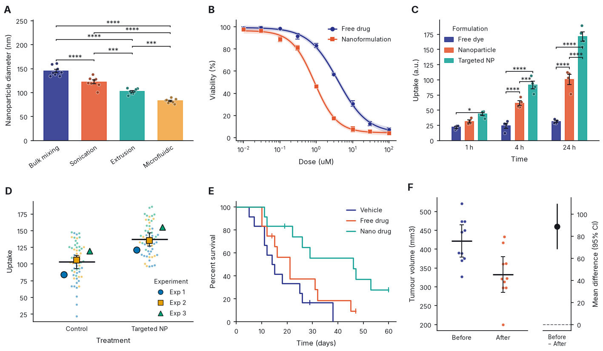
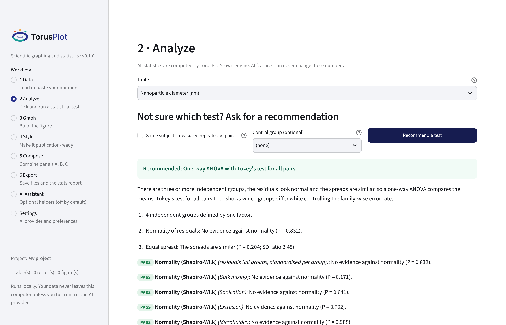
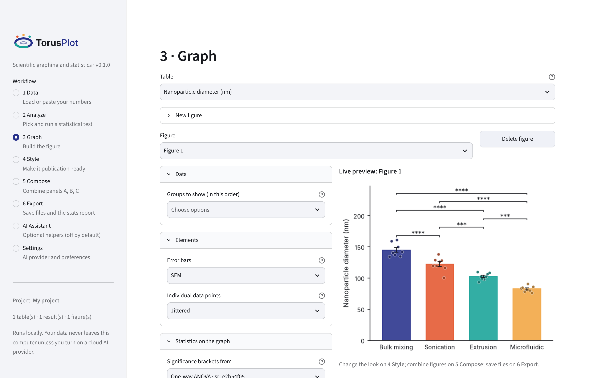

<p align="left"></p>

# TorusPlot

**Scientific graphing and statistics that runs on your own computer.**
Point-and-click figures, rigorous statistics with plain-English explanations, publication
exports, and optional AI helpers. Free to run, works offline.

Copyright (c) 2026 Torus Washington LLC. All rights reserved. See [LICENSE](LICENSE).



---

## What you can do with it

| You want to... | TorusPlot gives you |
|---|---|
| Compare groups | t tests, ANOVA (one-, two-, three-way, repeated measures, mixed), nonparametric tests, post-hoc tests, effect sizes with 95% CIs |
| Fit curves | Linear and multiple regression, dose-response (EC50/IC50), Michaelis-Menten, exponential, binding, your own equation |
| Analyse survival or counts | Kaplan-Meier + log-rank, chi-square, Fisher's exact, odds ratio, relative risk |
| Know *which* test to use | A "Recommend a test" button that checks your data and explains its choice in plain English |
| Make the figure | Bars + points, box, violin, beeswarm, SuperPlots, estimation plots, before-after, XY, dose-response, survival, heat maps, Q-Q... |
| Make it publication-ready | Journal-sized style presets, colour-blind-safe palettes, panel letters, exact size in mm |
| Hand it to a journal | SVG with editable text, PDF, TIFF (LZW, 300/600 dpi), PNG, plus a statistics report and a methods paragraph |
| Use AI (optional) | Describe a figure in words, match the style of an example image, digitize a published plot, or paste instructions from any chatbot |

Statistics are **always** computed by TorusPlot's own tested engine. AI features can
change how a figure looks, never the numbers.

---

## Install on Windows (about 10 minutes, once)

You do not need to know how to code.

1. **Install Python** (free). Go to <https://www.python.org/downloads/windows/>, download
   the latest **64-bit Windows installer** (Python 3.11 or newer), run it, and on the first
   screen **tick "Add python.exe to PATH"** before clicking *Install Now*.
2. **Get TorusPlot.** On the project's GitHub page click the green **Code** button, then
   **Download ZIP**. Right-click the downloaded file, choose **Extract All...**, and put the
   folder somewhere easy to find (for example `Documents\TorusPlot`).
3. **Start it.** Open the folder and double-click **`run_torusplot.bat`**.
   - If Windows shows "Windows protected your PC", click **More info**, then **Run anyway**.
   - The first start downloads the required free packages (needs internet, a few minutes).
     Later starts take a few seconds and work offline.
4. **Use it.** Your web browser opens at `http://localhost:8501`. That page *is* the app; it
   is running on your computer, not on the internet.
5. **Stop it.** Close the black window that opened in step 3.

To update later: download the ZIP again and replace the folder (keep your `.tplot` project
files anywhere you like; they are independent of the app folder).

### macOS / Linux

```bash
./run_torusplot.sh
```

### If something goes wrong

| Problem | Fix |
|---|---|
| "Python 3.11 or newer was not found" | Repeat step 1 and make sure "Add python.exe to PATH" is ticked. Then double-click `run_torusplot.bat` again. |
| Installation failed | Check the internet connection and run `run_torusplot.bat` again; it continues where it stopped. |
| Browser did not open | Open your browser yourself and go to `http://localhost:8501`. |
| "Port 8501 is already in use" | TorusPlot is probably already running in another window. Close that window first. |
| Start completely fresh | Delete the `.venv` folder inside the TorusPlot folder and run `run_torusplot.bat` again. |

---

## Your first figure in 2 minutes

The app follows the steps in the left sidebar, top to bottom.

1. **1 Data**: choose the sample *Nanoparticle diameter (nm)* and click **Load sample**
   (or paste your own cells straight from Excel).
2. **2 Analyze**: click **Recommend a test**. TorusPlot checks normality and equal variance,
   tells you which test fits and why, and runs it with one more click.
   
3. **3 Graph**: click **Create figure**. The significance brackets come from the result you
   just computed.
   
4. **4 Style**: pick a preset such as *Journal Single-Column (89 mm)* and a colour-blind-safe
   palette. Check the colour-blind preview.
5. **5 Compose**: combine several figures into panels A, B, C.
6. **6 Export**: download SVG / PDF / TIFF / PNG, the statistics report, and a ready-to-paste
   methods paragraph. Save the whole project as a `.tplot` file to reopen later.

More detail, with one worked example per analysis: **[docs/USER_GUIDE.md](docs/USER_GUIDE.md)**.

---

## Table types

Pick the table type that matches your experiment; it decides which analyses and graphs are offered.

| Table type | Use it when | Example |
|---|---|---|
| **Column** | One grouping variable; each column is a group | Size of nanoparticles made by 4 methods |
| **XY** | Each point has an X value (dose, time) | Viability vs drug concentration |
| **Grouped** | Two grouping variables (rows x columns) with replicates | Uptake at 3 time points for 3 formulations |
| **Multiple variables** | One row per observation, one column per variable | Survival data; per-cell data with replicate labels |
| **Contingency** | Counts of subjects in categories | Responders vs non-responders, treated vs control |

---

## Statistics you can trust

- Every analysis reports the test, **why it was chosen**, the assumptions that were checked
  (with pass / check / fail badges), the statistic, degrees of freedom, P value, adjusted P
  values, effect size with 95% CI, sample sizes, and warnings.
- The engine is validated against **NIST Statistical Reference Datasets**, published worked
  examples, and cross-checks between independent implementations. See
  [docs/STATS_METHODS.md](docs/STATS_METHODS.md) for the method, the primary reference and the
  validation behind each test.
- Outliers are **flagged, never removed automatically**. Excluding a value takes an explicit
  confirmation and is written into the statistics report and methods paragraph.
- Technical replicates are not treated as independent samples: use the *SuperPlot* workflow
  to analyse the means of biological replicates.

TorusPlot is a tool, not a statistician. For high-stakes analyses (clinical data, regulatory
submissions) have a statistician review the plan and results.

---

## Optional AI features (off by default)

Turn them on under **Settings**. Nothing is sent anywhere unless you enable a provider.

| Feature | What it does |
|---|---|
| Describe it | Type "bar chart with SD error bars, log Y axis, journal single-column" and get the figure |
| Match this figure | Upload an image of a figure you like; its *style* (not its data) is applied to your data |
| Digitize | Extract approximate points from an image of a plot (clearly labelled approximate; statistics blocked unless you override) |
| Outside AI instructions | Paste JSON or instructions written by any chatbot; see [docs/PROMPT_TEMPLATE_FOR_OUTSIDE_AI.md](docs/PROMPT_TEMPLATE_FOR_OUTSIDE_AI.md) |
| MCP server | Let an AI agent drive TorusPlot's engine directly; see [docs/MCP.md](docs/MCP.md) |

Providers:

- **Free and local:** [Ollama](https://ollama.com) with a model you download yourself.
  TorusPlot suggests only Apache-2.0 / MIT licensed models and never bundles model files.
- **Bring your own key:** Google Gemini, Anthropic, or OpenAI. Put your key in a file named
  `.env` (copy `.env.example`). **Each provider's own terms, pricing and data policies apply
  to your account**; TorusPlot does not provide or pay for access. When a cloud provider is
  enabled, the text you type and the images you upload for that feature are sent to that
  provider. Your raw data values are not included in AI prompts.

---

## For the curious (command line)

```bash
python cli.py samples                                   # list sample datasets
python cli.py recommend --sample nanoparticle_size      # which test, and why
python cli.py analyze --sample nanoparticle_size --analysis anova_oneway
python cli.py demo --out output/demo                    # full pipeline on synthetic data
python cli.py render --project my.tplot --formats svg pdf tiff
python -m torusplot.mcp_server                          # MCP server for AI agents
```

<!-- dev-only:start -->
Developer checks (development repository only):

```bash
pip install --require-hashes -r requirements-lock.txt
pip install -r requirements-dev.txt
python -m pytest                 # full test suite
python -m ruff check .           # lint
python tools/check_licenses.py   # every runtime dependency must be permissively licensed
python tools/build_release.py    # build the clean customer ZIP (no tests, no dev notes)
```
<!-- dev-only:end -->

---

## Licensing

- **TorusPlot** itself is proprietary software owned by Torus Washington LLC ([LICENSE](LICENSE)).
- It is built only on permissively licensed open-source packages (MIT, BSD, Apache-2.0, PSF,
  and similar). The full list with versions and licenses is in
  [THIRD_PARTY_NOTICES.md](THIRD_PARTY_NOTICES.md). The launcher installs exact,
  hash-checked versions from `requirements-lock.txt`.
- Bundled fonts (Inter, Source Sans 3, Liberation Sans) are under the SIL Open Font License;
  see [torusplot/plot/fonts/README.md](torusplot/plot/fonts/README.md).
- Example datasets in `examples/` are synthetic.

<!-- dev-only:start -->
Project documents (development repository): [FINAL_REPORT.md](FINAL_REPORT.md) ·
[PROGRESS.md](PROGRESS.md) · [DECISIONS.md](DECISIONS.md) ·
[docs/REFERENCE_NOTES.md](docs/REFERENCE_NOTES.md) ·
[docs/COMMERCIAL_RELEASE_CHECKLIST.md](docs/COMMERCIAL_RELEASE_CHECKLIST.md)
<!-- dev-only:end -->
