<!-- GENERATED FILE: do not edit by hand. Edit tools/build_user_guide.py and run
     `python tools/build_user_guide.py`. Every number below is real TorusPlot output. -->

# TorusPlot user guide

TorusPlot is a graphing and statistics program that runs on your own computer.
This guide shows how to use it, with one worked example for every analysis.

- You do not need to know how to code.
- Every result block in this guide was produced by TorusPlot itself, on **synthetic**
  (simulated) data. None of the example data are real measurements.
- Result IDs are random. This guide prints `sr_xxxxxxxx` in their place.
- For the formulas, assumptions and references behind each method see
  [STATS_METHODS.md](STATS_METHODS.md). For installation see the [README](../README.md).

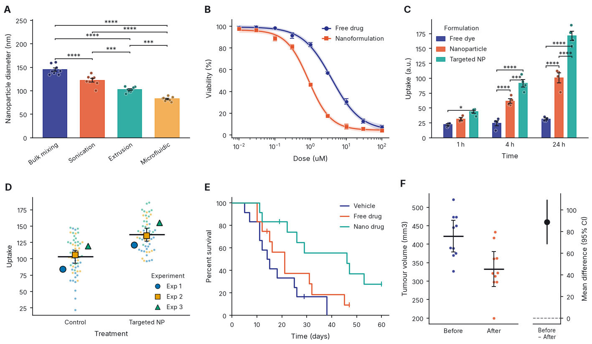

## Contents

1. [Start here](#1-start-here)
2. [Choosing a table type](#2-choosing-a-table-type)
3. [Which test should I use?](#3-which-test-should-i-use)
4. [Worked examples: one per analysis](#4-worked-examples-one-per-analysis)
5. [Outliers, exclusions and replicates](#5-outliers-exclusions-and-replicates)
6. [Making figures](#6-making-figures)
7. [Styling and exporting](#7-styling-and-exporting)
8. [Optional AI features and the MCP server](#8-optional-ai-features-and-the-mcp-server)
9. [Troubleshooting and FAQ](#9-troubleshooting-and-faq)
10. [Glossary](#10-glossary)

## 1. Start here

Start TorusPlot with `run_torusplot.bat` (Windows) or `./run_torusplot.sh` (macOS, Linux).
Your web browser opens the app. It runs on your computer, not on the internet.

The left sidebar lists the pages under **Workflow**. Work from top to bottom.

| Step | Page | What you do there |
|---|---|---|
| 1 | **1 Data** | Load a sample, paste cells from Excel, or import a file. Choose the table type. |
| 2 | **2 Analyze** | Ask for a test recommendation or pick an analysis. Read the result. |
| 3 | **3 Graph** | Create a figure from the table. Add error bars, points and significance brackets. |
| 4 | **4 Style** | Pick a style preset, colours, fonts and the exact size in mm. |
| 5 | **5 Compose** | Combine several figures into one multi-panel figure with letters A, B, C. |
| 6 | **6 Export** | Download figure files, the statistics report and the methods paragraph. Save the project. |

Two more pages, **AI Assistant** and **Settings**, hold the optional AI features (section 8).

### 1.1 Data

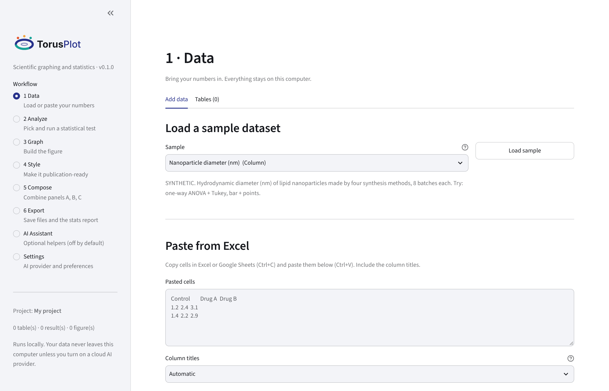

The page has two tabs: **Add data** and **Tables**.

On **Add data** there are three ways to bring numbers in:

- **Load a sample dataset.** Choose a *Sample* and click **Load sample**. The samples are synthetic.
- **Paste from Excel.** Copy cells in Excel or Google Sheets, click in *Pasted cells* and paste.
  Check *Column titles*, choose the *Table type*, type a *Table name* and click
  **Create table from pasted cells**.
- **Import a file.** Drop a CSV, TSV, TXT or Excel (.xlsx) file. For Excel pick the *Worksheet*.
  Choose the *Table type* and click **Create table from file**.

On **Tables** you see the grid of the selected *Table*. You can type into it.

- **Apply edits** saves what you typed.
- **Download CSV** saves the table as a file.
- **Make long-format copy** creates a *Multiple variables* copy with one row per value.
- **Delete table** removes the table from the project.
- **Restore excluded values** appears when you have excluded values (section 5).

### 1.2 Analyze

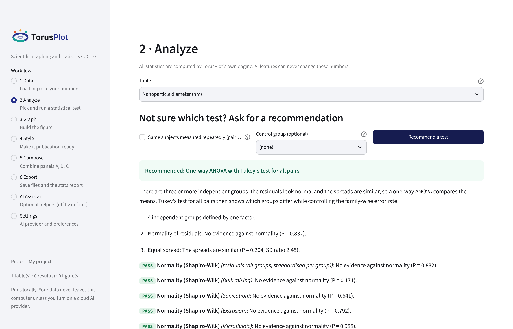

1. Choose the *Table*.
2. Under *Not sure which test? Ask for a recommendation*, click **Recommend a test**.
   - Tick *Same subjects measured repeatedly (paired)* if each row (Column table) or each replicate
     column (Grouped table) is the same animal, sample or person.
   - With three or more groups you can choose a *Control group (optional)*.
3. Read the recommendation, its numbered reasons and the badges. Then click **Run: ...** to run it.
4. Or go to *Choose an analysis*: pick a *Category* and an *Analysis*, set the options, and click
   **Run** followed by the analysis name. Only analyses that are valid for the table type are listed.
   Every option has a tooltip.
5. Read the result under *Results for this table*.

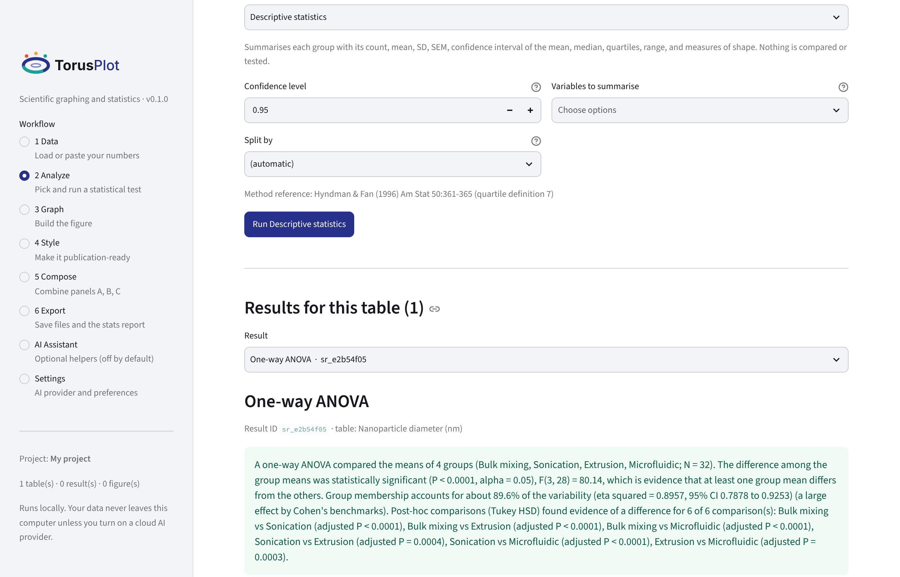

The results panel shows, from top to bottom:

- the test name and its result ID;
- a plain-English reading of the result;
- the statistic with degrees of freedom, the P value, and the main effect size;
- **Assumption checks** with badges: PASS, CHECK (look at it), FAIL, INFO (cannot be checked from the numbers);
- **Why this test?** with the method references;
- warnings;
- tables: *Multiple comparisons*, *ANOVA table*, *Estimates*, *Effect sizes*, *Descriptive statistics*;
- **Methods sentence**: a sentence for your paper.

At the bottom of the page, *Power and sample size calculator* plans an experiment without any data.

### 1.3 Graph

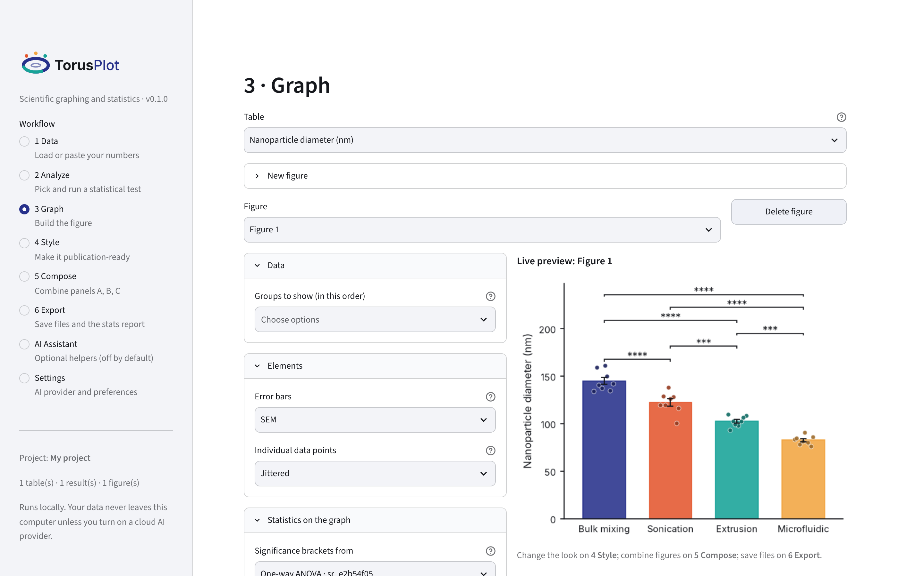

1. Open *New figure*. Choose the *Graph type*, type a *Figure name*, click **Create figure**.
   If the table already has a result with pairwise comparisons, its brackets are attached for you.
2. Change the figure in the four panels on the left. The *Live preview* updates at once.
   - **Data**: which groups, series or columns to show, and in which order.
   - **Elements**: *Error bars* and *Individual data points*.
   - **Statistics on the graph**: *Significance brackets from*, *Test summary text in a corner*,
     *Fitted curves to draw*.
   - **Titles and axes**: *Title*, axis titles, *Y scale*, *X scale*, *Y minimum*, *Y maximum*.

### 1.4 Style

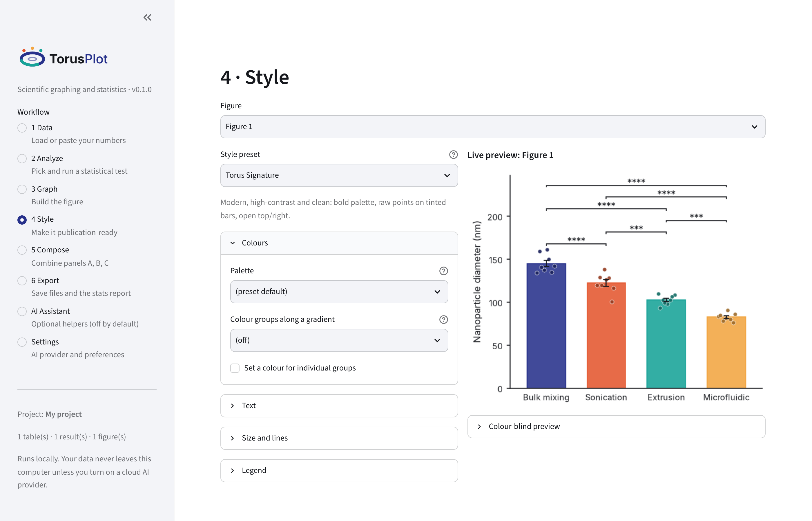

Choose the *Figure* and a *Style preset*. Fine-tune under **Colours**, **Text**, **Size and lines**
and **Legend**. Open *Colour-blind preview* to check the figure. Details are in section 7.

### 1.5 Compose

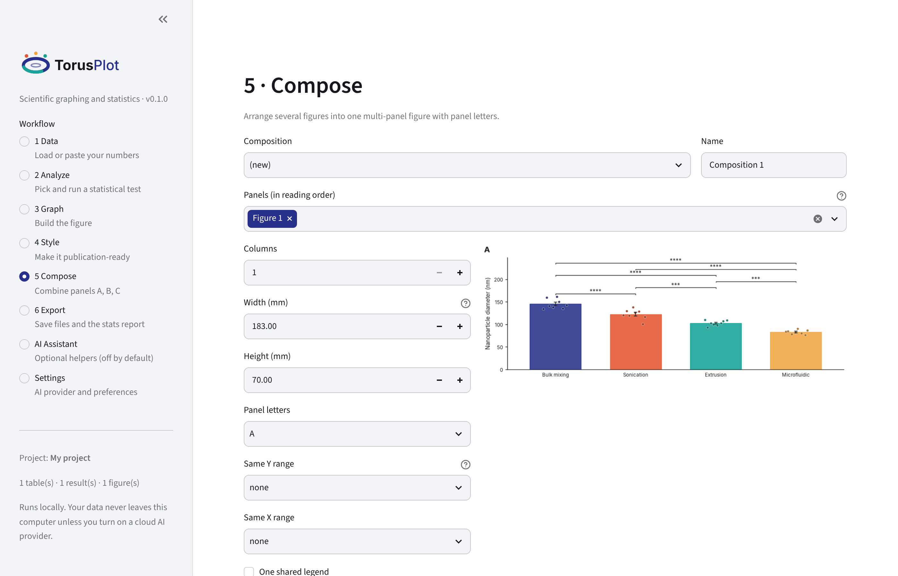

Choose the figures under *Panels (in reading order)*, set *Columns*, *Width (mm)*, *Height (mm)* and
*Panel letters*, then click **Save composition**.

### 1.6 Export

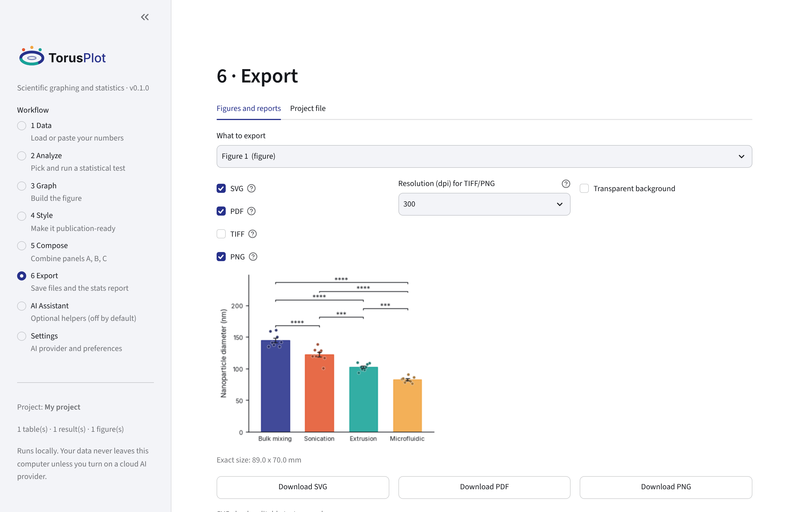

On the tab **Figures and reports**: choose *What to export*, tick the formats, choose the
*Resolution (dpi) for TIFF/PNG*, and click the **Download** buttons. Below them are the
*Methods paragraph* and the buttons **Download report (Markdown)** and **Download report (CSV)**.

On the tab **Project file**: **Save project (.tplot)** keeps everything; *Open a project* loads it again.

### 1.7 A first run in two minutes

1. **1 Data**: choose the sample *Nanoparticle diameter (nm)* and click **Load sample**.
2. **2 Analyze**: click **Recommend a test**. For this sample TorusPlot answers:
   *Recommended: One-way ANOVA with Tukey's test for all pairs*. Click **Run: One-way ANOVA with Tukey's test for all pairs**.
   The result reads: F(3, 28) = 80.14, P < 0.0001.
3. **3 Graph**: click **Create figure**. The brackets come from the result you just computed.
4. **4 Style**: pick *Journal Single-Column (89 mm)*.
5. **6 Export**: download the PDF and the statistics report.

## 2. Choosing a table type

The table type tells TorusPlot how your experiment is organised. It decides which analyses and
graphs are offered. There are five types.

### 2.1 Which one do I need?

- One grouping variable (Control, Drug A, Drug B)? Use **Column**. Each column is a group.
- The same subjects measured twice or more (before/after, several time points)? Use **Column**,
  with one subject per row.
- Every point has an X value (dose, time, concentration)? Use **XY**.
- Two grouping variables (for example time point and treatment)? Use **Grouped**.
- Counts of subjects in categories (responders, non-responders)? Use **Contingency**.
- One row per subject or measurement, with a column for each variable? Use **Multiple variables**.
  You need it for survival data, for data with technical and biological replicates, for three
  grouping factors, for covariates, and for multiple regression.

When you paste data, TorusPlot suggests a table type. You can always change it.

### 2.2 What each type looks like

The pictures below show the first rows of the bundled synthetic samples.

**Column.** Each column is one group (e.g. Control, Drug A, Drug B). Rows are replicates.

| Bulk mixing | Sonication | Extrusion | Microfluidic |
|---|---|---|---|
| 142.5 | 129.2 | 109.8 | 76.4 |
| 161 | 100.7 | 102.6 | 81.9 |
| 159.1 | 138.2 | 102.9 | 83.7 |

Each column is one group. Rows are replicates. The columns may have different lengths. For paired or repeated measures, each row is one subject.

**XY.** First column is X (dose, time, concentration). Other columns are Y values, optionally with replicates side by side.

| Dose (uM) | Free drug:1 | Free drug:2 | Free drug:3 | Nanoformulation:1 | Nanoformulation:2 | Nanoformulation:3 |
|---|---|---|---|---|---|---|
| 0.01 | 97.9 | 101.1 | 97.7 | 95.4 | 98.3 | 99.7 |
| 0.03 | 100.9 | 97.5 | 99.6 | 99.3 | 95.1 | 95.5 |
| 0.1 | 98.9 | 98.1 | 98.6 | 87.4 | 92.8 | 86.3 |

The first column is X. The other columns are Y values. Replicates of one data set sit side by side (`Free drug:1`, `Free drug:2`, ...).

**Grouped.** Rows are one factor (e.g. time point), column groups are a second factor (e.g. treatment), with replicate sub-columns.

| Time | Free dye:1 | Free dye:2 | Free dye:3 | Free dye:4 | Nanoparticle:1 | Nanoparticle:2 | ... |
|---|---|---|---|---|---|---|---|
| 1 h | 24.6 | 18.3 | 24.6 | 20.1 | 28.8 | 27.7 | ... |
| 4 h | 12.6 | 31.7 | 26.1 | 27.9 | 63.2 | 55.3 | ... |
| 24 h | 35.6 | 32.8 | 28.5 | 29.3 | 103.5 | 76.8 | ... |

The first column names the rows (first factor, here time). The column groups are the second factor (here formulation), each with replicate sub-columns.

**Multiple variables.** One row per observation, one column per variable (like a tidy spreadsheet). Pick the role of each column when you analyze.

| Treatment | Experiment | Uptake |
|---|---|---|
| Control | Exp 1 | 101.3 |
| Control | Exp 1 | 64.5 |
| Control | Exp 1 | 51.4 |

One row per measurement. One column per variable. Text columns are categories; numeric columns are measurements. You choose the role of each column when you analyse or graph.

**Contingency.** Counts of subjects: rows are exposures/groups, columns are outcomes.

| Group | Responder | Non-responder |
|---|---|---|
| Treated | 18 | 6 |
| Control | 7 | 17 |

Each cell is a **count of subjects**. Rows are the groups; put the treated or exposed group first. Columns are the outcomes; put "outcome present" first.

A second **Multiple variables** example, for survival data (time, event, group):

| Time (days) | Event | Group |
|---|---|---|
| 29 | 0 | Vehicle |
| 25 | 1 | Vehicle |
| 12 | 1 | Vehicle |

`Event` is 1 when the event happened and 0 when the subject was censored (still event-free when last seen).

### 2.3 Pasting from Excel

1. In Excel or Google Sheets select the cells, including the column titles, and copy (Ctrl+C).
2. In TorusPlot go to **1 Data** > **Add data** > *Paste from Excel*, click in *Pasted cells* and paste (Ctrl+V).
3. TorusPlot shows what it detected: the number of rows and columns and a suggested table type.
4. Check *Column titles*. *Automatic* treats a first row of text as titles. Choose
   *First row is column titles* or *No titles (numbers only)* if the guess is wrong.
5. Choose the *Table type*, type a *Table name*, and click **Create table from pasted cells**.

What the paste box understands:

- Tabs, semicolons, commas or spaces between cells.
- Decimal commas (`1,5`). They are converted, and the page says so.
- Empty cells and the markers `NA`, `N/A`, `nan`, `null`, `none`, `-`, `--`, `.`, `#N/A`, `#DIV/0!`,
  `#VALUE!` become missing values.
- A percent sign after a number is dropped (`12%` becomes 12).
- A column of numbers with a few stray text cells (such as "outlier?") stays numeric; the text cells
  become missing values. This applies when the column has at least 5 values and at least 80% are numbers.

The table name becomes the default axis title, so a name such as `Particle size (nm)` saves typing later.

### 2.4 Replicates side by side

XY and Grouped tables can hold replicates in neighbouring columns. There are two ways to say which
columns belong together:

- Type the number in *Replicates side by side* (for example 3). Every 3 neighbouring columns form one group.
  The number of data columns must be a multiple of it.
- Or leave it at 0 and name the columns so that TorusPlot can group them: `Drug:1, Drug:2`,
  `Drug_1, Drug_2`, `Drug rep 1`, or simply the same title repeated.
- Take care with titles that end in a number after `:`, `_`, `-` or `#`. `Day_7` and `Day_14` are
  read as two replicates of `Day`. Rename them (for example `Day 7`, `Day 14`) if they are separate groups.

How replicates are used:

- **XY tables**: regression fits every replicate as its own point by default. Tick
  *Fit the mean of replicates* if the replicates are repeat readings of one sample.
- **Grouped tables**: for a two-way ANOVA each replicate is an independent value. For a
  mixed-design ANOVA each replicate sub-column is one subject followed across the rows.
- Many cells or wells measured inside a few independent experiments do **not** belong in
  side-by-side replicate columns. Use a Multiple variables table with a replicate column (section 5).

### 2.5 Long-format data

Long format (also called tidy format) has one row per value and one column per variable.

- If your data are already long, paste them as a **Multiple variables** table.
- To see any table in long format, open **1 Data** > **Tables** > *Long-format view (what analyses see)*.
- **Make long-format copy** makes a Multiple variables copy of the selected table, one row per value.
- The app has no button for the opposite direction. If an analysis needs a Column table
  (for example a paired t test), paste the data in the wide layout: one column per group.

### 2.6 Which analyses each table type offers

The menu on **2 Analyze** only lists analyses that are valid for the selected table.

| Table type | Analyses offered |
|---|---|
| Column | Descriptive statistics; Normality tests; Equal variance tests; Unpaired t test; Welch's t test; Paired t test; One-sample t test; Mann-Whitney test; Wilcoxon matched-pairs signed-rank test; Wilcoxon signed-rank test (one sample); One-way ANOVA; Welch's ANOVA; Brown-Forsythe ANOVA; Kruskal-Wallis test; Friedman test; Repeated-measures one-way ANOVA; Correlation (Pearson or Spearman); Correlation matrix; Identify outliers (Grubbs); Identify outliers (ROUT) |
| XY | Descriptive statistics; Correlation (Pearson or Spearman); Simple linear regression; Compare slopes of regression lines; Nonlinear regression (curve fit); Compare two curve fits (which model is better?); Compare a curve parameter between data sets (e.g. EC50) |
| Grouped | Descriptive statistics; Two-way ANOVA; Mixed-design ANOVA (repeated measures by group) |
| Multiple variables | Descriptive statistics; Normality tests; Two-way ANOVA; Three-way ANOVA; ANCOVA (analysis of covariance); Mixed-design ANOVA (repeated measures by group); Two-way repeated-measures ANOVA; Correlation (Pearson or Spearman); Correlation matrix; Multiple linear regression; Survival analysis (Kaplan-Meier, log-rank); Replicate-aware comparison (SuperPlot analysis) |
| Contingency | Chi-square test; Fisher's exact test; Chi-square test for trend |

## 3. Which test should I use?

### 3.1 How *Recommend a test* decides

The button **Recommend a test** on page **2 Analyze** looks at the table and follows three steps.

1. **Design.** What kind of table is it? How many groups are there? Are the measurements paired
   (same subjects) or independent? You tell it about pairing with the tick box.
2. **Normality.** It runs the Shapiro-Wilk test at alpha = 0.05: on each group (two groups), on the
   paired differences (paired data), or on the residuals (three or more groups, grouped tables,
   regression). A residual is a value minus the mean of its group.
3. **Equal variance.** For independent groups it runs the Brown-Forsythe test at alpha = 0.05.

It then names one analysis, lists its reasons, shows the checks as badges, adds cautions, and lists
alternatives. It does not run the test until you click **Run: ...**, and it never changes your data.

### 3.2 Decision table for Column tables

| Groups | Design | Normality check | Equal-variance check | Recommended analysis |
|---|---|---|---|---|
| 1 | one group vs a fixed value | passes | not needed | One-sample t test |
| 1 | one group vs a fixed value | fails | not needed | Wilcoxon signed-rank test (one sample) |
| 2 | unpaired | passes | passes | Unpaired t test |
| 2 | unpaired | passes | fails | Welch's t test |
| 2 | unpaired | fails | not used | Mann-Whitney test |
| 2 | paired | passes (differences) | not needed | Paired t test |
| 2 | paired | fails (differences) | not needed | Wilcoxon matched-pairs signed-rank test |
| 3 or more | unpaired | passes (residuals) | passes | One-way ANOVA with Tukey's test (Dunnett's test if you chose a control) |
| 3 or more | unpaired | passes (residuals) | fails | Welch's ANOVA with Games-Howell comparisons |
| 3 or more | unpaired | fails (residuals) | not used | Kruskal-Wallis test with Dunn's comparisons |
| 3 or more | paired | passes (residuals) | not needed | Repeated-measures one-way ANOVA |
| 3 or more | paired | fails (residuals) | not needed | Friedman test |

For the other table types:

| Table | What TorusPlot sees | Recommended analysis |
|---|---|---|
| Grouped | paired box not ticked | Two-way ANOVA with Tukey's comparisons |
| Grouped | paired box ticked (each sub-column is one subject) | Mixed-design ANOVA |
| XY | at least 4 positive X values that span a factor of 100 or more (dose-like), or an X title that contains "log" | Nonlinear regression, four-parameter dose-response |
| XY | otherwise | Simple linear regression |
| Contingency | 2 x 2 table | Fisher's exact test |
| Contingency | larger table | Chi-square test |
| Multiple variables | a time column and an event column | Survival analysis |
| Multiple variables | a replicate-like column (replicate, experiment, batch, animal, donor ...) and a group column | Replicate-aware comparison |
| Multiple variables | one value and three text columns | Three-way ANOVA |
| Multiple variables | one value and two text columns | Two-way ANOVA |
| Multiple variables | one text column and two or more numeric columns | ANCOVA |
| Multiple variables | three or more numeric columns | Multiple linear regression |
| Multiple variables | two numeric columns | Correlation |

For Multiple variables tables the choice depends on the column names and types. Check that the
proposed roles (value, group, replicate, time, event) are what you mean.

There is no rank-based two-way test. If the residuals of a grouped table are not normal, TorusPlot
suggests a log transform of the values.

### 3.3 What a recommendation looks like

This is the real recommendation for the bundled sample *Nanoparticle diameter (nm)*:

```text
Recommended: One-way ANOVA with Tukey's test for all pairs

There are three or more independent groups, the residuals look normal and the spreads are similar, so a one-way ANOVA compares the means. Tukey's test for all pairs then shows which groups differ while controlling the family-wise error rate.

1. 4 independent groups defined by one factor.
2. Normality of residuals: No evidence against normality (P = 0.832).
3. Equal spread: The spreads are similar (P = 0.204; SD ratio 2.45).

Alternatives:
- Welch's ANOVA: if you do not want to assume equal variances
- Kruskal-Wallis test: if the data are skewed or ordinal
```

### 3.4 The caveats it prints, and why they matter

The recommendation is honest about what a pre-test can and cannot show.

- **Small samples.** Normality and variance tests have little power with few values. A pass then
  means little. With fewer than 5 values in a group TorusPlot says so.
- **Rank tests need enough values.** With 3 values per group a two-sided Mann-Whitney test cannot
  give P below 0.05. With fewer than 6 pairs the Wilcoxon test cannot either.
- **Pairing.** If two columns have the same number of rows and you did not tick the paired box,
  TorusPlot reminds you to check whether the data are paired.
- **Choosing a test from a pre-test is a convention, not a guarantee.** Welch's t test and Welch's
  ANOVA are always listed as alternatives because they do not need equal variances.
  The safest plan is to choose the test from the design before you collect the data.

Example: a synthetic pilot table with 3 values per group, one of them extreme. TorusPlot recommends *Mann-Whitney test* and prints these cautions:

- The smallest group has n = 3. With so few values no test can check its own assumptions reliably; rely on what is known about this kind of measurement and report individual points.
- If each row is the same subject measured twice, the data are paired: ask for the recommendation again with 'paired' switched on.
- With n = 3 per group a two-sided Mann-Whitney test cannot give P < 0.05: even when the two groups do not overlap at all the exact P value is 0.1. The test is recommended for validity, but it has no power here; collect more data if you can.

The check results in a recommendation can differ slightly from the checks printed with the analysis
itself. For three or more groups the recommendation tests residuals that are first standardised
within each group, so that unequal spread is not mistaken for non-normality. The ANOVA result tests
the plain residuals.

## 4. Worked examples: one per analysis

There is one example for each of the 36 analyses in the menu of page **2 Analyze**,
grouped as in that menu. Three tools that are not in the menu follow at the end.

Every example has the same parts:

- **Use it when**: the situation the analysis is made for.
- **In the app**: the table type and the clicks.
- **Example**: the data and the options. All data are synthetic.
- A result block: what TorusPlot computed. It is a short excerpt; the app shows more.
- **How to read it**: what the numbers mean.
- **What not to conclude**: the usual mistakes.
- **Report it like this**: the methods sentence TorusPlot writes, and the numbers to quote.

How to read a result block:

- *Statistic* gives the test statistic with its degrees of freedom in brackets.
- *P value* is followed by the star code (`ns, not significant; *P < 0.05; **P < 0.01; ***P < 0.001; ****P < 0.0001`) and by the verdict at the chosen alpha.
- *Effect size* says how large the effect is, with a 95% confidence interval (CI) where one exists.
- *Checks* lists assumption checks with their badge: PASS, CHECK or FAIL.
- Numbers are shown with 4 significant digits. P values below 0.0001 are written `<0.0001`.

### 4.1 Descriptive statistics

#### Descriptive statistics

Registry key: `descriptives`. Works on these table types: Column, Grouped, XY, Multiple variables. Method reference: Hyndman & Fan (1996) Am Stat 50:361-365 (quartile definition 7).

**Use it when.** Always, before any test. You want the count, centre and spread of each group, and a first look for typing errors or odd values.

**In the app.**

1. Page **1 Data** > *Load a sample dataset* > choose *Nanoparticle diameter (nm)* > **Load sample**.
2. Page **2 Analyze** > *Category*: Descriptive statistics > *Analysis*: Descriptive statistics > leave the options at their defaults > **Run Descriptive statistics**.

**Example.** Data: the bundled sample **Nanoparticle diameter (nm)** (`nanoparticle_size`; synthetic; 4 synthesis methods, 8 batches each). Options: all defaults.

```text
Test          Descriptive statistics
Result ID     sr_xxxxxxxx  (random; yours will differ)
Sample size   Bulk mixing: 8; Sonication: 8; Extrusion: 8; Microfluidic: 8  (total 32)
```

| Group | n | Mean | SD | SEM | CI low | CI high | Median | Q1 | Q3 |
|---|---|---|---|---|---|---|---|---|---|
| Bulk mixing | 8 | 145.1 | 10.44 | 3.69 | 136.4 | 153.9 | 141.8 | 137.1 | 152.3 |
| Sonication | 8 | 122.4 | 11.11 | 3.927 | 113.1 | 131.6 | 123 | 118.8 | 128.7 |
| Extrusion | 8 | 102.7 | 5.677 | 2.007 | 97.94 | 107.4 | 102.8 | 98.95 | 107.3 |
| Microfluidic | 8 | 82.75 | 4.531 | 1.602 | 78.96 | 86.54 | 82.8 | 79.62 | 85.15 |

What TorusPlot writes under the result:

> Summary of 4 groups (n = 8 each). Means range from 82.75 (Microfluidic) to 145.1 (Bulk mixing). The 95% confidence interval of each mean is the range likely to contain the true (population) mean, assuming the values are a random sample. These are descriptions only: no groups were compared and there is no P value.

**How to read it.**

- **n** is the number of values used. Empty cells are not counted.
- **Mean** and **SD** describe the data. The SD (standard deviation) is the typical distance of a value from the mean.
- **SEM** and the **95% CI** describe how precisely the mean is known. They shrink as n grows. The SD does not.
- **Median, Q1, Q3** are the middle value and the quartiles. Prefer them when the data are skewed.
- There is no P value. Nothing was compared.

**What not to conclude.** Do not decide that two groups differ because their confidence intervals do not overlap, or that they are the same because the intervals overlap. Run a test.

**Report it like this.** TorusPlot writes this methods sentence for you:

> Data are summarised as mean, SD, SEM and 95% confidence interval of the mean (t distribution), and as median with quartiles (linear interpolation, Hyndman & Fan type 7).

### 4.2 Assumption checks

#### Normality tests

Registry key: `normality`. Works on these table types: Column, Multiple variables. Method reference: Shapiro & Wilk (1965) Biometrika 52:591-611; D'Agostino & Pearson (1973) Biometrika 60:613-622; Lilliefors (1967) J Am Stat Assoc 62:399-402.

**Use it when.** You want to know whether a t test or ANOVA is reasonable. Those tests assume a normal (Gaussian) distribution: the symmetric, bell-shaped curve.

**In the app.**

1. Page **1 Data** > *Load a sample dataset* > choose *Nanoparticle diameter (nm)* > **Load sample**.
2. Page **2 Analyze** > *Category*: Assumption checks > *Analysis*: Normality tests > leave the options at their defaults > **Run Normality tests**.

**Example.** Data: the bundled sample **Nanoparticle diameter (nm)** (`nanoparticle_size`; synthetic; 4 synthesis methods, 8 batches each). Options: all defaults.

```text
Test          Normality tests
Result ID     sr_xxxxxxxx  (random; yours will differ)
Sample size   Bulk mixing: 8; Sonication: 8; Extrusion: 8; Microfluidic: 8  (total 32)
```

| Group | Test | Statistic | P | Outcome |
|---|---|---|---|---|
| Bulk mixing | Shapiro-Wilk | W = 0.8757 | 0.1712 | pass |
| Bulk mixing | D'Agostino-Pearson | K2 = 1.52 | 0.4677 | pass |
| Bulk mixing | Kolmogorov-Smirnov (Lilliefors P value) | D = 0.2248 | 0.2832 | pass |
| Sonication | Shapiro-Wilk | W = 0.943 | 0.6405 | pass |
| Sonication | D'Agostino-Pearson | K2 = 2.421 | 0.2980 | pass |
| Sonication | Kolmogorov-Smirnov (Lilliefors P value) | D = 0.1833 | 0.5979 | pass |
| Extrusion | Shapiro-Wilk | W = 0.9581 | 0.7919 | pass |
| Extrusion | D'Agostino-Pearson | K2 = 0.3962 | 0.8203 | pass |
| Extrusion | Kolmogorov-Smirnov (Lilliefors P value) | D = 0.1406 | 0.9138 | pass |
| Microfluidic | Shapiro-Wilk | W = 0.9867 | 0.9882 | pass |
| Microfluidic | D'Agostino-Pearson | K2 = 0.2006 | 0.9046 | pass |
| Microfluidic | Kolmogorov-Smirnov (Lilliefors P value) | D = 0.103 | 0.9900 | pass |

What TorusPlot writes under the result:

> Normality was checked in 4 groups with: Shapiro-Wilk, D'Agostino-Pearson, Kolmogorov-Smirnov (Lilliefors P value) (alpha = 0.05). No test found evidence against a normal distribution in Bulk mixing, Sonication, Extrusion, Microfluidic. This does not show that the data are normal, only that a deviation was not detected. Keep the sample size in mind: with very few values these tests can miss even strong non-normality, and with very many values they flag deviations too small to matter. Look at the QQ plot as well.

Warnings shown with this result:

- Bulk mixing: With fewer than 20 values the kurtosis part of the D'Agostino-Pearson test is only roughly calibrated.
- Sonication: With fewer than 20 values the kurtosis part of the D'Agostino-Pearson test is only roughly calibrated.
- ... and 2 more warning(s) of the same kind.

**How to read it.**

- One row per group and test. A P value below alpha (0.05) is evidence that the group is **not** normal. The app then shows a FAIL badge.
- In this example 0 of 12 checks fail.
- Shapiro-Wilk is the most useful single test for small samples. D'Agostino-Pearson needs at least 8 values. The Kolmogorov-Smirnov P value always uses the Lilliefors correction; it is never reported below 0.001 or above 0.99.
- Each group has only 8 values. With so few values these tests rarely detect non-normality. A pass means "no deviation detected". It does not mean "normal".

**What not to conclude.** Do not treat a pass as proof of normality. Do not try one test after another until one passes. Also look at the Q-Q plot (page **3 Graph**, graph type *Q-Q plot (normality)*).

**Report it like this.** TorusPlot writes this methods sentence for you:

> Normality was assessed in each group with the following test(s): Shapiro-Wilk, D'Agostino-Pearson, Kolmogorov-Smirnov (Lilliefors P value) (alpha = 0.05); the Kolmogorov-Smirnov P value, where reported, uses the Lilliefors correction.

#### Equal variance tests

Registry key: `equal_variance`. Works on these table types: Column. Method reference: Brown & Forsythe (1974) J Am Stat Assoc 69:364-367; Levene (1960); Bartlett (1937) Proc R Soc A 160:268-282.

**Use it when.** Before an unpaired t test or an ordinary ANOVA. Both assume the groups have similar spread (variance is the SD squared).

**In the app.**

1. Page **1 Data** > *Load a sample dataset* > choose *Nanoparticle diameter (nm)* > **Load sample**.
2. Page **2 Analyze** > *Category*: Assumption checks > *Analysis*: Equal variance tests > leave the options at their defaults > **Run Equal variance tests**.

**Example.** Data: the bundled sample **Nanoparticle diameter (nm)** (`nanoparticle_size`; synthetic; 4 synthesis methods, 8 batches each). Options: all defaults.

```text
Test          Tests for equal variances (Brown-Forsythe, Levene, Bartlett)
Result ID     sr_xxxxxxxx  (random; yours will differ)
Statistic     F(3, 28) = 1.634
P value       0.2039  ns  (not significant at alpha = 0.05)
Estimates     SD ratio (largest / smallest) = 2.451
Sample size   Bulk mixing: 8; Sonication: 8; Extrusion: 8; Microfluidic: 8  (total 32)
```

| Test | Statistic | P |
|---|---|---|
| Brown-Forsythe | F(3, 28) = 1.634 | 0.2039 |
| Levene | F(3, 28) = 2.472 | 0.0823 |
| Bartlett | chi2(3) = 7.035 | 0.0708 |

What TorusPlot writes under the result:

> The Brown-Forsythe test found no evidence that the spread differs between the 4 groups: the difference is not statistically significant (P = 0.2039, alpha = 0.05); F(3, 28) = 1.634. This does not prove the variances are equal, especially with small samples. The SD ranges from 4.531 (Microfluidic) to 11.11 (Sonication), a 2.45-fold difference.

**How to read it.**

- The headline result is the Brown-Forsythe test: F(3, 28) = 1.634, P = 0.2039. Here it is not statistically significant.
- Levene's and Bartlett's tests are listed for comparison. Bartlett's test is very sensitive to non-normal data.
- SD ratio (largest / smallest) = 2.451. A ratio above about 2 to 3 deserves attention even when the test passes, because the test has little power with small groups.

**What not to conclude.** A non-significant result does not prove that the variances are equal. If in doubt, use Welch's t test or Welch's ANOVA. They do not need this assumption.

**Report it like this.** TorusPlot writes this methods sentence for you:

> Homogeneity of variances was assessed with the Brown-Forsythe test (alpha = 0.05); Levene's and Bartlett's tests are reported for comparison.

Numbers to quote with it: F(3, 28) = 1.634; P = 0.2039. Always add the sample size (n) of every group.

### 4.3 Compare two groups

#### Unpaired t test

Registry key: `ttest_unpaired`. Works on these table types: Column. Method reference: Student (1908) Biometrika 6:1-25.

**Use it when.** Two independent groups: different animals, batches or wells in each group. Both groups roughly normal, with similar spread.

**In the app.**

1. Page **1 Data** > *Load a sample dataset* > choose *Nanoparticle diameter (nm)* > **Load sample**.
2. Page **2 Analyze** > *Category*: Compare two groups > *Analysis*: Unpaired t test > set *First group* = `Bulk mixing`; *Second group* = `Sonication` > **Run Unpaired t test**.

**Example.** Data: the bundled sample **Nanoparticle diameter (nm)** (`nanoparticle_size`; synthetic; 4 synthesis methods, 8 batches each). Options: *First group* = `Bulk mixing`; *Second group* = `Sonication`.

```text
Test          Unpaired t test (Student, pooled variance)
Result ID     sr_xxxxxxxx  (random; yours will differ)
Statistic     t(14) = 4.227
P value       0.0008  ***  (two-sided; significant at alpha = 0.05)
Effect size   Cohen's d = 2.113 (95% CI 0.8407 to 3.34; large)
Estimates     Mean difference (Bulk mixing - Sonication) = 22.78 (95% CI 11.22 to 34.33; P = 0.0008)
              Mean of Bulk mixing = 145.1 (95% CI 136.4 to 153.9)
              Mean of Sonication = 122.4 (95% CI 113.1 to 131.6)
Sample size   Bulk mixing: 8; Sonication: 8  (total 16)
Checks        PASS  Normality (Shapiro-Wilk) [Bulk mixing], P = 0.1712
              PASS  Normality (Shapiro-Wilk) [Sonication], P = 0.6405
              PASS  Equal variances (Brown-Forsythe), P = 0.9717
              plus 1 design assumption(s) stated in the app (they cannot be checked from the numbers)
```

What TorusPlot writes under the result:

> The mean of Bulk mixing (145.1, n = 8) was 22.78 higher than the mean of Sonication (122.4, n = 8); difference Bulk mixing - Sonication = 22.78 (95% CI 11.22 to 34.33). By the unpaired t test this difference is statistically significant (P = 0.0008, alpha = 0.05); t(14) = 4.227. This is evidence that the population means differ. Cohen's d = 2.11 (95% CI 0.8407 to 3.34), a large effect by Cohen's conventions.

**How to read it.**

- Mean difference (Bulk mixing - Sonication) = 22.78 (95% CI 11.22 to 34.33; P = 0.0008). This is first group minus second group. The 95% CI is the range of true differences that is compatible with the data.
- t(14) = 4.227, P = 0.0008: the difference is statistically significant at alpha = 0.05. The P value is the probability of a difference at least this large if the two population means were equal.
- Cohen's d = 2.113 (95% CI 0.8407 to 3.34). This is the difference in units of the pooled SD. The interval is wide because n is small.
- Checks: normality of each group and equal variance. Both pass here.

**What not to conclude.** Do not use it for before/after data from the same animals; use the paired t test. A significant P value does not say that the difference is large or important. Read the difference and its CI.

**Report it like this.** TorusPlot writes this methods sentence for you:

> The two groups were compared with an unpaired Student's t test (two-tailed, alpha = 0.05).

Numbers to quote with it: t(14) = 4.227; P = 0.0008; Mean difference (Bulk mixing - Sonication) = 22.78 (95% CI 11.22 to 34.33); Cohen's d = 2.113 (95% CI 0.8407 to 3.34). Always add the sample size (n) of every group.

#### Welch's t test

Registry key: `ttest_welch`. Works on these table types: Column. Method reference: Welch (1947) Biometrika 34:28-35.

**Use it when.** Two independent groups when the SDs or the group sizes differ. Many statisticians use it as the routine default, because it does not assume equal variances.

**In the app.**

1. Page **1 Data** > *Load a sample dataset* > choose *Nanoparticle diameter (nm)* > **Load sample**.
2. Page **2 Analyze** > *Category*: Compare two groups > *Analysis*: Welch's t test > set *First group* = `Bulk mixing`; *Second group* = `Microfluidic` > **Run Welch's t test**.

**Example.** Data: the bundled sample **Nanoparticle diameter (nm)** (`nanoparticle_size`; synthetic; 4 synthesis methods, 8 batches each). Options: *First group* = `Bulk mixing`; *Second group* = `Microfluidic`.

```text
Test          Welch's t test
Result ID     sr_xxxxxxxx  (random; yours will differ)
Statistic     t(9.549) = 15.51
P value       <0.0001  ****  (two-sided; significant at alpha = 0.05)
Effect size   Cohen's d = 7.755 (95% CI 4.737 to 10.74; large)
Estimates     Mean difference (Bulk mixing - Microfluidic) = 62.39 (95% CI 53.37 to 71.41; P < 0.0001)
              Mean of Bulk mixing = 145.1 (95% CI 136.4 to 153.9)
              Mean of Microfluidic = 82.75 (95% CI 78.96 to 86.54)
Sample size   Bulk mixing: 8; Microfluidic: 8  (total 16)
Checks        PASS  Normality (Shapiro-Wilk) [Bulk mixing], P = 0.1712
              PASS  Normality (Shapiro-Wilk) [Microfluidic], P = 0.9882
              plus 2 design assumption(s) stated in the app (they cannot be checked from the numbers)
```

What TorusPlot writes under the result:

> The mean of Bulk mixing (145.1, n = 8) was 62.39 higher than the mean of Microfluidic (82.75, n = 8); difference Bulk mixing - Microfluidic = 62.39 (95% CI 53.37 to 71.41). By Welch's t test this difference is statistically significant (P < 0.0001, alpha = 0.05); t(9.549) = 15.51. This is evidence that the population means differ. Cohen's d = 7.75 (95% CI 4.737 to 10.74), a large effect by Cohen's conventions.

**How to read it.**

- Read it like the unpaired t test. The degrees of freedom are not a whole number (t(9.549) = 15.51). Welch's method lowers them when the SDs differ.
- Here the SDs are 10.44 (Bulk mixing) and 4.531 (Microfluidic).
- Mean difference (Bulk mixing - Microfluidic) = 62.39 (95% CI 53.37 to 71.41; P < 0.0001).
- Cohen's d = 7.755 (95% CI 4.737 to 10.74). Cohen's d is standardised by the pooled SD of the two groups, as for the unpaired t test.

**What not to conclude.** Welch's test still assumes roughly normal data in each group. It does not protect against outliers or strong skew.

**Report it like this.** TorusPlot writes this methods sentence for you:

> The two groups were compared with Welch's unequal-variance t test (two-tailed, alpha = 0.05).

Numbers to quote with it: t(9.549) = 15.51; P < 0.0001; Mean difference (Bulk mixing - Microfluidic) = 62.39 (95% CI 53.37 to 71.41); Cohen's d = 7.755 (95% CI 4.737 to 10.74). Always add the sample size (n) of every group.

#### Paired t test

Registry key: `ttest_paired`. Works on these table types: Column. Method reference: Student (1908) Biometrika 6:1-25.

**Use it when.** Two measurements on the same subjects: before and after, left and right, treated and untreated wells from the same donor. One subject per row.

**In the app.**

1. Page **1 Data** > *Load a sample dataset* > choose *Tumour volume (mm3)* > **Load sample**.
2. Page **2 Analyze** > *Category*: Compare two groups > *Analysis*: Paired t test > leave the options at their defaults > **Run Paired t test**.

**Example.** Data: the bundled sample **Tumour volume (mm3)** (`paired`; synthetic; 10 animals measured before and after treatment, one animal per row). Options: all defaults.

```text
Test          Paired t test
Result ID     sr_xxxxxxxx  (random; yours will differ)
Statistic     t(9) = 9.744
P value       <0.0001  ****  (two-sided; significant at alpha = 0.05)
Effect size   Cohen's d_z (paired) = 3.081 (95% CI 1.54 to 4.599; large)
Estimates     Mean of differences (Before - After) = 88.9 (95% CI 68.26 to 109.5; P < 0.0001)
              Correlation between pairs (Pearson r; two-tailed P) = 0.9 (95% CI 0.624 to 0.9764; P = 0.0004)
Sample size   Before: 10; After: 10  (total 10)
Checks        PASS  Normality (Shapiro-Wilk) [Difference (Before - After)], P = 0.7543
              PASS  Effective pairing (correlation between pairs; one-tailed P), P = 0.0002
              plus 1 design assumption(s) stated in the app (they cannot be checked from the numbers)
```

What TorusPlot writes under the result:

> Across 10 pairs, Before was on average 88.9 higher than After (mean difference Before - After = 88.9, 95% CI 68.26 to 109.5). By the paired t test this is statistically significant (P < 0.0001, alpha = 0.05); t(9) = 9.744. This is evidence that there is a systematic difference within pairs. Cohen's d_z (paired) = 3.08 (95% CI 1.54 to 4.599), a large effect by Cohen's conventions.

**How to read it.**

- Mean of differences (Before - After) = 88.9 (95% CI 68.26 to 109.5; P < 0.0001). This is the mean of the within-animal differences (first column minus second column).
- t(9) = 9.744, P < 0.0001: statistically significant.
- Correlation between pairs (Pearson r; two-tailed P) = 0.9 (95% CI 0.624 to 0.9764; P = 0.0004). Pairing helps when this correlation is positive. It was effective here.
- Cohen's d_z (paired) = 3.081. For paired data this is the mean difference divided by the SD of the differences (d_z). It is not comparable with Cohen's d from an unpaired test.
- The normality check is on the differences, not on each column.

**What not to conclude.** Do not use it when the rows are not the same subject. The test says that the average change is not zero. It does not say that every animal responded.

**Report it like this.** TorusPlot writes this methods sentence for you:

> Paired measurements were compared with a paired t test (two-tailed, alpha = 0.05).

Numbers to quote with it: t(9) = 9.744; P < 0.0001; Mean of differences (Before - After) = 88.9 (95% CI 68.26 to 109.5); Cohen's d_z (paired) = 3.081 (95% CI 1.54 to 4.599). Always add the sample size (n) of every group.

#### One-sample t test

Registry key: `ttest_one_sample`. Works on these table types: Column. Method reference: Student (1908) Biometrika 6:1-25.

**Use it when.** One group compared with a fixed value that you chose in advance: 0 (no change), 1 (a ratio of one), 100 (percent of control), or a specification limit.

**In the app.**

1. Page **1 Data** > *Load a sample dataset* > choose *Tumour volume (mm3)* > **Load sample**.
2. Page **2 Analyze** > *Category*: Compare two groups > *Analysis*: One-sample t test > set *Group* = `Before`; *Hypothetical value* = `400` > **Run One-sample t test**.

**Example.** Data: the bundled sample **Tumour volume (mm3)** (`paired`; synthetic; 10 animals measured before and after treatment, one animal per row). Options: *Group* = `Before`; *Hypothetical value* = `400`.

```text
Test          One-sample t test
Result ID     sr_xxxxxxxx  (random; yours will differ)
Statistic     t(9) = 1.137
P value       0.2849  ns  (two-sided; not significant at alpha = 0.05)
Effect size   Cohen's d = 0.3596 (95% CI -0.2907 to 0.9914; small)
Estimates     Mean of Before = 421.6 (95% CI 378.6 to 464.6)
              Difference from hypothetical value = 21.6 (95% CI -21.37 to 64.57; P = 0.2849)
Sample size   Before: 10  (total 10)
Checks        PASS  Normality (Shapiro-Wilk) [Before], P = 0.7403
              plus 1 design assumption(s) stated in the app (they cannot be checked from the numbers)
```

What TorusPlot writes under the result:

> The mean of Before was 421.6 (n = 10, 95% CI 378.6 to 464.6), which is 21.6 higher than the hypothetical value 400. By the one-sample t test this difference is not statistically significant (P = 0.2849, alpha = 0.05); t(9) = 1.137. The data do not provide evidence that the population mean differs from 400; this is not the same as evidence of no difference. Cohen's d = 0.36 (95% CI -0.2907 to 0.9914), a small effect by Cohen's conventions.

**How to read it.**

- Mean of Before = 421.6 (95% CI 378.6 to 464.6).
- Difference from hypothetical value = 21.6 (95% CI -21.37 to 64.57; P = 0.2849). This is the mean minus the hypothetical value.
- t(9) = 1.137, P = 0.2849: not statistically significant. The 95% CI of the mean contains the hypothetical value; that always goes together with a two-sided P above 0.05.
- Not significant does not mean "equal to 400". The data are compatible with every value inside the CI.

**What not to conclude.** Do not pick the hypothetical value after looking at the data. If every control value was set to exactly 100%, the control group has no spread; compare the treated values with 100 using this test, not an unpaired test.

**Report it like this.** TorusPlot writes this methods sentence for you:

> The mean was compared with the hypothetical value 400 using a one-sample t test (two-tailed, alpha = 0.05).

Numbers to quote with it: t(9) = 1.137; P = 0.2849; Difference from hypothetical value = 21.6 (95% CI -21.37 to 64.57); Cohen's d = 0.3596 (95% CI -0.2907 to 0.9914). Always add the sample size (n) of every group.

#### Mann-Whitney test

Registry key: `mann_whitney`. Works on these table types: Column. Method reference: Mann & Whitney (1947) Ann Math Stat 18:50-60.

**Use it when.** Two independent groups when the data are skewed, contain outliers, are scores or ranks, or you do not want to assume a normal distribution.

**In the app.**

1. Page **1 Data** > *Load a sample dataset* > choose *Nanoparticle diameter (nm)* > **Load sample**.
2. Page **2 Analyze** > *Category*: Compare two groups > *Analysis*: Mann-Whitney test > set *First group* = `Bulk mixing`; *Second group* = `Sonication` > **Run Mann-Whitney test**.

**Example.** Data: the bundled sample **Nanoparticle diameter (nm)** (`nanoparticle_size`; synthetic; 4 synthesis methods, 8 batches each). Options: *First group* = `Bulk mixing`; *Second group* = `Sonication`.

```text
Test          Mann-Whitney U test
Result ID     sr_xxxxxxxx  (random; yours will differ)
Statistic     U = 3
P value       0.0011  **  (two-sided; significant at alpha = 0.05)
Effect size   rank-biserial r = 0.9062 (95% CI 0.3719 to 0.9877; large)
Estimates     Hodges-Lehmann difference (Bulk mixing - Sonication) = 21.15 (95% CI 11.7 to 34.2)
              Difference between medians (Bulk mixing - Sonication) = 18.85
Sample size   Bulk mixing: 8; Sonication: 8  (total 16)
Checks        PASS  Similar distribution shape (needed to interpret the result as a difference in medians), P = 0.9717
              plus 2 design assumption(s) stated in the app (they cannot be checked from the numbers)
```

What TorusPlot writes under the result:

> By the Mann-Whitney test, values in Bulk mixing tended to be larger than in Sonication (median 141.8 vs 123; mean rank 12.12 vs 4.875; n = 8 and 8); the difference between the two distributions is statistically significant (P = 0.0011, alpha = 0.05); U = 3, exact P value. The Hodges-Lehmann estimate of the shift Bulk mixing - Sonication is 21.15 (95% CI 11.7 to 34.2). Rank-biserial r = 0.906 (95% CI 0.3719 to 0.9877), a large effect by Cohen's conventions. The test compares the distributions (mean ranks); it compares medians only if both groups have distributions of the same shape.

**How to read it.**

- The test ranks all values together and asks whether one group tends to have the larger values. U = 3, P = 0.0011, with an exact P value: statistically significant.
- Hodges-Lehmann difference (Bulk mixing - Sonication) = 21.15 (95% CI 11.7 to 34.2). The Hodges-Lehmann estimate is the median of all pairwise differences between the groups. It is the shift that the test is about.
- Difference between medians (Bulk mixing - Sonication) = 18.85. This is a different number and has no confidence interval.
- rank-biserial r = 0.9062 (95% CI 0.3719 to 0.9877). A value of +1 means every value in the first group is larger than every value in the second; 0 means no tendency.

**What not to conclude.** It is not automatically a test of medians. It compares medians only if the two distributions have the same shape. With 3 values per group the smallest possible two-sided P value is 0.10, so the test cannot reach 0.05.

**Report it like this.** TorusPlot writes this methods sentence for you:

> The two groups were compared with the Mann-Whitney U test (two-tailed, alpha = 0.05; exact P value); the shift was estimated with the Hodges-Lehmann estimator.

Numbers to quote with it: U = 3; P = 0.0011; Hodges-Lehmann difference (Bulk mixing - Sonication) = 21.15 (95% CI 11.7 to 34.2); rank-biserial r = 0.9062 (95% CI 0.3719 to 0.9877). Always add the sample size (n) of every group.

#### Wilcoxon matched-pairs signed-rank test

Registry key: `wilcoxon_signed_rank`. Works on these table types: Column. Method reference: Wilcoxon (1945) Biometrics Bull 1:80-83.

**Use it when.** Paired data when the within-pair differences are not normal, or are scores.

**In the app.**

1. Page **1 Data** > *Load a sample dataset* > choose *Tumour volume (mm3)* > **Load sample**.
2. Page **2 Analyze** > *Category*: Compare two groups > *Analysis*: Wilcoxon matched-pairs signed-rank test > leave the options at their defaults > **Run Wilcoxon matched-pairs signed-rank test**.

**Example.** Data: the bundled sample **Tumour volume (mm3)** (`paired`; synthetic; 10 animals measured before and after treatment, one animal per row). Options: all defaults.

```text
Test          Wilcoxon matched-pairs signed-rank test
Result ID     sr_xxxxxxxx  (random; yours will differ)
Statistic     W = 55
P value       0.0020  **  (two-sided; significant at alpha = 0.05)
Effect size   matched-pairs rank-biserial r = 1 (95% CI 0.3595 to 1; large)
Estimates     Hodges-Lehmann median difference (Before - After) = 88 (95% CI 67.5 to 110)
              Median of differences = 86
              Correlation between pairs (Spearman r; two-tailed P) = 0.8171 (P = 0.0039)
Sample size   Before: 10; After: 10  (total 10)
Checks        PASS  Effective pairing (correlation between pairs; one-tailed P), P = 0.0020
              plus 2 design assumption(s) stated in the app (they cannot be checked from the numbers)
```

What TorusPlot writes under the result:

> By the Wilcoxon matched-pairs signed-rank test, Before tended to be larger than After (sum of positive ranks 55, sum of negative ranks 0, 10 non-zero differences); this is statistically significant (P = 0.0020, alpha = 0.05); W = 55, exact P value. Hodges-Lehmann median difference (Before - After): 88 (95% CI 67.5 to 110). Matched-pairs rank-biserial r = 1 (95% CI 0.3595 to 1), a large effect by Cohen's conventions.

**How to read it.**

- W is the sum of the signed ranks of the differences. W = 55, P = 0.0020, with an exact P value: statistically significant.
- Hodges-Lehmann median difference (Before - After) = 88 (95% CI 67.5 to 110). This is the typical within-pair difference (Hodges-Lehmann estimate).
- matched-pairs rank-biserial r = 1. It is exactly 1 here because every animal changed in the same direction. Its confidence interval comes from an approximation that collapses to a single point at 1. Do not read that interval as certainty.

**What not to conclude.** The test assumes that the differences are roughly symmetric around their median. With fewer than 6 pairs a two-sided P value below 0.05 is impossible.

**Report it like this.** TorusPlot writes this methods sentence for you:

> Paired measurements were compared with the Wilcoxon matched-pairs signed-rank test (two-tailed, alpha = 0.05; exact P value; zero differences discarded).

Numbers to quote with it: W = 55; P = 0.0020; Hodges-Lehmann median difference (Before - After) = 88 (95% CI 67.5 to 110). Always add the sample size (n) of every group.

#### Wilcoxon signed-rank test (one sample)

Registry key: `wilcoxon_one_sample`. Works on these table types: Column. Method reference: Wilcoxon (1945) Biometrics Bull 1:80-83.

**Use it when.** One group compared with a fixed value, when the values are not normal or are scores.

**In the app.**

1. Page **1 Data** > *Load a sample dataset* > choose *Tumour volume (mm3)* > **Load sample**.
2. Page **2 Analyze** > *Category*: Compare two groups > *Analysis*: Wilcoxon signed-rank test (one sample) > set *Group* = `Before`; *Hypothetical value* = `400` > **Run Wilcoxon signed-rank test (one sample)**.

**Example.** Data: the bundled sample **Tumour volume (mm3)** (`paired`; synthetic; 10 animals measured before and after treatment, one animal per row). Options: *Group* = `Before`; *Hypothetical value* = `400`.

```text
Test          Wilcoxon signed-rank test (one sample)
Result ID     sr_xxxxxxxx  (random; yours will differ)
Statistic     W = 21
P value       0.3077  ns  (two-sided; not significant at alpha = 0.05)
Effect size   matched-pairs rank-biserial r = 0.3818 (95% CI -0.3167 to 0.7853; medium)
Estimates     Hodges-Lehmann pseudo-median of Before = 422 (95% CI 376 to 474)
              Median of Before = 417.5
              Median minus hypothetical value = 17.5
Sample size   Before: 10  (total 10)
Checks        plus 2 design assumption(s) stated in the app (they cannot be checked from the numbers)
```

What TorusPlot writes under the result:

> By the one-sample Wilcoxon signed-rank test, Before tended to be larger than the hypothetical median 400 (sum of positive ranks 38, sum of negative ranks 17, 10 non-zero differences); this is not statistically significant (P = 0.3077, alpha = 0.05); W = 21, approximate P value. Hodges-Lehmann pseudo-median of Before: 422 (95% CI 376 to 474). Matched-pairs rank-biserial r = 0.382 (95% CI -0.3167 to 0.7853), a medium effect by Cohen's conventions.

Warnings shown with this result:

- Some differences are tied in size, so the tabulated exact distribution does not apply; the normal approximation with tie correction was used.

**How to read it.**

- The test ranks the distances of the values from the hypothetical value. W = 21, P = 0.3077, with an approximate (normal approximation) P value: not statistically significant.
- Hodges-Lehmann pseudo-median of Before = 422 (95% CI 376 to 474). The pseudo-median equals the median when the distribution is symmetric.
- The warning explains why the P value is approximate here: some distances are tied.

**What not to conclude.** Like every rank test it needs enough values. With 5 or fewer values a two-sided P below 0.05 is impossible.

**Report it like this.** TorusPlot writes this methods sentence for you:

> The median was compared with the hypothetical value 400 using the Wilcoxon signed-rank test (two-tailed, alpha = 0.05; normal approximation with tie and continuity correction; zero differences discarded).

Numbers to quote with it: W = 21; P = 0.3077; Hodges-Lehmann pseudo-median of Before = 422 (95% CI 376 to 474); matched-pairs rank-biserial r = 0.3818 (95% CI -0.3167 to 0.7853). Always add the sample size (n) of every group.

### 4.4 Compare three or more groups

#### One-way ANOVA

Registry key: `anova_oneway`. Works on these table types: Column. Method reference: Fisher RA (1925) Statistical Methods for Research Workers. Oliver & Boyd.

**Use it when.** Three or more independent groups defined by one factor. Roughly normal data with similar spread.

**In the app.**

1. Page **1 Data** > *Load a sample dataset* > choose *Nanoparticle diameter (nm)* > **Load sample**.
2. Page **2 Analyze** > *Category*: Compare three or more groups > *Analysis*: One-way ANOVA > leave the options at their defaults > **Run One-way ANOVA**.

**Example.** Data: the bundled sample **Nanoparticle diameter (nm)** (`nanoparticle_size`; synthetic; 4 synthesis methods, 8 batches each). Options: all defaults.

```text
Test          One-way ANOVA
Result ID     sr_xxxxxxxx  (random; yours will differ)
Statistic     F(3, 28) = 80.14
P value       <0.0001  ****  (significant at alpha = 0.05)
Effect size   eta squared = 0.8957 (95% CI 0.7878 to 0.9253; large)
Sample size   Bulk mixing: 8; Sonication: 8; Extrusion: 8; Microfluidic: 8  (total 32)
Checks        PASS  Normality of residuals (Shapiro-Wilk) [residuals], P = 0.5423
              PASS  Equal variances (Brown-Forsythe), P = 0.2039
              PASS  Equal variances (Bartlett), P = 0.0708
              PASS  Normality within group (Shapiro-Wilk) [Bulk mixing], P = 0.1712
              ... and 3 more check(s) listed in the app
              plus 1 design assumption(s) stated in the app (they cannot be checked from the numbers)
```

ANOVA table:

| Source | SS | df | MS | F | P |
|---|---|---|---|---|---|
| Between groups | 17133 | 3 | 5711 | 80.14 | <0.0001 |
| Within groups (residual) | 1995 | 28 | 71.26 |  |  |
| Total | 19129 | 31 |  |  |  |

Multiple comparisons (Tukey HSD):

| Comparison | Difference | CI of difference | P | Adjusted P | Stars |
|---|---|---|---|---|---|
| Bulk mixing vs Sonication | 22.77 | 11.25 to 34.3 | <0.0001 | <0.0001 | `****` |
| Bulk mixing vs Extrusion | 42.45 | 30.93 to 53.97 | <0.0001 | <0.0001 | `****` |
| Bulk mixing vs Microfluidic | 62.39 | 50.86 to 73.91 | <0.0001 | <0.0001 | `****` |
| Sonication vs Extrusion | 19.67 | 8.151 to 31.2 | <0.0001 | 0.0004 | `***` |
| Sonication vs Microfluidic | 39.61 | 28.09 to 51.14 | <0.0001 | <0.0001 | `****` |
| Extrusion vs Microfluidic | 19.94 | 8.413 to 31.46 | <0.0001 | 0.0003 | `***` |

Family of comparisons: all 6 pairwise comparisons among 4 groups.

What TorusPlot writes under the result:

> A one-way ANOVA compared the means of 4 groups (Bulk mixing, Sonication, Extrusion, Microfluidic; N = 32). The difference among the group means was statistically significant (P < 0.0001, alpha = 0.05), F(3, 28) = 80.14, which is evidence that at least one group mean differs from the others. Group membership accounts for about 89.6% of the variability (eta squared = 0.8957, 95% CI 0.7878 to 0.9253) (a large effect by Cohen's benchmarks). Post-hoc comparisons (Tukey HSD) found evidence of a difference for 6 of 6 comparison(s): Bulk mixing vs Sonication (adjusted P < 0.0001), Bulk mixing vs Extrusion (adjusted P < 0.0001), Bulk mixing vs Microfluidic (adjusted P < 0.0001), Sonication vs Extrusion (adjusted P = 0.0004), Sonication vs Microfluidic (adjusted P < 0.0001), Extrusion vs Microfluidic (adjusted P = 0.0003).

**How to read it.**

- The ANOVA table splits the variation. *Between groups* is the variation of the group means. *Within groups* is the scatter inside the groups. F is the ratio of the two mean squares.
- F(3, 28) = 80.14, P < 0.0001: at least one group mean differs from the others. This overall test does not say which.
- eta squared = 0.8957 (95% CI 0.7878 to 0.9253). This is the share of the total variation that is explained by the grouping.
- Multiple comparisons (Tukey HSD): one row per pair. *Difference* is first group minus second group. Use the **Adjusted P** column. Here 6 of 6 pairs are significant.
- If you only want to compare each group with a control, set *Post-hoc comparisons* to `dunnett` and choose the *Control group*. That makes fewer comparisons and has more power.

**What not to conclude.** Do not run a series of t tests instead. With 4 groups there are 6 pairs, and the chance of at least one false positive rises well above 5%. Do not use this analysis when the same subjects were measured in every group.

**Report it like this.** TorusPlot writes this methods sentence for you:

> Group means were compared with a one-way ANOVA (alpha = 0.05), followed by Tukey's HSD test (studentized range, pooled error variance) (all 6 pairwise comparisons among 4 groups).

Numbers to quote with it: F(3, 28) = 80.14; P < 0.0001; eta squared = 0.8957 (95% CI 0.7878 to 0.9253). Always add the sample size (n) of every group.

#### Welch's ANOVA

Registry key: `welch_anova`. Works on these table types: Column. Method reference: Welch BL (1951) Biometrika 38:330-336.

**Use it when.** Three or more independent groups whose SDs or sample sizes differ.

**In the app.**

1. Page **1 Data** > *Load a sample dataset* > choose *Nanoparticle diameter (nm)* > **Load sample**.
2. Page **2 Analyze** > *Category*: Compare three or more groups > *Analysis*: Welch's ANOVA > leave the options at their defaults > **Run Welch's ANOVA**.

**Example.** Data: the bundled sample **Nanoparticle diameter (nm)** (`nanoparticle_size`; synthetic; 4 synthesis methods, 8 batches each). Options: all defaults.

```text
Test          Welch's ANOVA
Result ID     sr_xxxxxxxx  (random; yours will differ)
Statistic     F(3, 14.77) = 91.01
P value       <0.0001  ****  (significant at alpha = 0.05)
Effect size   eta squared (descriptive) = 0.8957 (large)
Sample size   Bulk mixing: 8; Sonication: 8; Extrusion: 8; Microfluidic: 8  (total 32)
Checks        PASS  Normality of residuals (Shapiro-Wilk) [residuals], P = 0.5423
              PASS  Normality within group (Shapiro-Wilk) [Bulk mixing], P = 0.1712
              PASS  Normality within group (Shapiro-Wilk) [Sonication], P = 0.6405
              PASS  Normality within group (Shapiro-Wilk) [Extrusion], P = 0.7919
              ... and 1 more check(s) listed in the app
              plus 2 design assumption(s) stated in the app (they cannot be checked from the numbers)
```

Multiple comparisons (Games-Howell):

| Comparison | Difference | CI of difference | P | Adjusted P | Stars |
|---|---|---|---|---|---|
| Bulk mixing vs Sonication | 22.77 | 7.105 to 38.44 | 0.0009 | 0.0042 | `**` |
| Bulk mixing vs Extrusion | 42.45 | 29.77 to 55.13 | <0.0001 | <0.0001 | `****` |
| Bulk mixing vs Microfluidic | 62.39 | 49.98 to 74.8 | <0.0001 | <0.0001 | `****` |
| Sonication vs Extrusion | 19.67 | 6.281 to 33.07 | 0.0011 | 0.0051 | `**` |
| Sonication vs Microfluidic | 39.61 | 26.45 to 52.78 | <0.0001 | <0.0001 | `****` |
| Extrusion vs Microfluidic | 19.94 | 12.43 to 27.45 | <0.0001 | <0.0001 | `****` |

Family of comparisons: all 6 pairwise comparisons among 4 groups.

What TorusPlot writes under the result:

> Welch's ANOVA compared the means of 4 groups (Bulk mixing, Sonication, Extrusion, Microfluidic; N = 32) without assuming equal variances. The difference among the group means was statistically significant (P < 0.0001, alpha = 0.05), F(3, 14.77) = 91.01, which is evidence that at least one group mean differs from the others. Descriptively, group membership accounts for about 89.6% of the variability in this sample (eta squared = 0.8957). Post-hoc comparisons (Games-Howell) found evidence of a difference for 6 of 6 comparison(s): Bulk mixing vs Sonication (adjusted P = 0.0042), Bulk mixing vs Extrusion (adjusted P < 0.0001), Bulk mixing vs Microfluidic (adjusted P < 0.0001), Sonication vs Extrusion (adjusted P = 0.0051), Sonication vs Microfluidic (adjusted P < 0.0001), Extrusion vs Microfluidic (adjusted P < 0.0001).

Warnings shown with this result:

- The effect size is eta squared from the ordinary sums of squares (between / total). It describes this sample only: no confidence interval is given because the usual interval assumes equal variances.

**How to read it.**

- F(3, 14.77) = 91.01, P < 0.0001. The second number of degrees of freedom is not a whole number; that is normal for this test.
- The Games-Howell comparisons use each pair's own SDs. Here 6 of 6 pairs are significant.
- eta squared (descriptive) = 0.8957. The effect size is descriptive only. No confidence interval is given, because the usual interval assumes equal variances (see the warning).

**What not to conclude.** Welch's ANOVA still assumes roughly normal data within each group, and every group needs at least 2 values and some spread.

**Report it like this.** TorusPlot writes this methods sentence for you:

> Group means were compared with Welch's ANOVA (alpha = 0.05), followed by Games-Howell test (studentized range with separate variances and Welch-Satterthwaite degrees of freedom) (all 6 pairwise comparisons among 4 groups).

Numbers to quote with it: F(3, 14.77) = 91.01; P < 0.0001; eta squared (descriptive) = 0.8957. Always add the sample size (n) of every group.

#### Brown-Forsythe ANOVA

Registry key: `brown_forsythe_anova`. Works on these table types: Column. Method reference: Brown MB, Forsythe AB (1974) Technometrics 16:129-132.

**Use it when.** The same situation as Welch's ANOVA: three or more independent groups with unequal spread.

**In the app.**

1. Page **1 Data** > *Load a sample dataset* > choose *Nanoparticle diameter (nm)* > **Load sample**.
2. Page **2 Analyze** > *Category*: Compare three or more groups > *Analysis*: Brown-Forsythe ANOVA > leave the options at their defaults > **Run Brown-Forsythe ANOVA**.

**Example.** Data: the bundled sample **Nanoparticle diameter (nm)** (`nanoparticle_size`; synthetic; 4 synthesis methods, 8 batches each). Options: all defaults.

```text
Test          Brown-Forsythe ANOVA
Result ID     sr_xxxxxxxx  (random; yours will differ)
Statistic     F*(3, 19.93) = 80.14
P value       <0.0001  ****  (significant at alpha = 0.05)
Effect size   eta squared (descriptive) = 0.8957 (large)
Sample size   Bulk mixing: 8; Sonication: 8; Extrusion: 8; Microfluidic: 8  (total 32)
Checks        PASS  Normality of residuals (Shapiro-Wilk) [residuals], P = 0.5423
              PASS  Normality within group (Shapiro-Wilk) [Bulk mixing], P = 0.1712
              PASS  Normality within group (Shapiro-Wilk) [Sonication], P = 0.6405
              PASS  Normality within group (Shapiro-Wilk) [Extrusion], P = 0.7919
              ... and 1 more check(s) listed in the app
              plus 2 design assumption(s) stated in the app (they cannot be checked from the numbers)
```

What TorusPlot writes under the result:

> A Brown-Forsythe ANOVA compared the means of 4 groups (Bulk mixing, Sonication, Extrusion, Microfluidic; N = 32) without assuming equal variances. The difference among the group means was statistically significant (P < 0.0001, alpha = 0.05), F(3, 19.93) = 80.14, which is evidence that at least one group mean differs from the others. Descriptively, group membership accounts for about 89.6% of the variability in this sample (eta squared = 0.8957). Post-hoc comparisons (Games-Howell) found evidence of a difference for 6 of 6 comparison(s): Bulk mixing vs Sonication (adjusted P = 0.0042), Bulk mixing vs Extrusion (adjusted P < 0.0001), Bulk mixing vs Microfluidic (adjusted P < 0.0001), Sonication vs Extrusion (adjusted P = 0.0051), Sonication vs Microfluidic (adjusted P < 0.0001), Extrusion vs Microfluidic (adjusted P < 0.0001).

Warnings shown with this result:

- The effect size is eta squared from the ordinary sums of squares (between / total). It describes this sample only: no confidence interval is given because the usual interval assumes equal variances.

**How to read it.**

- F*(3, 19.93) = 80.14, P < 0.0001. F* uses the ordinary between-group sum of squares with adjusted degrees of freedom.
- Welch's ANOVA and the Brown-Forsythe ANOVA answer the same question and usually agree. Choose one before you see the results, and report which one you used.
- The follow-up comparisons are Games-Howell, as for Welch's ANOVA (6 of 6 significant here).

**What not to conclude.** Do not confuse it with the Brown-Forsythe test for equal variances (see *Equal variance tests*). The names are the same; the questions are different.

**Report it like this.** TorusPlot writes this methods sentence for you:

> Group means were compared with a Brown-Forsythe ANOVA (alpha = 0.05), followed by Games-Howell test (studentized range with separate variances and Welch-Satterthwaite degrees of freedom) (all 6 pairwise comparisons among 4 groups).

Numbers to quote with it: F*(3, 19.93) = 80.14; P < 0.0001; eta squared (descriptive) = 0.8957. Always add the sample size (n) of every group.

#### Kruskal-Wallis test

Registry key: `kruskal_wallis`. Works on these table types: Column. Method reference: Kruskal WH, Wallis WA (1952) J Am Stat Assoc 47:583-621.

**Use it when.** Three or more independent groups when the data are skewed, contain outliers, or are scores.

**In the app.**

1. Page **1 Data** > *Load a sample dataset* > choose *Nanoparticle diameter (nm)* > **Load sample**.
2. Page **2 Analyze** > *Category*: Compare three or more groups > *Analysis*: Kruskal-Wallis test > leave the options at their defaults > **Run Kruskal-Wallis test**.

**Example.** Data: the bundled sample **Nanoparticle diameter (nm)** (`nanoparticle_size`; synthetic; 4 synthesis methods, 8 batches each). Options: all defaults.

```text
Test          Kruskal-Wallis test
Result ID     sr_xxxxxxxx  (random; yours will differ)
Statistic     H(3) = 27.69
P value       <0.0001  ****  (significant at alpha = 0.05)
Effect size   epsilon squared (rank) = 0.8932 (large)
Sample size   Bulk mixing: 8; Sonication: 8; Extrusion: 8; Microfluidic: 8  (total 32)
Checks        PASS  Similar distribution shape and spread (Brown-Forsythe), P = 0.2039
              plus 2 design assumption(s) stated in the app (they cannot be checked from the numbers)
```

Multiple comparisons (Dunn's test, Bonferroni):

| Comparison | Difference | P | Adjusted P | Stars |
|---|---|---|---|---|
| Bulk mixing vs Sonication | 7.875 | 0.0932 | 0.5590 | `ns` |
| Bulk mixing vs Extrusion | 15 | 0.0014 | 0.0083 | `**` |
| Bulk mixing vs Microfluidic | 23.62 | <0.0001 | <0.0001 | `****` |
| Sonication vs Extrusion | 7.125 | 0.1287 | 0.7725 | `ns` |
| Sonication vs Microfluidic | 15.75 | 0.0008 | 0.0047 | `**` |
| Extrusion vs Microfluidic | 8.625 | 0.0659 | 0.3956 | `ns` |

Family of comparisons: all 6 pairwise comparisons among 4 groups.

What TorusPlot writes under the result:

> A Kruskal-Wallis test compared 4 groups (Bulk mixing, Sonication, Extrusion, Microfluidic; N = 32) using ranks. The difference among the groups was statistically significant (P < 0.0001, alpha = 0.05), H(3) = 27.69, which is evidence that values in at least one group tend to be higher or lower than in the others. Rank epsilon squared = 0.8932 (a large effect by Cohen's benchmarks). Post-hoc comparisons (Dunn's test, Bonferroni) found evidence of a difference for 3 of 6 comparison(s): Bulk mixing vs Extrusion (adjusted P = 0.0083), Bulk mixing vs Microfluidic (adjusted P < 0.0001), Sonication vs Microfluidic (adjusted P = 0.0047).

**How to read it.**

- All values are ranked together. H(3) = 27.69, P < 0.0001: values in at least one group tend to be higher or lower.
- The P value comes from a chi-square approximation. It is rough when every group has 5 or fewer values. TorusPlot does not compute an exact Kruskal-Wallis P value.
- Dunn's comparisons: *Difference* is the difference in mean ranks, so there is no confidence interval. Here 3 of 6 pairs are significant (Dunn's test, Bonferroni).
- Compare with the one-way ANOVA example on the same data: the rank test with a Bonferroni correction finds fewer pairs. Rank tests have less power when the data really are normal.

**What not to conclude.** It is a test of medians only if all groups have the same distribution shape. Do not describe the groups by mean and SD next to a rank test without saying so.

**Report it like this.** TorusPlot writes this methods sentence for you:

> Groups were compared with the Kruskal-Wallis test (alpha = 0.05), followed by Dunn's multiple comparisons with Bonferroni adjustment (all 6 pairwise comparisons among 4 groups).

Numbers to quote with it: H(3) = 27.69; P < 0.0001; epsilon squared (rank) = 0.8932. Always add the sample size (n) of every group.

### 4.5 Factorial designs

#### Two-way ANOVA

Registry key: `anova_twoway`. Works on these table types: Grouped, Multiple variables. Method reference: Fisher RA (1925) Statistical Methods for Research Workers. Oliver & Boyd, Edinburgh.

**Use it when.** Two grouping factors, and every value comes from a different subject or independent sample. Example: 3 time points x 3 formulations, separate wells for every combination.

**In the app.**

1. Page **1 Data** > *Load a sample dataset* > choose *Uptake (a.u.)* > **Load sample**.
2. Page **2 Analyze** > *Category*: Factorial designs > *Analysis*: Two-way ANOVA > set *Multiple comparisons* = `tukey` > **Run Two-way ANOVA**.

**Example.** Data: the bundled sample **Uptake (a.u.)** (`cell_uptake`; synthetic; 3 time points x 3 formulations, 4 replicates per cell). Options: *Multiple comparisons* = `tukey`.

```text
Test          Two-way ANOVA
Result ID     sr_xxxxxxxx  (random; yours will differ)
Statistic     F(4, 27) = 37.43
P value       <0.0001  ****  (significant at alpha = 0.05)
Sample size   9 groups or cells, n = 4 each  (total 36)
Checks        PASS  Normality of residuals (Shapiro-Wilk) [model residuals], P = 0.4199
              PASS  Equal variances (Brown-Forsythe) [cells], P = 0.2933
              PASS  Balanced design
              PASS  Replication
              plus 1 design assumption(s) stated in the app (they cannot be checked from the numbers)
```

ANOVA table:

| Source | SS | df | MS | F | P |
|---|---|---|---|---|---|
| Time | 28873 | 2 | 14437 | 151.9 | <0.0001 |
| Formulation | 34856 | 2 | 17428 | 183.4 | <0.0001 |
| Time x Formulation | 14226 | 4 | 3557 | 37.43 | <0.0001 |
| Residual | 2566 | 27 | 95.03 |  |  |
| Total | 80522 | 35 |  |  |  |

Multiple comparisons (Tukey HSD):

| Comparison | Difference | CI of difference | P | Adjusted P | Stars |
|---|---|---|---|---|---|
| 1 h: Free dye vs 1 h: Nanoparticle [Time = 1 h] | -9.7 | -26.79 to 7.391 | 0.1708 | 0.3514 | `ns` |
| 1 h: Free dye vs 1 h: Targeted NP [Time = 1 h] | -21.73 | -38.82 to -4.634 | 0.0039 | 0.0107 | `*` |
| 1 h: Nanoparticle vs 1 h: Targeted NP [Time = 1 h] | -12.02 | -29.12 to 5.066 | 0.0925 | 0.2075 | `ns` |
| 4 h: Free dye vs 4 h: Nanoparticle [Time = 4 h] | -37.15 | -54.24 to -20.06 | <0.0001 | <0.0001 | `****` |
| 4 h: Free dye vs 4 h: Targeted NP [Time = 4 h] | -67.12 | -84.22 to -50.03 | <0.0001 | <0.0001 | `****` |
| 4 h: Nanoparticle vs 4 h: Targeted NP [Time = 4 h] | -29.98 | -47.07 to -12.88 | 0.0002 | 0.0005 | `***` |

Family of comparisons: 9 comparisons: the levels of Formulation compared with each other within each level of Time. Tukey's test with k = 3 means per family (3 families, one per conditioning level). Pooled error: MS residual = 95.03 with 27 df. First 6 of 9 comparisons shown; the app lists all of them.

What TorusPlot writes under the result:

> Two-way ANOVA of the measured values by Time and Formulation (36 values, Type III sums of squares). Interaction Time x Formulation: statistically significant (P < 0.0001, alpha = 0.05), F(4, 27) = 37.43, partial eta squared = 0.847. Main effect of Formulation: statistically significant (P < 0.0001, alpha = 0.05), F(2, 27) = 183.4, partial eta squared = 0.931. Main effect of Time: statistically significant (P < 0.0001, alpha = 0.05), F(2, 27) = 151.9, partial eta squared = 0.918. Because an interaction is significant there is evidence that the effect of one factor depends on the level of the other; interpret the main effects with caution and look at the comparisons within each level. Multiple comparisons (Tukey HSD): 7 of 9 comparisons were significant at alpha = 0.05.

**How to read it.**

- Read the **interaction** row first (*Time x Formulation*). A significant interaction means that the effect of one factor depends on the level of the other. The main effects then describe averages and can mislead.
- The statistic in the result box is the interaction: F(4, 27) = 37.43, P < 0.0001.
- Each other row of the ANOVA table has its own F and P value.
- Multiple comparisons: with *What to compare* left at `simple_b_within_a`, the formulations are compared within each time point. Each time point is its own Tukey family. Here 7 of 9 comparisons are significant.

**What not to conclude.** Do not use it when the same animals or wells were measured at every time point; use the mixed-design ANOVA. With unequal group sizes, Type II and Type III sums of squares differ; TorusPlot uses Type III unless you change it.

**Report it like this.** TorusPlot writes this methods sentence for you:

> Data were analysed by two-way ANOVA with the factors Time and Formulation and their interaction (Type III sums of squares; alpha = 0.05), followed by Tukey HSD multiple comparisons using the pooled residual error.

Numbers to quote with it: F(4, 27) = 37.43; P < 0.0001; partial eta squared = 0.8472 (95% CI 0.6797 to 0.8876). Always add the sample size (n) of every group.

#### Three-way ANOVA

Registry key: `anova_threeway`. Works on these table types: Multiple variables. Method reference: Fisher RA (1925) Statistical Methods for Research Workers. Oliver & Boyd, Edinburgh.

**Use it when.** Three grouping factors, every value from a different subject. Needs replicates in every combination of the three factors.

**In the app.**

1. Page **1 Data** > paste or import your own data as a **Multiple variables** table. (The table of this example is built by the guide script; it is not in the sample list.)
2. Page **2 Analyze** > *Category*: Factorial designs > *Analysis*: Three-way ANOVA > set *Outcome column* = `Response`; *Factor A column* = `Treatment`; *Factor B column* = `Sex`; *Factor C column* = `Age` > **Run Three-way ANOVA**.

**Example.** Data: a small **synthetic** Multiple variables table built by the guide script (seed 105): a response for Treatment x Sex x Age, 4 animals per combination (32 rows). Options: *Outcome column* = `Response`; *Factor A column* = `Treatment`; *Factor B column* = `Sex`; *Factor C column* = `Age`.

```text
Test          Three-way ANOVA
Result ID     sr_xxxxxxxx  (random; yours will differ)
Statistic     F(1, 24) = 0.5801
P value       0.4537  ns  (not significant at alpha = 0.05)
Sample size   8 groups or cells, n = 4 each  (total 32)
Checks        PASS  Normality of residuals (Shapiro-Wilk) [model residuals], P = 0.2116
              PASS  Equal variances (Brown-Forsythe) [cells], P = 0.8008
              PASS  Balanced design
              PASS  Replication
              plus 1 design assumption(s) stated in the app (they cannot be checked from the numbers)
```

ANOVA table:

| Source | SS | df | MS | F | P |
|---|---|---|---|---|---|
| Treatment | 9.084 | 1 | 9.084 | 8.994 | 0.0062 |
| Sex | 8.747 | 1 | 8.747 | 8.66 | 0.0071 |
| Age | 10.45 | 1 | 10.45 | 10.35 | 0.0037 |
| Treatment x Sex | 3.465 | 1 | 3.465 | 3.431 | 0.0763 |
| Treatment x Age | 0.3983 | 1 | 0.3983 | 0.3943 | 0.5360 |
| Sex x Age | 0.4255 | 1 | 0.4255 | 0.4213 | 0.5225 |
| Treatment x Sex x Age | 0.5859 | 1 | 0.5859 | 0.5801 | 0.4537 |
| Residual | 24.24 | 24 | 1.01 |  |  |
| Total | 57.4 | 31 |  |  |  |

What TorusPlot writes under the result:

> Three-way ANOVA of Response by Treatment and Sex and Age (32 values, Type III sums of squares). Interaction Treatment x Sex x Age: not statistically significant (P = 0.4537, alpha = 0.05), F(1, 24) = 0.5801, partial eta squared = 0.0236. Interaction Sex x Age: not statistically significant (P = 0.5225, alpha = 0.05), F(1, 24) = 0.4213, partial eta squared = 0.0173. Interaction Treatment x Age: not statistically significant (P = 0.5360, alpha = 0.05), F(1, 24) = 0.3943, partial eta squared = 0.0162. Interaction Treatment x Sex: not statistically significant (P = 0.0763, alpha = 0.05), F(1, 24) = 3.431, partial eta squared = 0.125. Main effect of Age: statistically significant (P = 0.0037, alpha = 0.05), F(1, 24) = 10.35, partial eta squared = 0.301. Main effect of Sex: statistically significant (P = 0.0071, alpha = 0.05), F(1, 24) = 8.66, partial eta squared = 0.265. Main effect of Treatment: statistically significant (P = 0.0062, alpha = 0.05), F(1, 24) = 8.994, partial eta squared = 0.273.

**How to read it.**

- The table has seven effects: three main effects, three two-factor interactions and one three-factor interaction.
- Start at the bottom. The statistic in the result box is the three-factor interaction: F(1, 24) = 0.5801, P = 0.4537, not statistically significant.
- When the highest interaction is not significant, read the two-factor interactions, then the main effects.
- No follow-up comparisons are made unless you choose a method under *Multiple comparisons*.

**What not to conclude.** Seven tests are made on one data set. A single P value just under 0.05 among them is weak evidence. Plot the data before you interpret a three-way table.

**Report it like this.** TorusPlot writes this methods sentence for you:

> Data were analysed by three-way ANOVA with the factors Treatment and Sex and Age and their interactions (Type III sums of squares; alpha = 0.05).

Numbers to quote with it: F(1, 24) = 0.5801; P = 0.4537; partial eta squared = 0.0236 (95% CI 0 to 0.2216). Always add the sample size (n) of every group.

#### ANCOVA (analysis of covariance)

Registry key: `ancova`. Works on these table types: Multiple variables. Method reference: Cochran WG (1957) Analysis of covariance: its nature and uses. Biometrics 13:261-281.

**Use it when.** You compare groups, and a second numeric variable (a covariate, such as the baseline value, age or body weight) also influences the measurement.

**In the app.**

1. Page **1 Data** > paste or import your own data as a **Multiple variables** table. (The table of this example is built by the guide script; it is not in the sample list.)
2. Page **2 Analyze** > *Category*: Factorial designs > *Analysis*: ANCOVA (analysis of covariance) > set *Outcome column* = `Final (mm3)`; *Group column* = `Group`; *Covariate column(s)* = `Baseline (mm3)`; *Multiple comparisons* = `tukey` > **Run ANCOVA (analysis of covariance)**.

**Example.** Data: a small **synthetic** Multiple variables table built by the guide script (seed 106): final tumour volume and baseline volume for 8 animals in each of three groups. Options: *Outcome column* = `Final (mm3)`; *Group column* = `Group`; *Covariate column(s)* = `Baseline (mm3)`; *Multiple comparisons* = `tukey`.

```text
Test          Analysis of covariance (ANCOVA)
Result ID     sr_xxxxxxxx  (random; yours will differ)
Statistic     F(2, 20) = 106.2
P value       <0.0001  ****  (significant at alpha = 0.05)
Effect size   partial eta squared = 0.9139 (95% CI 0.8002 to 0.9424; large) [Group]
Estimates     Slope: Baseline (mm3) = 1.537 (95% CI 1.243 to 1.83; P < 0.0001)
Sample size   Vehicle: 8; Low dose: 8; High dose: 8  (total 24)
Checks        PASS  Equal slopes (group x covariate interaction) [Baseline (mm3)], P = 0.2750
              PASS  Normality of residuals (Shapiro-Wilk) [model residuals], P = 0.3669
              PASS  Equal variances (Brown-Forsythe) [residuals by group], P = 0.6840
              plus 3 design assumption(s) stated in the app (they cannot be checked from the numbers)
```

ANOVA table:

| Source | SS | df | MS | F | P |
|---|---|---|---|---|---|
| Group | 38771 | 2 | 19385 | 106.2 | <0.0001 |
| Baseline (mm3) | 21735 | 1 | 21735 | 119 | <0.0001 |
| Residual | 3652 | 20 | 182.6 |  |  |
| Total | 69176 | 23 |  |  |  |

Multiple comparisons (Tukey-Kramer (approximate for adjusted means)):

| Comparison | Difference | CI of difference | P | Adjusted P | Stars |
|---|---|---|---|---|---|
| Vehicle vs Low dose | 34.47 | 16.61 to 52.33 | <0.0001 | 0.0003 | `***` |
| Vehicle vs High dose | 97.2 | 80.02 to 114.4 | <0.0001 | <0.0001 | `****` |
| Low dose vs High dose | 62.73 | 45.29 to 80.18 | <0.0001 | <0.0001 | `****` |

Family of comparisons: all 3 pairwise comparisons among the 3 covariate-adjusted group means (pooled error: MS residual = 182.6 with 20 df).

What TorusPlot writes under the result:

> ANCOVA of Final (mm3) by Group, adjusting for Baseline (mm3) (24 values). After adjusting for the covariate(s), the difference between the 3 groups was statistically significant (P < 0.0001, alpha = 0.05), F(2, 20) = 106.2, partial eta squared = 0.914. Baseline (mm3): slope = 1.537 (P < 0.0001). Adjusted means: Vehicle = 281.4; Low dose = 246.9; High dose = 184.2 (estimated at the average covariate value). Multiple comparisons (Tukey-Kramer (approximate for adjusted means)): 3 of 3 were significant.

**How to read it.**

- The group effect is tested after adjusting for the covariate: F(2, 20) = 106.2, P < 0.0001.
- Slope: Baseline (mm3) = 1.537 (95% CI 1.243 to 1.83; P < 0.0001). This is the common slope: the change in the outcome per unit of the covariate.
- Check the *Equal slopes* badge. ANCOVA assumes the covariate has the same slope in every group. It passes here.
- The interpretation lists the **adjusted means**: the group means estimated at the average covariate value.
- Comparisons of adjusted means with the Tukey-Kramer method are approximate. The label says so.

**What not to conclude.** The covariate must not be affected by the treatment. Measure it before treatment starts. ANCOVA cannot repair groups that differ strongly at baseline because allocation was not random.

**Report it like this.** TorusPlot writes this methods sentence for you:

> Groups (Group) were compared by analysis of covariance (ANCOVA) with Baseline (mm3) as covariate(s) (Type III sums of squares; alpha = 0.05); homogeneity of regression slopes was checked with the group x covariate interaction; adjusted means were compared with Tukey-Kramer (approximate for adjusted means) tests.

Numbers to quote with it: F(2, 20) = 106.2; P < 0.0001; partial eta squared = 0.9139 (95% CI 0.8002 to 0.9424). Always add the sample size (n) of every group.

### 4.6 Repeated measures

#### Friedman test

Registry key: `friedman`. Works on these table types: Column. Method reference: Friedman M (1937) J Am Stat Assoc 32:675-701.

**Use it when.** Three or more conditions measured on the same subjects, when the values are scores or clearly not normal. One subject per row.

**In the app.**

1. Page **1 Data** > paste or import your own data as a **Column** table. (The table of this example is built by the guide script; it is not in the sample list.)
2. Page **2 Analyze** > *Category*: Repeated measures > *Analysis*: Friedman test > leave the options at their defaults > **Run Friedman test**.

**Example.** Data: a small **synthetic** Column table built by the guide script (seed 102): a 0-10 histology score for 10 animals under Vehicle, Low dose and High dose, one animal per row. Options: all defaults.

```text
Test          Friedman test
Result ID     sr_xxxxxxxx  (random; yours will differ)
Statistic     chi2(2) = 16.8
P value       0.0002  ***  (significant at alpha = 0.05)
Effect size   Kendall's W = 0.84 (large)
Estimates     Median of Vehicle = 6
              Median of Low dose = 4
              Median of High dose = 2
Sample size   Vehicle: 10; Low dose: 10; High dose: 10  (total 10)
Checks        PASS  Complete blocks
              plus 2 design assumption(s) stated in the app (they cannot be checked from the numbers)
```

Multiple comparisons (Dunn's test, Bonferroni):

| Comparison | Difference | P | Adjusted P | Stars |
|---|---|---|---|---|
| Vehicle vs Low dose | 1.2 | 0.0073 | 0.0219 | `*` |
| Vehicle vs High dose | 1.8 | <0.0001 | 0.0002 | `***` |
| Low dose vs High dose | 0.6 | 0.1797 | 0.5391 | `ns` |

Family of comparisons: all 3 pairwise comparisons among 3 related conditions.

What TorusPlot writes under the result:

> A Friedman test compared 3 related conditions (Vehicle, Low dose, High dose) measured on 10 subjects. The difference among the conditions was statistically significant (P = 0.0002, alpha = 0.05), chi-square(2) = 16.8, which is evidence that at least one condition tends to give higher or lower values than the others. Kendall's W = 0.84 (0 = no agreement between subjects on the ordering of conditions, 1 = complete agreement). Post-hoc comparisons (Dunn's test, Bonferroni) found evidence of a difference for 2 of 3 comparison(s): Vehicle vs Low dose (adjusted P = 0.0219), Vehicle vs High dose (adjusted P = 0.0002).

**How to read it.**

- Values are ranked within each subject. chi2(2) = 16.8, P = 0.0002: at least one condition tends to give higher or lower values.
- Kendall's W = 0.84. Kendall's W runs from 0 (subjects do not agree on the order of the conditions) to 1 (complete agreement).
- Dunn-type comparisons use the same within-subject ranks. *Difference* is a difference in mean ranks. Here 2 of 3 pairs are significant.

**What not to conclude.** A subject with a missing value in any condition is left out completely. The chi-square approximation is rough with few subjects.

**Report it like this.** TorusPlot writes this methods sentence for you:

> Related conditions were compared with the Friedman test (alpha = 0.05), followed by Dunn-type comparisons of within-subject rank sums (Bonferroni adjustment; all 3 pairwise comparisons among 3 related conditions).

Numbers to quote with it: chi2(2) = 16.8; P = 0.0002; Kendall's W = 0.84. Always add the sample size (n) of every group.

#### Repeated-measures one-way ANOVA

Registry key: `anova_rm_oneway`. Works on these table types: Column. Method reference: Greenhouse SW, Geisser S (1959) On methods in the analysis of profile data. Psychometrika 24:95-112.

**Use it when.** Three or more conditions or time points measured in the same subjects. One subject per row, one column per condition. Roughly normal data.

**In the app.**

1. Page **1 Data** > paste or import your own data as a **Column** table. (The table of this example is built by the guide script; it is not in the sample list.)
2. Page **2 Analyze** > *Category*: Repeated measures > *Analysis*: Repeated-measures one-way ANOVA > leave the options at their defaults > **Run Repeated-measures one-way ANOVA**.

**Example.** Data: a small **synthetic** Column table built by the guide script (seed 101): tumour volume (mm3) of 8 animals on Day 0, 7, 14 and 21, one animal per row. Options: all defaults.

```text
Test          Repeated-measures one-way ANOVA
Result ID     sr_xxxxxxxx  (random; yours will differ)
Statistic     F(1.468, 10.28) = 121.1
P value       <0.0001  ****  (significant at alpha = 0.05)
Effect size   partial eta squared = 0.9453 (95% CI 0.8695 to 0.9616; large) [Condition]
Sample size   Day 0: 8; Day 7: 8; Day 14: 8; Day 21: 8  (total 8)
Checks        FAIL  Sphericity (Mauchly's test) [Condition], P = 0.0474
              PASS  Normality of residuals (Shapiro-Wilk) [residuals (subject and condition effects removed)], P = 0.2740
              CHECK Normality of paired differences (Shapiro-Wilk) [Day 0 - Day 21], P = 0.0252
              plus 1 design assumption(s) stated in the app (they cannot be checked from the numbers)
```

ANOVA table:

| Source | SS | df | MS | F | P (sphericity assumed) | P (Greenhouse-Geisser) | P (Huynh-Feldt) |
|---|---|---|---|---|---|---|---|
| Condition | 167286 | 3 | 55762 | 121.1 | <0.0001 | <0.0001 | <0.0001 |
| Subjects | 17331 | 7 | 2476 | 5.375 | 0.0012 |  |  |
| Residual | 9673 | 21 | 460.6 |  |  |  |  |
| Total | 194290 | 31 |  |  |  |  |  |

Multiple comparisons (Holm):

| Comparison | Difference | CI of difference | P | Adjusted P | Stars |
|---|---|---|---|---|---|
| Day 0 vs Day 7 | -46.12 | -61.63 to -30.62 | <0.0001 | <0.0001 | `****` |
| Day 0 vs Day 14 | -119 | -158.5 to -79.52 | <0.0001 | <0.0001 | `****` |
| Day 0 vs Day 21 | -190.2 | -221.8 to -158.7 | <0.0001 | <0.0001 | `****` |
| Day 7 vs Day 14 | -72.88 | -108.3 to -37.42 | 0.0001 | 0.0003 | `***` |
| Day 7 vs Day 21 | -144.1 | -181.8 to -106.4 | <0.0001 | <0.0001 | `****` |
| Day 14 vs Day 21 | -71.25 | -131.7 to -10.75 | 0.0036 | 0.0036 | `**` |

Family of comparisons: all 6 pairwise comparisons among the 4 conditions; paired t tests (each comparison uses its own differences, so sphericity is not required), treated as one family.

What TorusPlot writes under the result:

> Repeated-measures one-way ANOVA comparing 4 conditions measured in the same 8 subjects. The difference between conditions was statistically significant (P < 0.0001, alpha = 0.05), F(1.468, 10.28) = 121.1 with the Greenhouse-Geisser correction (epsilon = 0.489); partial eta squared = 0.945, generalized eta squared = 0.861. Mauchly's test indicated a violation of sphericity (W = 0.137, P = 0.0474). Paired comparisons (Holm): 6 of 6 were significant at alpha = 0.05.

**How to read it.**

- The degrees of freedom in F(1.468, 10.28) = 121.1 are not whole numbers. With more than two conditions TorusPlot applies the Greenhouse-Geisser correction by default. P < 0.0001.
- Sphericity means that the differences between every pair of conditions vary equally. Mauchly's test gives P = 0.0474 here. The Greenhouse-Geisser epsilon is 0.4895 (1 = no violation).
- The ANOVA table shows three P values for the condition effect: sphericity assumed, Greenhouse-Geisser and Huynh-Feldt. Report the corrected one.
- Follow-up tests are paired t tests with Holm adjustment. 6 of 6 are significant.

**What not to conclude.** Do not use it when different animals were measured at each time point. A subject with one missing value is dropped from the whole analysis; TorusPlot has no mixed-effects model that keeps incomplete subjects.

**Report it like this.** TorusPlot writes this methods sentence for you:

> Conditions were compared by one-way repeated-measures ANOVA with the Greenhouse-Geisser correction for non-sphericity (alpha = 0.05), followed by paired t tests with Holm adjustment.

Numbers to quote with it: F(1.468, 10.28) = 121.1; P < 0.0001; partial eta squared = 0.9453 (95% CI 0.8695 to 0.9616). Always add the sample size (n) of every group.

#### Mixed-design ANOVA (repeated measures by group)

Registry key: `anova_mixed`. Works on these table types: Grouped, Multiple variables. Method reference: Winer BJ, Brown DR, Michels KM (1991) Statistical Principles in Experimental Design, 3rd ed. McGraw-Hill.

**Use it when.** Separate groups of subjects, each subject measured repeatedly. Example: two treatment groups followed over time.

**In the app.**

1. Page **1 Data** > paste or import your own data as a **Grouped** table. (The table of this example is built by the guide script; it is not in the sample list.)
2. Page **2 Analyze** > *Category*: Repeated measures > *Analysis*: Mixed-design ANOVA (repeated measures by group) > set *Multiple comparisons* = `holm` > **Run Mixed-design ANOVA (repeated measures by group)**.

**Example.** Data: a small **synthetic** Grouped table built by the guide script (seed 103): tumour volume (mm3) on Day 0, 7 and 14 (rows) for Vehicle and Treated (column groups), 5 animals per group, each sub-column one animal. Options: *Multiple comparisons* = `holm`.

```text
Test          Mixed-design (split-plot) two-way ANOVA
Result ID     sr_xxxxxxxx  (random; yours will differ)
Statistic     F(1.888, 15.1) = 35.51
P value       <0.0001  ****  (significant at alpha = 0.05)
Sample size   6 groups or cells, n = 5 each  (total 10)
Checks        PASS  Sphericity (Mauchly's test) [Day and Treatment x Day], P = 0.8074
              PASS  Normality of residuals (Shapiro-Wilk) [within-subject residuals], P = 0.5426
              PASS  Normality of residuals (Shapiro-Wilk) [subject averages (between-subjects part)], P = 0.4015
              ... and 4 more check(s) listed in the app
              plus 2 design assumption(s) stated in the app (they cannot be checked from the numbers)
```

ANOVA table:

| Source | SS | df | MS | F | P (sphericity assumed) | P (Greenhouse-Geisser) | P (Huynh-Feldt) |
|---|---|---|---|---|---|---|---|
| Treatment | 7489 | 1 | 7489 | 5.359 | 0.0493 |  |  |
| Subjects within Treatment | 11181 | 8 | 1398 | 19.13 | <0.0001 |  |  |
| Day | 33538 | 2 | 16769 | 229.6 | <0.0001 | <0.0001 | <0.0001 |
| Treatment x Day | 5188 | 2 | 2594 | 35.51 | <0.0001 | <0.0001 | <0.0001 |
| Residual | 1169 | 16 | 73.04 |  |  |  |  |
| Total | 58565 | 29 |  |  |  |  |  |

Multiple comparisons (Holm):

| Comparison | Difference | CI of difference | P | Adjusted P | Stars |
|---|---|---|---|---|---|
| Day 0: Vehicle vs Day 0: Treated [Day = Day 0] | -3.4 | -40.59 to 33.79 | 0.7898 | 0.7898 | `ns` |
| Day 7: Vehicle vs Day 7: Treated [Day = Day 7] | 38.2 | -6.683 to 83.08 | 0.0333 | 0.0666 | `ns` |
| Day 14: Vehicle vs Day 14: Treated [Day = Day 14] | 60 | 12.9 to 107.1 | 0.0049 | 0.0148 | `*` |

Family of comparisons: 3 comparisons: the groups of Treatment compared at each level of Day (unpaired t tests on that level's data, error pooled over the 2 groups, df = 8); treated as one family.

What TorusPlot writes under the result:

> Mixed-design ANOVA of the measured values with Treatment as between-subjects factor (2 groups) and Day as within-subjects factor (3 levels), 10 subjects. Interaction Treatment x Day: statistically significant (P < 0.0001, alpha = 0.05), F(1.888, 15.1) = 35.51, Greenhouse-Geisser corrected (epsilon = 0.944), partial eta squared = 0.816. Main effect of Day: statistically significant (P < 0.0001, alpha = 0.05), F(1.888, 15.1) = 229.6, Greenhouse-Geisser corrected (epsilon = 0.944), partial eta squared = 0.966. Main effect of Treatment: statistically significant (P = 0.0493, alpha = 0.05), F(1, 8) = 5.359, partial eta squared = 0.401. The significant interaction is evidence that the change across Day differs between the groups of Treatment; interpret the main effects with caution. Multiple comparisons (Holm): 1 of 3 were significant at alpha = 0.05.

**How to read it.**

- Three effects: the group factor (between subjects), the repeated factor (within subjects) and their interaction.
- Read the interaction first. It is the statistic in the result box: F(1.888, 15.1) = 35.51, P < 0.0001. A significant interaction means that the change over the repeated factor differs between the groups.
- The group effect is tested against the variation between subjects. Its degrees of freedom come from the number of animals, not from the number of measurements.
- With *What to compare* left at `between_per_level`, the groups are compared at each time point (1 of 3 significant after Holm adjustment).

**What not to conclude.** The layout matters. In a Grouped table, rows are the repeated levels and each sub-column must be the same subject in every row. If the sub-columns are not the same subjects, use the two-way ANOVA.

**Report it like this.** TorusPlot writes this methods sentence for you:

> Data were analysed by mixed-design (split-plot) ANOVA with Treatment as between-subjects factor and Day as within-subjects factor, with the Greenhouse-Geisser correction for non-sphericity (alpha = 0.05), followed by Holm-adjusted t tests.

Numbers to quote with it: F(1.888, 15.1) = 35.51; P < 0.0001; partial eta squared = 0.8161 (95% CI 0.5478 to 0.8806). Always add the sample size (n) of every group.

#### Two-way repeated-measures ANOVA

Registry key: `anova_rm_twoway`. Works on these table types: Multiple variables. Method reference: Greenhouse SW, Geisser S (1959) On methods in the analysis of profile data. Psychometrika 24:95-112.

**Use it when.** Every subject is measured at every combination of two factors. Example: a crossover study in which each subject receives both treatments and is measured at every time point.

**In the app.**

1. Page **1 Data** > paste or import your own data as a **Multiple variables** table. (The table of this example is built by the guide script; it is not in the sample list.)
2. Page **2 Analyze** > *Category*: Repeated measures > *Analysis*: Two-way repeated-measures ANOVA > set *Outcome column* = `Heart rate (bpm)`; *Subject column* = `Subject`; *First repeated factor* = `Treatment`; *Second repeated factor* = `Time` > **Run Two-way repeated-measures ANOVA**.

**Example.** Data: a small **synthetic** Multiple variables table built by the guide script (seed 104): heart rate of 8 subjects, each measured under Placebo and Drug at 0, 1 and 2 h (48 rows). Options: *Outcome column* = `Heart rate (bpm)`; *Subject column* = `Subject`; *First repeated factor* = `Treatment`; *Second repeated factor* = `Time`.

```text
Test          Two-way repeated-measures ANOVA
Result ID     sr_xxxxxxxx  (random; yours will differ)
Statistic     F(1.97, 13.79) = 10.52
P value       0.0017  **  (significant at alpha = 0.05)
Sample size   Placebo: 0 h: 8; Placebo: 1 h: 8; Placebo: 2 h: 8; Drug: 0 h: 8; Drug: 1 h: 8; Drug: 2 h: 8  (total 8)
Checks        PASS  Sphericity (Mauchly's test) [Treatment]
              PASS  Sphericity (Mauchly's test) [Time], P = 0.4804
              PASS  Sphericity (Mauchly's test) [Treatment x Time], P = 0.9543
              ... and 1 more check(s) listed in the app
              plus 1 design assumption(s) stated in the app (they cannot be checked from the numbers)
```

ANOVA table:

| Source | SS | df | MS | F | P (sphericity assumed) | P (Greenhouse-Geisser) | P (Huynh-Feldt) |
|---|---|---|---|---|---|---|---|
| Treatment | 314.7 | 1 | 314.7 | 59.38 | 0.0001 | 0.0001 | 0.0001 |
| Treatment x Subjects | 37.1 | 7 | 5.299 |  |  |  |  |
| Time | 117.4 | 2 | 58.7 | 9.289 | 0.0027 | 0.0053 | 0.0027 |
| Time x Subjects | 88.47 | 14 | 6.32 |  |  |  |  |
| Treatment x Time | 101.3 | 2 | 50.64 | 10.52 | 0.0016 | 0.0017 | 0.0016 |
| Treatment x Time x Subjects | 67.4 | 14 | 4.814 |  |  |  |  |
| Subjects | 2043 | 7 | 291.9 |  |  |  |  |
| Total | 2770 | 47 |  |  |  |  |  |

What TorusPlot writes under the result:

> Two-way repeated-measures ANOVA of Heart rate (bpm) with Treatment (2 levels) and Time (3 levels) measured in the same 8 subjects. Interaction Treatment x Time: statistically significant (P = 0.0017, alpha = 0.05), F(1.97, 13.79) = 10.52, Greenhouse-Geisser corrected (epsilon = 0.985), partial eta squared = 0.6. Main effect of Treatment: statistically significant (P = 0.0001, alpha = 0.05), F(1, 7) = 59.38, partial eta squared = 0.895. Main effect of Time: statistically significant (P = 0.0053, alpha = 0.05), F(1.644, 11.51) = 9.289, Greenhouse-Geisser corrected (epsilon = 0.822), partial eta squared = 0.57.

**How to read it.**

- Each effect is tested against its own interaction with subjects, so the table has three error rows.
- The statistic in the result box is the interaction: F(1.97, 13.79) = 10.52, P = 0.0017.
- Effects with more than two levels get the Greenhouse-Geisser correction. Compare the P columns.
- This analysis does not produce multiple comparisons.

**What not to conclude.** It needs complete data: one value for every subject at every combination. It only accepts a Multiple variables (long) table.

**Report it like this.** TorusPlot writes this methods sentence for you:

> Data were analysed by two-way repeated-measures ANOVA (Treatment x Time, both within subjects), each effect tested against its interaction with subjects with Greenhouse-Geisser correction for non-sphericity where an effect has more than one degree of freedom (alpha = 0.05).

Numbers to quote with it: F(1.97, 13.79) = 10.52; P = 0.0017; partial eta squared = 0.6004 (95% CI 0.1526 to 0.7447). Always add the sample size (n) of every group.

### 4.7 Correlation

#### Correlation (Pearson or Spearman)

Registry key: `correlation`. Works on these table types: XY, Column, Multiple variables. Method reference: Pearson K (1896) Philos Trans R Soc A 187:253-318; Spearman C (1904) Am J Psychol 15:72-101.

**Use it when.** Two measurements on each subject, and you ask how strongly they go together. You do not need to call one of them X and the other Y.

**In the app.**

1. Page **1 Data** > *Load a sample dataset* > choose *Tumour volume (mm3)* > **Load sample**.
2. Page **2 Analyze** > *Category*: Correlation > *Analysis*: Correlation (Pearson or Spearman) > leave the options at their defaults > **Run Correlation (Pearson or Spearman)**.

**Example.** Data: the bundled sample **Tumour volume (mm3)** (`paired`; synthetic; 10 animals measured before and after treatment, one animal per row). Options: all defaults.

```text
Test          Pearson correlation
Result ID     sr_xxxxxxxx  (random; yours will differ)
Statistic     t(8) = 5.841
P value       0.0004  ***  (two-sided; significant at alpha = 0.05)
Effect size   Pearson r = 0.9 (95% CI 0.624 to 0.9764; large)
              r squared = 0.81 (95% CI 0.3894 to 0.9533)
Sample size   Before / After pairs: 10  (total 10)
Checks        PASS  Normality (Shapiro-Wilk) [Before], P = 0.7403
              PASS  Normality (Shapiro-Wilk) [After], P = 0.5407
              PASS  No single influential point (leave-one-out)
              plus 2 design assumption(s) stated in the app (they cannot be checked from the numbers)
```

What TorusPlot writes under the result:

> Before and After show a large positive linear correlation (Pearson r = 0.9, 95% CI 0.624 to 0.9764; n = 10 pairs), which is statistically significant (P = 0.0004, alpha = 0.05). r squared = 0.81: about 81% of the variance of one variable is shared with the other. Correlation alone is not evidence that one variable causes the other.

**How to read it.**

- Pearson r = 0.9 (95% CI 0.624 to 0.9764). r runs from -1 (perfect decreasing line) through 0 (no straight-line relation) to +1.
- t(8) = 5.841, P = 0.0004: tests whether the true correlation is zero.
- r squared is the share of variance that the two variables have in common.
- Set *Method* to `spearman` for skewed data, outliers, or a curved but steadily rising relation.

**What not to conclude.** Correlation does not show cause. It does not show agreement either: here the before and after volumes correlate strongly although every animal changed. Do not correlate repeated readings of the same sample as if they were independent.

**Report it like this.** TorusPlot writes this methods sentence for you:

> The association between Before and After was assessed with the Pearson correlation coefficient (two-tailed t test, alpha = 0.05); the 95% confidence interval was obtained with the Fisher z transformation.

Numbers to quote with it: t(8) = 5.841; P = 0.0004; Pearson r = 0.9 (95% CI 0.624 to 0.9764). Always add the sample size (n) of every group.

#### Correlation matrix

Registry key: `correlation_matrix`. Works on these table types: Multiple variables, Column. Method reference: Pearson K (1896) Philos Trans R Soc A 187:253-318; Spearman C (1904) Am J Psychol 15:72-101.

**Use it when.** Several numeric variables measured on the same samples, and you want every pairwise correlation.

**In the app.**

1. Page **1 Data** > paste or import your own data as a **Multiple variables** table. (The table of this example is built by the guide script; it is not in the sample list.)
2. Page **2 Analyze** > *Category*: Correlation > *Analysis*: Correlation matrix > set *Multiple-comparison adjustment* = `holm` > **Run Correlation matrix**.

**Example.** Data: a small **synthetic** Multiple variables table built by the guide script (seed 107): size, PDI, zeta potential and encapsulation of 24 batches. Options: *Multiple-comparison adjustment* = `holm`.

```text
Test          Pearson correlation matrix
Result ID     sr_xxxxxxxx  (random; yours will differ)
Sample size   Size (nm): 24; PDI: 24; Zeta (mV): 24; Encapsulation (%): 24  (total 24)
```

| Pair | r | 95% CI | n | P | Adjusted P | Stars |
|---|---|---|---|---|---|---|
| Size (nm) vs PDI | 0.8329 | 0.6469 to 0.9254 | 24 | <0.0001 | <0.0001 | `****` |
| Size (nm) vs Zeta (mV) | 0.4745 | 0.08793 to 0.7369 | 24 | 0.0191 | 0.0574 | `ns` |
| Size (nm) vs Encapsulation (%) | -0.7911 | -0.9055 to -0.5694 | 24 | <0.0001 | <0.0001 | `****` |
| PDI vs Zeta (mV) | 0.327 | -0.08804 to 0.6453 | 24 | 0.1189 | 0.2378 | `ns` |
| PDI vs Encapsulation (%) | -0.7787 | -0.8995 to -0.5472 | 24 | <0.0001 | <0.0001 | `****` |
| Zeta (mV) vs Encapsulation (%) | -0.2925 | -0.6225 to 0.1257 | 24 | 0.1654 | 0.2378 | `ns` |

What TorusPlot writes under the result:

> Pearson correlations were computed for all 6 pair(s) among 4 variables. 3 of 6 computable pair(s) are statistically significant at alpha = 0.05 (Holm). The strongest association is between Size (nm) and PDI (r = 0.833, n = 24, adjusted P < 0.0001). Correlation does not show causation.

**How to read it.**

- One row per pair of variables. Each pair uses the rows where both values are present.
- With 6 pairs, some would look significant by chance. *Adjusted P* corrects for that (Holm method here). 3 pairs remain significant; 4 had an unadjusted P below 0.05.
- Draw the matrix as a heat map on page **3 Graph** (graph type *Heat map*).

**What not to conclude.** Do not report only the pairs that came out significant without saying how many pairs were tested.

**Report it like this.** TorusPlot writes this methods sentence for you:

> Pairwise Pearson correlation coefficients were computed using pairwise-complete observations; two-tailed P values were adjusted for multiple comparisons with the Holm method (alpha = 0.05).

### 4.8 Regression

#### Simple linear regression

Registry key: `linear_regression`. Works on these table types: XY. Method reference: Draper NR, Smith H (1998) Applied Regression Analysis, 3rd ed., Wiley.

**Use it when.** X is a quantity you set or measured (time, dose, concentration), Y is the response, and the relation looks like a straight line.

**In the app.**

1. Page **1 Data** > paste or import your own data as a **XY** table. (The table of this example is built by the guide script; it is not in the sample list.)
2. Page **2 Analyze** > *Category*: Regression > *Analysis*: Simple linear regression > set *Y series* = `Formulation A` > **Run Simple linear regression**.

**Example.** Data: a small **synthetic** XY table built by the guide script (seed 108): drug released (%) at 6 time points for two formulations, 3 replicates each. Options: *Y series* = `Formulation A`.

```text
Test          Simple linear regression
Result ID     sr_xxxxxxxx  (random; yours will differ)
Statistic     F(1, 16) = 604.1
P value       <0.0001  ****  (significant at alpha = 0.05)
Effect size   R squared = 0.9742 (95% CI 0.9336 to 0.9839)
Estimates     Slope = 8.029 (95% CI 7.337 to 8.722; P < 0.0001)
              Y-intercept = 5.893 (95% CI 2.783 to 9.002; P = 0.0010)
              X-intercept = -0.7339 (95% CI -1.207 to -0.3244)
Sample size   Formulation A: 18  (total 18)
Checks        PASS  Normality of residuals (Shapiro-Wilk), P = 0.6418
              PASS  Constant scatter (Breusch-Pagan test), P = 0.1797
              PASS  Model adequacy (replicates lack-of-fit F test), P = 0.5363
              PASS  No systematic deviation (runs test), P = 0.7000
              plus 3 design assumption(s) stated in the app (they cannot be checked from the numbers)
```

ANOVA table:

| Source | SS | df | MS | F | P |
|---|---|---|---|---|---|
| Regression | 9187 | 1 | 9187 | 604.1 | <0.0001 |
| Residual | 243.3 | 16 | 15.21 |  |  |
|   Lack of fit | 52.28 | 4 | 13.07 | 0.8209 | 0.5363 |
|   Pure error | 191 | 12 | 15.92 |  |  |
| Total | 9430 | 17 |  |  |  |

What TorusPlot writes under the result:

> The best-fit line is Y = 8.029\*X + 5.893: Formulation A increases by 8.029 for each one-unit increase in Time (h) (slope 8.029 (95% CI 7.337 to 8.722)). The test of whether the slope differs from zero is statistically significant (P < 0.0001, alpha = 0.05). R squared = 0.974, meaning the line accounts for about 97.4% of the variation in Formulation A. Predictions outside the range of the data are extrapolations.

**How to read it.**

- Slope = 8.029 (95% CI 7.337 to 8.722; P < 0.0001). The slope is the change in Y per unit of X.
- Y-intercept = 5.893 (95% CI 2.783 to 9.002; P = 0.0010). The Y-intercept is the predicted Y at X = 0.
- F(1, 16) = 604.1, P < 0.0001: tests whether the slope is zero.
- R squared = 0.9742: the share of the variation in Y that the line explains.
- Checks: normal residuals, constant scatter, lack of fit (needs replicates) and the runs test (points systematically above or below the line). All pass here.

**What not to conclude.** Do not extrapolate beyond the X range of the data. A high R squared does not prove that a straight line is the right model; look at the residual plot. By default every replicate is its own point. That is right only for independent samples; tick *Fit the mean of replicates* for repeat readings of one sample.

**Report it like this.** TorusPlot writes this methods sentence for you:

> Formulation A was regressed on Time (h) by ordinary least-squares linear regression; the slope was tested against 0 with a two-tailed F test (alpha = 0.05), and 95% confidence intervals are reported.

Numbers to quote with it: F(1, 16) = 604.1; P < 0.0001; Slope = 8.029 (95% CI 7.337 to 8.722); R squared = 0.9742 (95% CI 0.9336 to 0.9839). Always add the sample size (n) of every group.

#### Compare slopes of regression lines

Registry key: `compare_slopes`. Works on these table types: XY. Method reference: Zar JH (2010) Biostatistical Analysis, 5th ed., ch. 18.

**Use it when.** Two or more straight lines in one XY table, and you ask whether they are equally steep.

**In the app.**

1. Page **1 Data** > paste or import your own data as a **XY** table. (The table of this example is built by the guide script; it is not in the sample list.)
2. Page **2 Analyze** > *Category*: Regression > *Analysis*: Compare slopes of regression lines > leave the options at their defaults > **Run Compare slopes of regression lines**.

**Example.** Data: a small **synthetic** XY table built by the guide script (seed 108): drug released (%) at 6 time points for two formulations, 3 replicates each. Options: all defaults.

```text
Test          Comparison of regression slopes (analysis of covariance)
Result ID     sr_xxxxxxxx  (random; yours will differ)
Statistic     F(1, 32) = 39.45
P value       <0.0001  ****  (significant at alpha = 0.05)
Effect size   partial eta squared (slopes) = 0.5521 (95% CI 0.2939 to 0.6919)
Estimates     Slope (Formulation A) = 8.029 (95% CI 7.337 to 8.722)
              Slope (Formulation B) = 5.58 (95% CI 5.129 to 6.031)
              Common (pooled) slope = 6.805 (95% CI 6.221 to 7.388)
Sample size   Formulation A: 18; Formulation B: 18  (total 36)
Checks        PASS  Normality of residuals (Shapiro-Wilk), P = 0.8483
              plus 3 design assumption(s) stated in the app (they cannot be checked from the numbers)
```

ANOVA table:

| Source | SS | df | MS | F | P |
|---|---|---|---|---|---|
| Difference between slopes | 427.4 | 1 | 427.4 | 39.45 | <0.0001 |
| Residual (separate lines) | 346.7 | 32 | 10.83 |  |  |
| Difference between elevations | 1037 | 1 | 1037 | 44.2 | <0.0001 |
| Residual (common slope) | 774 | 33 | 23.46 |  |  |

What TorusPlot writes under the result:

> The slopes (Formulation A: 8.029, Formulation B: 5.58) differ between the data sets: F(1, 32) = 39.45, which is statistically significant (P < 0.0001, alpha = 0.05). There is evidence that the relationship between X and Y is not equally steep, so comparing the elevations (intercepts) of the lines is not meaningful.

**How to read it.**

- The first test compares the slopes: F(1, 32) = 39.45, P < 0.0001, statistically significant.
- Slope (Formulation A) = 8.029 (95% CI 7.337 to 8.722); Slope (Formulation B) = 5.58 (95% CI 5.129 to 6.031).
- If the slopes do not differ, the second test (elevations) asks whether one line lies higher. If the slopes differ, as here, comparing elevations is not meaningful.

**What not to conclude.** The test assumes similar scatter around each line, and that each line really is straight.

**Report it like this.** TorusPlot writes this methods sentence for you:

> Slopes of the regression lines of Formulation A, Formulation B were compared by analysis of covariance (extra-sum-of-squares F test, alpha = 0.05); elevations were compared under a common slope when the slopes did not differ.

Numbers to quote with it: F(1, 32) = 39.45; P < 0.0001; Slope (Formulation A) = 8.029 (95% CI 7.337 to 8.722); Slope (Formulation B) = 5.58 (95% CI 5.129 to 6.031). Always add the sample size (n) of every group.

#### Multiple linear regression

Registry key: `multiple_regression`. Works on these table types: Multiple variables. Method reference: Draper NR, Smith H (1998) Applied Regression Analysis, 3rd ed., Wiley.

**Use it when.** One numeric outcome and several possible explanatory variables measured on the same rows.

**In the app.**

1. Page **1 Data** > paste or import your own data as a **Multiple variables** table. (The table of this example is built by the guide script; it is not in the sample list.)
2. Page **2 Analyze** > *Category*: Regression > *Analysis*: Multiple linear regression > set *Outcome (Y)* = `Encapsulation (%)`; *Predictors (X variables)* = `Lipid ratio, Flow rate (mL/min), Mixer` > **Run Multiple linear regression**.

**Example.** Data: a small **synthetic** Multiple variables table built by the guide script (seed 109): encapsulation (%) of 30 batches with lipid ratio, flow rate and mixer type. Options: *Outcome (Y)* = `Encapsulation (%)`; *Predictors (X variables)* = `Lipid ratio, Flow rate (mL/min), Mixer`.

```text
Test          Multiple linear regression
Result ID     sr_xxxxxxxx  (random; yours will differ)
Statistic     F(3, 26) = 106.9
P value       <0.0001  ****  (significant at alpha = 0.05)
Effect size   R squared = 0.925 (95% CI 0.8407 to 0.9466)
              adjusted R squared = 0.9164
Estimates     Intercept = 52.38 (95% CI 48.73 to 56.02; P < 0.0001)
              Lipid ratio = 1.008 (95% CI 0.8743 to 1.142; P < 0.0001)
              Flow rate (mL/min) = 0.2292 (95% CI -0.0985 to 0.5569; P = 0.1624)
              Mixer[Microfluidic] = 10.37 (95% CI 8.133 to 12.6; P < 0.0001)
Sample size   Encapsulation (%): 30  (total 30)
Checks        PASS  Normality of residuals (Shapiro-Wilk), P = 0.9834
              PASS  Constant scatter (Breusch-Pagan test), P = 0.1391
              PASS  No multicollinearity (VIF)
              plus 2 design assumption(s) stated in the app (they cannot be checked from the numbers)
```

ANOVA table:

| Source | SS | df | MS | F | P |
|---|---|---|---|---|---|
| Regression | 2679 | 3 | 892.9 | 106.9 | <0.0001 |
| Residual | 217.1 | 26 | 8.35 |  |  |
| Total | 2896 | 29 |  |  |  |

What TorusPlot writes under the result:

> Together, the 3 predictor(s) explain 92.5% of the variation in Encapsulation (%) (R squared = 0.925, adjusted R squared = 0.916); the overall model is statistically significant (P < 0.0001, alpha = 0.05). Predictors with coefficients significantly different from zero: Lipid ratio, Mixer[Microfluidic]. Each coefficient is the expected change in Encapsulation (%) for a one-unit increase in that predictor with the others held constant; this describes association, not necessarily cause.

**How to read it.**

- Each coefficient is the expected change in the outcome for a one-unit increase in that predictor, with the other predictors held constant.
- A text column is treated as categories. *Mixer[Microfluidic]* is the difference from the reference level, which is the first level in alphabetical order (here *Bulk*).
- F(3, 26) = 106.9, P < 0.0001: tests the model as a whole. R squared = 0.925.
- Each coefficient has its own CI and P value. A coefficient whose CI contains 0 is not distinguishable from no effect in this data set.
- The VIF check looks for predictors that largely repeat each other (multicollinearity).

**What not to conclude.** Coefficients describe association, not necessarily cause. Keep the number of predictors small compared with the number of rows; TorusPlot warns below about 10 rows per predictor. Do not add and remove predictors until something is significant.

**Report it like this.** TorusPlot writes this methods sentence for you:

> Encapsulation (%) was modelled by multiple linear regression (ordinary least squares) on Lipid ratio, Flow rate (mL/min), Mixer; coefficients were tested with two-tailed t tests (alpha = 0.05) and multicollinearity was assessed with variance inflation factors.

Numbers to quote with it: F(3, 26) = 106.9; P < 0.0001; R squared = 0.925 (95% CI 0.8407 to 0.9466). Always add the sample size (n) of every group.

### 4.9 Nonlinear regression

#### Nonlinear regression (curve fit)

Registry key: `nonlinear_regression`. Works on these table types: XY. Method reference: Bates DM, Watts DG (1988) Nonlinear Regression Analysis and Its Applications, Wiley.

**Use it when.** The relation between X and Y is a curve with a known shape: dose-response, enzyme kinetics, exponential decay, binding. You want the parameters of the curve, such as the IC50.

**In the app.**

1. Page **1 Data** > *Load a sample dataset* > choose *Viability (%)* > **Load sample**.
2. Page **2 Analyze** > *Category*: Nonlinear regression > *Analysis*: Nonlinear regression (curve fit) > set *Y series* = `Free drug`; *Model* = `dose_response_4pl`; *Name of the potency parameter* = `IC50` > **Run Nonlinear regression (curve fit)**.

**Example.** Data: the bundled sample **Viability (%)** (`dose_response`; synthetic; 9 doses, two formulations, 3 replicates per dose). Options: *Y series* = `Free drug`; *Model* = `dose_response_4pl`; *Name of the potency parameter* = `IC50`.

```text
Test          Nonlinear regression: Dose-response, four parameters (X is dose)
Result ID     sr_xxxxxxxx  (random; yours will differ)
Effect size   R squared = 0.9945
Estimates     IC50 = 3.915 (95% CI 3.356 to 4.567)
              HillSlope = -1.072 (95% CI -1.229 to -0.916)
              Top = 99.37 (95% CI 97.2 to 101.6)
              Bottom = 4.033 (95% CI -0.3338 to 8.4)
Sample size   Free drug: 27  (total 27)
Checks        PASS  Convergence
              CHECK Parameters well determined (identifiability)
              PASS  Normality of residuals (Shapiro-Wilk), P = 0.3412
              PASS  Model adequacy (replicates lack-of-fit F test), P = 0.4653
              PASS  No systematic deviation (runs test), P = 0.9921
              ... and 1 more check(s) listed in the app
              plus 2 design assumption(s) stated in the app (they cannot be checked from the numbers)
```

What TorusPlot writes under the result:

> The best-fit IC50 is 3.915 (95% CI 3.356 to 4.567), in the units of your X values: the concentration giving a response halfway between Bottom and Top. The Hill slope is -1.072: the response falls as the dose increases, close to the standard slope of 1. The curve runs between Bottom = 4.033 (95% CI -0.3338 to 8.4) and Top = 99.37 (95% CI 97.2 to 101.6). R squared = 0.9945, so the curve accounts for about 99.5% of the variation in Free drug. Caution: at least one parameter is poorly determined by the data (see the warnings).

Warnings shown with this result:

- The Bottom plateau is not well defined: only 1 of the tested X values lies within 10% of it. Consider fixing Bottom to a control value (for example 0 or 100 for normalised data) or testing a wider concentration range.

**How to read it.**

- There is no overall P value. The result is the set of best-fit parameters with their confidence intervals.
- IC50 = 3.915 (95% CI 3.356 to 4.567). The IC50 (or EC50) is the concentration that gives a response halfway between Bottom and Top. Its CI is not symmetric because the fit works on the logarithm of the IC50.
- HillSlope = -1.072 (95% CI -1.229 to -0.916). A negative Hill slope means the response falls as the dose rises.
- Top = 99.37 (95% CI 97.2 to 101.6); Bottom = 4.033 (95% CI -0.3338 to 8.4). These are the plateaus of the curve.
- The CHECK badge and the warning say that the Bottom plateau is poorly defined by these doses. If the data are normalised, fix it under *Fixed parameters* (for example `Bottom=0`).
- R squared = 0.9945 describes how close the points are to the curve. It is not a test and cannot choose between models.

**What not to conclude.** Do not report an IC50 that lies outside the tested dose range, or whose CI spans orders of magnitude. Do not fit means when the replicates are independent samples. Use the model with `_logx` in its name only when your X values are already log10(concentration).

**Models you can choose.**

| *Model* | What it is | Equation |
|---|---|---|
| `dose_response_4pl_logx` | Dose-response, four parameters (X is log10 of dose) | `Y = Bottom + (Top - Bottom) / (1 + 10^((LogEC50 - X) * HillSlope))` |
| `dose_response_4pl` | Dose-response, four parameters (X is dose) | `Y = Bottom + (Top - Bottom) / (1 + (EC50 / X)^HillSlope)` |
| `dose_response_3pl_logx` | Dose-response, three parameters (X is log10 of dose, standard slope) | `Y = Bottom + (Top - Bottom) / (1 + 10^((LogEC50 - X) * HillSlope)), HillSlope fixed at +1 or -1` |
| `dose_response_3pl` | Dose-response, three parameters (X is dose, standard slope) | `Y = Bottom + (Top - Bottom) / (1 + (EC50 / X)^HillSlope), HillSlope fixed at +1 or -1` |
| `michaelis_menten` | Michaelis-Menten enzyme kinetics | `Y = Vmax * X / (Km + X)` |
| `one_phase_decay` | One-phase exponential decay | `Y = (Y0 - Plateau) * exp(-K * X) + Plateau` |
| `one_phase_association` | One-phase exponential association | `Y = Y0 + (Plateau - Y0) * (1 - exp(-K * X))` |
| `one_site_binding_specific` | One site: specific binding | `Y = Bmax * X / (Kd + X)` |
| `one_site_binding_total` | One site: total binding | `Y = Bmax * X / (Kd + X) + NS * X + Background` |
| `exponential_growth` | Exponential growth | `Y = Y0 * exp(K * X)` |
| `gaussian` | Gaussian (bell-shaped curve) | `Y = Amplitude * exp(-0.5 * ((X - Mean) / SD)^2)` |
| `linear` | Straight line | `Y = Intercept + Slope * X` |
| `quadratic` | Quadratic (second-order polynomial) | `Y = B0 + B1 * X + B2 * X^2` |
| `user_defined` | Your own equation | typed under *Equation (user-defined model)*, for example `Y = Bottom + (Top - Bottom) / (1 + (EC50 / X)^HillSlope)` |

Other options: *Fixed parameters* holds a parameter constant (for example `Bottom=0`). *Weighting* changes how much each point counts. *Confidence interval method* = `profile` gives intervals that may be asymmetric and are more reliable when a parameter is poorly determined.

**Report it like this.** TorusPlot writes this methods sentence for you:

> Free drug was fitted as a function of Dose (uM) by nonlinear least-squares regression (Dose-response, four parameters (X is dose): Y = Bottom + (Top - Bottom) / (1 + (IC50 / X)^HillSlope)); 95% asymptotic (t-based) confidence intervals are reported.

Numbers to quote with it: IC50 = 3.915 (95% CI 3.356 to 4.567); HillSlope = -1.072 (95% CI -1.229 to -0.916); R squared = 0.9945. Always add the sample size (n) of every group.

#### Compare two curve fits (which model is better?)

Registry key: `compare_fits`. Works on these table types: XY. Method reference: Bates DM, Watts DG (1988) Nonlinear Regression Analysis and Its Applications, Wiley; Hurvich CM, Tsai CL (1989) Biometrika 76:297-307.

**Use it when.** You hesitate between two models for the same data, for example a dose-response curve with a standard slope (3 parameters) or a variable slope (4 parameters).

**In the app.**

1. Page **1 Data** > *Load a sample dataset* > choose *Viability (%)* > **Load sample**.
2. Page **2 Analyze** > *Category*: Nonlinear regression > *Analysis*: Compare two curve fits (which model is better?) > set *Y series* = `Free drug` > **Run Compare two curve fits (which model is better?)**.

**Example.** Data: the bundled sample **Viability (%)** (`dose_response`; synthetic; 9 doses, two formulations, 3 replicates per dose). Options: *Y series* = `Free drug`.

```text
Test          Comparison of two curve fits (extra sum-of-squares F test and AICc)
Result ID     sr_xxxxxxxx  (random; yours will differ)
Statistic     F(1, 23) = 0.9745
P value       0.3338  ns  (not significant at alpha = 0.05)
Effect size   R squared = 0.9943 [simpler model: Dose-response, three parameters (X is dose, standard slope)]
              R squared = 0.9945 [more complex model: Dose-response, four parameters (X is dose)]
Sample size   Free drug: 27  (total 27)
Checks        PASS  Nested models (needed for the F test)
              PASS  Both fits converged
              PASS  Normality of residuals (Shapiro-Wilk), P = 0.8230
              plus 1 design assumption(s) stated in the app (they cannot be checked from the numbers)
```

ANOVA table:

| Source | SS | df | MS | F | P |
|---|---|---|---|---|---|
| Improvement (simpler - complex) | 8.242 | 1 | 8.242 | 0.9745 | 0.3338 |
| Residual (complex model) | 194.5 | 23 | 8.458 |  |  |
| Residual (simpler model) | 202.8 | 24 | 8.449 |  |  |

What TorusPlot writes under the result:

> The more complex model (Dose-response, four parameters (X is dose)) does not fit significantly better than the simpler one (Dose-response, three parameters (X is dose, standard slope)): F(1, 23) = 0.9745, P = 0.3338. The simpler model is preferred, because a simpler model is kept unless P < 0.05. By AICc the simpler model is more likely to be correct (difference in AICc = 1.92; probability 72.3% that it is the better of the two); a difference below 2 is weak evidence, so the data do not clearly distinguish the two models. A statistical preference is not proof: also check that the preferred fit is scientifically sensible.

**How to read it.**

- The question is whether the more complex model fits enough better to justify its extra parameter. F(1, 23) = 0.9745, P = 0.3338: not statistically significant.
- The simpler model is kept unless P is below alpha. Here the simpler model is preferred.
- The interpretation also gives the AICc comparison. AICc is the only valid comparison when neither model is a special case of the other (not nested).

**What not to conclude.** A statistical preference is not proof. Check that the preferred curve is scientifically sensible. Both models must be fitted to exactly the same points.

**Report it like this.** TorusPlot writes this methods sentence for you:

> The fits of two models (Dose-response, three parameters (X is dose, standard slope); Dose-response, four parameters (X is dose)) were compared with the extra sum-of-squares F test and the corrected Akaike information criterion (AICc); alpha = 0.05.

Numbers to quote with it: F(1, 23) = 0.9745; P = 0.3338. Always add the sample size (n) of every group.

#### Compare a curve parameter between data sets (e.g. EC50)

Registry key: `compare_curve_parameter`. Works on these table types: XY. Method reference: Bates DM, Watts DG (1988) Nonlinear Regression Analysis and Its Applications, Wiley.

**Use it when.** Two or more curves in one XY table, and you ask whether one parameter (usually the EC50 or IC50) differs between them.

**In the app.**

1. Page **1 Data** > *Load a sample dataset* > choose *Viability (%)* > **Load sample**.
2. Page **2 Analyze** > *Category*: Nonlinear regression > *Analysis*: Compare a curve parameter between data sets (e.g. EC50) > set *Parameter to compare* = `EC50` > **Run Compare a curve parameter between data sets (e.g. EC50)**.

**Example.** Data: the bundled sample **Viability (%)** (`dose_response`; synthetic; 9 doses, two formulations, 3 replicates per dose). Options: *Parameter to compare* = `EC50`.

```text
Test          Comparison of LogEC50 between data sets (extra sum-of-squares F test)
Result ID     sr_xxxxxxxx  (random; yours will differ)
Statistic     F(1, 46) = 294.8
P value       <0.0001  ****  (significant at alpha = 0.05)
Effect size   R squared (separate curves) = 0.9952
Estimates     LogEC50 (Free drug) = 0.5927 (95% CI 0.5291 to 0.6564)
              LogEC50 (Nanoformulation) = -0.05558 (95% CI -0.1009 to -0.01022)
              EC50 ratio (Nanoformulation / Free drug) = 0.2247 (95% CI 0.1877 to 0.2691)
Sample size   Free drug: 27; Nanoformulation: 27  (total 54)
Checks        PASS  All fits converged
              PASS  Normality of residuals (Shapiro-Wilk), P = 0.5770
              plus 2 design assumption(s) stated in the app (they cannot be checked from the numbers)
```

ANOVA table:

| Source | SS | df | MS | F | P |
|---|---|---|---|---|---|
| LogEC50 shared vs separate | 2387 | 1 | 2387 | 294.8 | <0.0001 |
| Residual (separate curves) | 372.4 | 46 | 8.096 |  |  |
| Residual (shared parameter) | 2759 | 47 | 58.71 |  |  |

What TorusPlot writes under the result:

> The best-fit LogEC50 values are Free drug: 0.5927, Nanoformulation: -0.05558. Forcing the data sets to share one LogEC50 makes the fit significantly worse: F(1, 46) = 294.8, which is statistically significant (P < 0.0001, alpha = 0.05). There is evidence that LogEC50 differs between the data sets. The EC50 of Nanoformulation is 0.225-fold that of Free drug (95% CI 0.1877 to 0.2691).

**How to read it.**

- TorusPlot fits the curves twice: once with a separate EC50 for each data set, once with one shared EC50. F(1, 46) = 294.8, P < 0.0001: forcing a shared EC50 makes the fit significantly worse, so the EC50 values differ.
- The comparison is made on the log scale (LogEC50), which is the appropriate scale for potencies.
- EC50 ratio (Nanoformulation / Free drug) = 0.2247 (95% CI 0.1877 to 0.2691). A ratio below 1 means the second curve is more potent.

**What not to conclude.** The other parameters (Top, Bottom, Hill slope) stay separate for each curve. If the curves have different plateaus, their EC50 values refer to different response ranges. The test assumes the same scatter in every data set.

**Report it like this.** TorusPlot writes this methods sentence for you:

> LogEC50 was compared between Free drug, Nanoformulation by fitting the Dose-response, four parameters (X is dose) model with LogEC50 either shared among or separate for the data sets, and comparing the two fits with the extra sum-of-squares F test (alpha = 0.05).

Numbers to quote with it: F(1, 46) = 294.8; P < 0.0001; EC50 ratio (Nanoformulation / Free drug) = 0.2247 (95% CI 0.1877 to 0.2691). Always add the sample size (n) of every group.

### 4.10 Survival

#### Survival analysis (Kaplan-Meier, log-rank)

Registry key: `survival`. Works on these table types: Multiple variables. Method reference: Kaplan & Meier (1958) J Am Stat Assoc 53:457-481; Mantel (1966) Cancer Chemother Rep 50:163-170.

**Use it when.** Time-to-event data: time until death, relapse, tumour reaching a size limit, device failure. Some subjects have not had the event when the study ends (they are censored).

**In the app.**

1. Page **1 Data** > *Load a sample dataset* > choose *Survival study* > **Load sample**.
2. Page **2 Analyze** > *Category*: Survival > *Analysis*: Survival analysis (Kaplan-Meier, log-rank) > leave the options at their defaults > **Run Survival analysis (Kaplan-Meier, log-rank)**.

**Example.** Data: the bundled sample **Survival study** (`survival`; synthetic; 3 groups of 12 animals, time in days, event = 1 or 0). Options: all defaults.

```text
Test          Log-rank (Mantel-Cox) test
Result ID     sr_xxxxxxxx  (random; yours will differ)
Statistic     chi2(2) = 8.754
P value       0.0126  *  (significant at alpha = 0.05)
Sample size   Vehicle: 12; Free drug: 12; Nano drug: 12  (total 36)
Checks        PASS  Enough events for the chi-square approximation
              plus 3 design assumption(s) stated in the app (they cannot be checked from the numbers)
```

| Group | n | Events | Censored | Median survival | 95% CI of the median |
|---|---|---|---|---|---|
| Vehicle | 12 | 11 | 1 | 14 | 7 to 26 |
| Free drug | 12 | 10 | 2 | 21 | 10 to 32 |
| Nano drug | 12 | 8 | 4 | 46 | 12 to (not reached) |

Hazard ratios (first group relative to second):

| Pair | Hazard ratio | 95% CI |
|---|---|---|
| Vehicle vs Free drug | 1.741 | 0.6976 to 4.346 |
| Vehicle vs Nano drug | 4.502 | 1.56 to 12.99 |
| Free drug vs Nano drug | 2.665 | 0.9637 to 7.37 |

Multiple comparisons (Bonferroni):

| Comparison | P | Adjusted P | Stars |
|---|---|---|---|
| Vehicle vs Free drug | 0.2347 | 0.7042 | `ns` |
| Vehicle vs Nano drug | 0.0054 | 0.0162 | `*` |
| Free drug vs Nano drug | 0.0589 | 0.1768 | `ns` |

Family of comparisons: all 3 pairwise comparisons among 3 groups (log-rank (Mantel-Cox) test on each pair of groups).

What TorusPlot writes under the result:

> Survival was compared between Vehicle (n = 12, 11 event(s)), Free drug (n = 12, 10 event(s)), Nano drug (n = 12, 8 event(s)) with the log-rank (Mantel-Cox) test. The difference between the survival curves was statistically significant (P = 0.0126, alpha = 0.05) (chi-square = 8.754, df = 2). Median survival: Vehicle: 14; Free drug: 21; Nano drug: 46. After Bonferroni adjustment, these pairs differed: Vehicle vs Nano drug (P = 0.0162).

**How to read it.**

- **Median survival** is the time at which the Kaplan-Meier curve first reaches 50%. *Not reached* means the curve or its confidence band never dropped to 50%.
- chi2(2) = 8.754, P = 0.0126: the log-rank test compares the whole curves of all groups at once.
- With three or more groups every pair is compared and the P values are adjusted (Bonferroni). Significant pairs here: 1 of 3.
- The result also holds a hazard ratio for each pair. A hazard ratio above 1 means the event happens at a higher rate in the first-named group.
- A censored subject (event = 0) counts as at risk until its last time and is then removed. It is neither a death nor a survivor to the end.

**What not to conclude.** Do not delete censored animals, and do not code them as events. The hazard ratio assumes that the ratio of event rates is constant over time; if the curves cross, a single hazard ratio misleads. TorusPlot does not fit Cox regression models.

**Report it like this.** TorusPlot writes this methods sentence for you:

> Survival curves were estimated with the Kaplan-Meier method (95% confidence intervals by the log-log transformation (exponential Greenwood)) and compared with the log-rank (Mantel-Cox) test (alpha = 0.05). Pairwise comparisons used the same test with Bonferroni adjustment.

Numbers to quote with it: chi2(2) = 8.754; P = 0.0126. Always add the sample size (n) of every group.

### 4.11 Contingency tables

#### Chi-square test

Registry key: `chi_square`. Works on these table types: Contingency. Method reference: Pearson (1900) Philos Mag 50:157-175; Yates (1934) J R Stat Soc Suppl 1:217-235.

**Use it when.** Counts of subjects in categories, and you ask whether two categorical variables are related. Suited to large counts and to tables larger than 2 x 2.

**In the app.**

1. Page **1 Data** > *Load a sample dataset* > choose *Response by treatment* > **Load sample**.
2. Page **2 Analyze** > *Category*: Contingency tables > *Analysis*: Chi-square test > leave the options at their defaults > **Run Chi-square test**.

**Example.** Data: the bundled sample **Response by treatment** (`contingency`; synthetic; responders and non-responders in a treated and a control group). Options: all defaults.

```text
Test          Chi-square test of independence (Yates' continuity correction)
Result ID     sr_xxxxxxxx  (random; yours will differ)
Statistic     chi2(1) = 8.348
P value       0.0039  **  (significant at alpha = 0.05)
Effect size   phi = 0.4587 (medium)
              Cramér's V = 0.4587 (95% CI 0.1758 to 0.7416; medium)
Estimates     Odds ratio = 7.286 (95% CI 2.034 to 26.1)
              Relative risk = 2.571 (95% CI 1.323 to 5)
              Risk difference = 0.4583 (95% CI 0.1762 to 0.6512)
Sample size   Treated: 24; Control: 24  (total 48)
Checks        PASS  Expected counts large enough (Cochran's rule)
              PASS  Cells are counts
              plus 1 design assumption(s) stated in the app (they cannot be checked from the numbers)
```

What TorusPlot writes under the result:

> The association between Group (Treated, Control) and Outcome (Responder, Non-responder) in 48 subjects was statistically significant (P = 0.0039, alpha = 0.05) by the chi-square test with Yates' continuity correction (chi-square = 8.348, df = 1). The strength of association was Cramér's V = 0.459. Responder occurred in 18 of 24 (75%) in Treated and 7 of 24 (29.2%) in Control: risk difference 45.8 percentage points (95% CI 17.6 to 65.1), relative risk 2.571 (95% CI 1.323 to 5), odds ratio 7.286 (95% CI 2.034 to 26.1), all for Treated relative to Control.

**How to read it.**

- chi2(1) = 8.348, P = 0.0039. For a 2 x 2 table TorusPlot applies Yates' continuity correction by default, which makes the test more cautious.
- phi = 0.4587. For a 2 x 2 table phi equals Cramér's V; 0 means no association, 1 a perfect one.
- For 2 x 2 tables the result adds the risk in each row, the relative risk, the odds ratio, the risk difference and the number needed to treat, each with a CI.
- Orientation: the first row is the exposed or treated group, the first column is "outcome present". All ratios are first row relative to second row.

**What not to conclude.** Enter counts of subjects, never percentages or means. Each subject must be counted once. For before/after data on the same subjects you need McNemar's test, which TorusPlot does not have.

**Report it like this.** TorusPlot writes this methods sentence for you:

> The association between Group and Outcome was tested with Pearson's chi-square test with Yates' continuity correction (alpha = 0.05); odds ratio (Woolf), relative risk (Katz) and risk difference (Newcombe hybrid score) are given with 95% confidence intervals.

Numbers to quote with it: chi2(1) = 8.348; P = 0.0039; Relative risk = 2.571 (95% CI 1.323 to 5); phi = 0.4587. Always add the sample size (n) of every group.

#### Fisher's exact test

Registry key: `fisher_exact`. Works on these table types: Contingency. Method reference: Fisher (1922) J R Stat Soc 85:87-94; Freeman & Halton (1951) Biometrika 38:141-149.

**Use it when.** A 2 x 2 table of counts, especially with small numbers. The P value is exact for any sample size.

**In the app.**

1. Page **1 Data** > *Load a sample dataset* > choose *Response by treatment* > **Load sample**.
2. Page **2 Analyze** > *Category*: Contingency tables > *Analysis*: Fisher's exact test > leave the options at their defaults > **Run Fisher's exact test**.

**Example.** Data: the bundled sample **Response by treatment** (`contingency`; synthetic; responders and non-responders in a treated and a control group). Options: all defaults.

```text
Test          Fisher's exact test
Result ID     sr_xxxxxxxx  (random; yours will differ)
Statistic     odds ratio = 7.286
P value       0.0034  **  (two-sided; significant at alpha = 0.05)
Effect size   Odds ratio = 7.286 (95% CI 2.034 to 26.1)
Estimates     Odds ratio = 7.286 (95% CI 2.034 to 26.1)
              Odds ratio (conditional MLE) = 6.941 (95% CI 1.745 to 31.92)
              Relative risk = 2.571 (95% CI 1.323 to 5)
Sample size   Treated: 24; Control: 24  (total 48)
Checks        PASS  Cells are counts
              plus 2 design assumption(s) stated in the app (they cannot be checked from the numbers)
```

What TorusPlot writes under the result:

> The association between Group (Treated, Control) and Outcome (Responder, Non-responder) in 48 subjects was statistically significant (P = 0.0034, alpha = 0.05) by Fisher's exact test. Responder occurred in 18 of 24 (75%) in Treated and 7 of 24 (29.2%) in Control: risk difference 45.8 percentage points (95% CI 17.6 to 65.1), relative risk 2.571 (95% CI 1.323 to 5), odds ratio 7.286 (95% CI 2.034 to 26.1), all for Treated relative to Control.

**How to read it.**

- P = 0.0034. This is the exact two-sided P value. The line *Statistic* shows the sample odds ratio, not a test statistic.
- Two odds ratios are listed. *Odds ratio* is the simple cross-product ratio with the Woolf (logit) CI. *Odds ratio (conditional MLE)* comes with an exact CI and is the one that belongs to Fisher's test.
- Compare with the chi-square example on the same table: the P values are close because the counts are not small.

**What not to conclude.** The same rules as for the chi-square test: counts only, each subject once. For tables larger than 2 x 2 only the two-sided test exists, and very large tables fall back to a simulated P value (the result says so).

**Report it like this.** TorusPlot writes this methods sentence for you:

> The association between Group and Outcome was tested with Fisher's exact test (two-sided) (alpha = 0.05); odds ratio (Woolf), relative risk (Katz) and risk difference (Newcombe hybrid score) are given with 95% confidence intervals.

Numbers to quote with it: P = 0.0034; Odds ratio (conditional MLE) = 6.941 (95% CI 1.745 to 31.92). Always add the sample size (n) of every group.

#### Chi-square test for trend

Registry key: `chi_square_trend`. Works on these table types: Contingency. Method reference: Cochran (1954) Biometrics 10:417-451; Armitage (1955) Biometrics 11:375-386.

**Use it when.** A yes/no outcome in three or more **ordered** groups, such as increasing doses. You ask whether the proportion rises or falls steadily.

**In the app.**

1. Page **1 Data** > paste or import your own data as a **Contingency** table. (The table of this example is built by the guide script; it is not in the sample list.)
2. Page **2 Analyze** > *Category*: Contingency tables > *Analysis*: Chi-square test for trend > leave the options at their defaults > **Run Chi-square test for trend**.

**Example.** Data: a small **synthetic** Contingency table built by the guide script: responders and non-responders in four ordered dose groups of 20 animals. Options: all defaults.

```text
Test          Chi-square test for trend (Cochran-Armitage)
Result ID     sr_xxxxxxxx  (random; yours will differ)
Statistic     chi2(1) = 16.37
P value       <0.0001  ****  (significant at alpha = 0.05)
Effect size   r (linear trend) = 0.4523 (medium)
Estimates     Slope = 0.2
Sample size   0 mg/kg: 20; 1 mg/kg: 20; 3 mg/kg: 20; 10 mg/kg: 20  (total 80)
Checks        PASS  Expected counts large enough
              PASS  Cells are counts
              plus 2 design assumption(s) stated in the app (they cannot be checked from the numbers)
```

What TorusPlot writes under the result:

> The proportion of Responder increased across Dose (0 mg/kg: 15%, 1 mg/kg: 30%, 3 mg/kg: 50%, 10 mg/kg: 75%); the linear trend was statistically significant (P < 0.0001, alpha = 0.05) (chi-square for trend = 16.37, df = 1; slope 20 percentage points per step).

**How to read it.**

- chi2(1) = 16.37, P < 0.0001: tests a straight-line trend in the proportion across the ordered groups. It has 1 degree of freedom, so it is more powerful than the ordinary chi-square test when a trend exists.
- Slope = 0.2. The slope is the change in the proportion per step from one group to the next.
- The groups are scored 1, 2, 3, ... in the order of the table. The test treats the steps as equally large.

**What not to conclude.** Put the groups in their natural order before you run it. In the app the scores are always 1, 2, 3, ...; the real spacing of the doses (here 0, 1, 3, 10 mg/kg) is not used.

**Report it like this.** TorusPlot writes this methods sentence for you:

> A linear trend in proportions across Dose was tested with the Cochran-Armitage chi-square test for trend (equally spaced category scores; alpha = 0.05).

Numbers to quote with it: chi2(1) = 16.37; P < 0.0001; Slope = 0.2; r (linear trend) = 0.4523. Always add the sample size (n) of every group.

### 4.12 Outliers

#### Identify outliers (Grubbs)

Registry key: `outliers_grubbs`. Works on these table types: Column. Method reference: Grubbs (1969) Technometrics 11:1-21.

**Use it when.** You suspect a single extreme value in a group that is otherwise roughly normal.

**In the app.**

1. Page **1 Data** > paste or import your own data as a **Column** table. (The table of this example is built by the guide script; it is not in the sample list.)
2. Page **2 Analyze** > *Category*: Outliers > *Analysis*: Identify outliers (Grubbs) > leave the options at their defaults > **Run Identify outliers (Grubbs)**.

**Example.** Data: a small **synthetic** Column table built by the guide script (seed 110): two groups of 9 values with one grossly high value planted in the Treated group. Options: all defaults.

```text
Test          Grubbs' outlier test
Result ID     sr_xxxxxxxx  (random; yours will differ)
Sample size   Control: 9; Treated: 9  (total 18)
```

| Group | n | Most extreme value | G | Critical G | P | Outcome |
|---|---|---|---|---|---|---|
| Control | 9 | 44.7 | 1.882 | 2.215 | 0.3025 | not flagged |
| Treated | 9 | 86.6 | 2.533 | 2.215 | 0.0008 | flagged |

What TorusPlot writes under the result:

> Grubbs' test flagged 1 possible outlier - Treated: 86.6 (row 7). No outliers were flagged in Control. A flagged value is unusually far from the rest given the method's assumptions; that is evidence it may come from a different process (a mistake, or real biology), not proof. Flagged values were not removed or changed. Excluding a value is your explicit decision; if you exclude any, say so (and why, and by which method) when you report the results.

**How to read it.**

- G is the distance of the most extreme value from the group mean, in SDs. The value is flagged when G exceeds the critical value for that sample size.
- Each group is tested on its own. One value is flagged in the Treated group; nothing in Control.
- The value is only flagged. The table is unchanged.

**What not to conclude.** Grubbs' test looks for one outlier. Two outliers can hide each other, because both inflate the SD. A flagged value is not automatically a mistake.

**Report it like this.** TorusPlot writes this methods sentence for you:

> Outliers were identified with Grubbs' test (two-sided, alpha = 0.05); flagged values were not removed automatically.

#### Identify outliers (ROUT)

Registry key: `outliers_rout`. Works on these table types: Column. Method reference: Motulsky & Brown (2006) BMC Bioinformatics 7:123.

**Use it when.** You suspect one or several extreme values. ROUT estimates the centre and spread robustly, so outliers do not hide each other.

**In the app.**

1. Page **1 Data** > paste or import your own data as a **Column** table. (The table of this example is built by the guide script; it is not in the sample list.)
2. Page **2 Analyze** > *Category*: Outliers > *Analysis*: Identify outliers (ROUT) > leave the options at their defaults > **Run Identify outliers (ROUT)**.

**Example.** Data: a small **synthetic** Column table built by the guide script (seed 110): two groups of 9 values with one grossly high value planted in the Treated group. Options: all defaults.

```text
Test          ROUT outlier detection (Q = 1%)
Result ID     sr_xxxxxxxx  (random; yours will differ)
Sample size   Control: 9; Treated: 9  (total 18)
```

| Group | n | Mean | Robust centre | SD | Robust SD (RSDR) | Flagged values |
|---|---|---|---|---|---|---|
| Control | 9 | 51.72 | 51.59 | 3.731 | 3.718 | none |
| Treated | 9 | 62.83 | 59.68 | 9.383 | 3.83 | 86.6 |

What TorusPlot writes under the result:

> ROUT (Q = 1%) flagged 1 possible outlier - Treated: 86.6 (row 7). No outliers were flagged in Control. A flagged value is unusually far from the rest given the method's assumptions; that is evidence it may come from a different process (a mistake, or real biology), not proof. Flagged values were not removed or changed. Excluding a value is your explicit decision; if you exclude any, say so (and why, and by which method) when you report the results.

**How to read it.**

- The robust centre and the robust SD (RSDR) are barely moved by the extreme value. Compare them with the ordinary mean and SD of the Treated group.
- Q is the maximum share of flagged values you accept to be false alarms. The default is 1%. A larger Q flags more readily.
- The value is only flagged. The table is unchanged.

**What not to conclude.** Do not exclude a value because the exclusion makes a P value smaller. Exclude only with a scientific reason, decide the rule in advance, and report it. See section 5.

**Report it like this.** TorusPlot writes this methods sentence for you:

> Outliers were identified with the ROUT method (Q = 1%); flagged values were not removed automatically.

### 4.13 Replicate-aware (nested)

#### Replicate-aware comparison (SuperPlot analysis)

Registry key: `nested_analysis`. Works on these table types: Multiple variables. Method reference: Lord SJ et al. (2020) J Cell Biol 219:e202001064.

**Use it when.** You measured many cells, wells or fields (technical replicates) inside a few independent experiments, animals or donors (biological replicates).

**In the app.**

1. Page **1 Data** > *Load a sample dataset* > choose *Per-cell uptake* > **Load sample**.
2. Page **2 Analyze** > *Category*: Replicate-aware (nested) > *Analysis*: Replicate-aware comparison (SuperPlot analysis) > leave the options at their defaults > **Run Replicate-aware comparison (SuperPlot analysis)**.

**Example.** Data: the bundled sample **Per-cell uptake** (`cell_uptake_cells`; synthetic; 2 treatments, 3 independent experiments, 20 cells in each). Options: all defaults.

```text
Test          Paired t test on replicate means
Result ID     sr_xxxxxxxx  (random; yours will differ)
Statistic     t(2) = -14.56
P value       0.0047  **  (significant at alpha = 0.05)
Effect size   Cohen's d_z (paired) = -8.407 (95% CI -16.21 to -1.214; large)
Estimates     Mean difference (Control - Targeted NP) = -33.97 (95% CI -44 to -23.93; P = 0.0047)
Sample size   Control: 3; Targeted NP: 3  (total 6)
Checks        PASS  Normality (Shapiro-Wilk) [Control - Targeted NP], P = 0.1455
              plus 2 design assumption(s) stated in the app (they cannot be checked from the numbers)
```

| Group | Biological replicate | Cells measured | Replicate mean | SD of the cells |
|---|---|---|---|---|
| Control | Exp 1 | 20 | 84.62 | 30.68 |
| Control | Exp 2 | 20 | 105.7 | 19.65 |
| Control | Exp 3 | 20 | 119.2 | 19.49 |
| Targeted NP | Exp 1 | 20 | 121.2 | 16.35 |
| Targeted NP | Exp 2 | 20 | 135 | 21.68 |
| Targeted NP | Exp 3 | 20 | 155.2 | 18.57 |

What TorusPlot writes under the result:

> Technical replicates were averaged within each biological replicate, and the 6 biological replicate means were compared between Control (n = 3), Targeted NP (n = 3) with a paired t test. The difference between Control and Targeted NP was statistically significant (P = 0.0047, alpha = 0.05) (t = -14.56, df = 2). Group means of the replicate means: Control: 103.2, Targeted NP: 137.2. The mean difference (Control - Targeted NP) was -33.97 (95% CI -44 to -23.93). Effect size: Cohen's d_z (paired) = -8.41 (95% CI -16.21 to -1.214), a large effect by the usual benchmarks.

Warnings shown with this result:

- Pseudoreplicated, do not report: treating all 120 individual measurements as independent (n = 60 vs 60; Welch's t test) would give P = 4.2e-11. The correct analysis of the biological replicates (n = 3 vs 3) gives P = 0.0047. The naive analysis overstates the evidence, because measurements from the same biological replicate are not independent.

**How to read it.**

- The 120 cell measurements are first reduced to 6 means, one per experiment and treatment. The test runs on those means.
- The sample size is the number of experiments (3 per group), not the number of cells.
- The same experiment labels occur in both groups, so TorusPlot pairs the experiments: Paired t test on replicate means. t(2) = -14.56, P = 0.0047.
- Mean difference (Control - Targeted NP) = -33.97 (95% CI -44 to -23.93; P = 0.0047).
- The warning shows the P value that the wrong analysis (every cell as an independent sample) would give. It is far smaller. Do not report it.

**What not to conclude.** Do not use the per-cell P value. With 3 replicates per group, normality cannot be judged and the confidence intervals are wide; that is the honest state of the evidence. If equal labels mean different animals in each group, set *Match replicates across groups* to `no`.

**Report it like this.** TorusPlot writes this methods sentence for you:

> Technical replicates were summarised by their mean within each biological replicate, and the replicate means (n = number of biological replicates) were compared with a paired two-tailed t test (replicates matched across groups) (alpha = 0.05; Lord et al. 2020).

Numbers to quote with it: t(2) = -14.56; P = 0.0047; Mean difference (Control - Targeted NP) = -33.97 (95% CI -44 to -23.93); Cohen's d_z (paired) = -8.407 (95% CI -16.21 to -1.214). Always add the sample size (n) of every group.

### 4.14 Tools that are not in the analysis menu

These three tools do not appear under *Choose an analysis*. They have their own place in the app.

#### Power and sample size

**Use it when.** You plan an experiment and ask how many subjects you need, or you ask what a
finished experiment could have detected. Power is the probability that the study finds a
statistically significant result if the true effect has the size you assume.

**In the app.** Page **2 Analyze** > open *Power and sample size calculator* at the bottom of the
page. Choose the *Design*. Fill in two of *Effect size*, *n per group* and *Power*, and leave the
third one empty. Set *Alpha*. Click **Calculate**. No data table is needed.

The effect size for t tests is Cohen's d: the expected difference divided by the SD.
For a one-way ANOVA it is Cohen's f: the SD of the group means divided by the SD within groups.

**Example 1.** Two independent groups, d = 0.8, power 0.8, alpha 0.05, *n per group* left empty.

```text
Power analysis: unpaired t test
Effect size (Cohen's d)                 0.8
Sample size, exact (per group)          25.52
Sample size, rounded up (per group)     26
Sample size of group 2                  26
Total sample size                       52
Power                                   0.8075
Alpha                                   0.05
```

> To have 80.0% power to detect an effect of d = 0.8 (conventionally a large effect) with a two-tailed unpaired t test at alpha = 0.05, you need 26 subjects per group (52 in total). The exact solution is 25.525 (per group); rounding up gives an actual power of 80.7%. If the true effect is smaller than assumed, the power will be lower.

**Example 2.** The same design with only 5 subjects per group, *Power* left empty.

```text
Power analysis: unpaired t test
Effect size (Cohen's d)                 0.8
Sample size (per group)                 5
Sample size of group 2                  5
Total sample size                       10
Power                                   0.2007
Alpha                                   0.05
```

> With 5 subjects per group (10 in total), a two-tailed unpaired t test at alpha = 0.05 has 20.1% power to detect an effect of d = 0.8 (conventionally a large effect). That is the chance of obtaining a statistically significant result if the true effect is exactly that large; the chance of missing it is 79.9%.

- Warning: Power is below 50%: the study is more likely to miss this effect than to find it.

**Example 3.** One-way ANOVA with 4 groups, f = 0.25, power 0.8, *n per group* left empty.

```text
Power analysis: one-way ANOVA
Effect size (Cohen's f)                 0.25
Sample size per group, exact            44.6
Sample size per group, rounded up       45
Total sample size                       180
Power                                   0.804
Alpha                                   0.05
```

> To have 80.0% power to detect an effect of f = 0.25 (conventionally a medium effect) with a one-way ANOVA of 4 groups at alpha = 0.05, you need 45 subjects per group (180 in total). The exact solution is 44.599 per group; rounding up gives an actual power of 80.4%. This is the power of the overall F test only; comparisons between specific pairs of groups need their own calculation.

**How to read it.**

- The required n is per group. For a paired design it is the number of pairs.
- TorusPlot gives the exact (fractional) solution and the next whole number.
- The power of an ANOVA is the power of the overall F test only, not of each pairwise comparison.

**What not to conclude.** The answer is only as good as the effect size you put in. Take the effect
size from earlier data or from the smallest effect that would matter, not from a wish. Do not compute
power from the effect you observed in the same experiment to explain a non-significant result; that
"observed power" adds nothing to the P value.

**Report it like this.**

> Sample size and power were calculated for a two-tailed unpaired t test (alpha = 0.05) from the noncentral t distribution.

#### Recommend a test

**Use it when.** You have a table and do not know which analysis fits. Section 3 explains the rules.

**In the app.** Page **2 Analyze** > **Recommend a test**. Tick
*Same subjects measured repeatedly (paired)* first if it applies.

**Example.** The bundled sample **Tumour volume (mm3)** (`paired`; synthetic), with the paired box ticked:

```text
Recommended: Paired t test

Each row is one subject measured under both conditions, so the test looks at the within-subject differences. Those differences look compatible with a normal distribution, so the paired t test applies.

1. Two groups, and each row is the same subject measured twice (paired).
2. For paired data the assumption is about the differences between pairs. No evidence against normality (P = 0.754).

Alternatives:
- Wilcoxon matched-pairs signed-rank test: if the differences are skewed or contain outliers
```

**How to read it.**

- The first line is the recommended analysis. The numbered lines are the reasons.
- *Alternatives* lists what you would choose instead, and when.
- The recommendation is a starting point. You decide, and you know things about the experiment
  that the numbers do not show.

**What not to conclude.** A recommendation is not a result. Nothing has been tested yet.

**Report it like this.** Report the test you ran and why it fits the design. Do not write that the
software chose the test.

#### Descriptive graphs

**Use it when.** You want to look at the data before, or instead of, testing: the spread, the
shape of the distribution, single odd values.

**In the app.** Page **3 Graph** > *New figure* > choose a *Graph type* > **Create figure**. No analysis
is needed for these graph types:

- *Histogram*: how often each range of values occurs.
- *Box plot + points*: median, quartiles and whiskers with the raw points.
- *Violin plot + points*: the smoothed shape of each distribution with the raw points.
- *Beeswarm* and *Scatter dot plot*: every value as a dot.
- *Q-Q plot (normality)*: points close to the line suggest a normal distribution.

**Example.** For each graph type, TorusPlot writes how the data are presented. These sentences are
real output for the default elements of each type:

| Graph type | Sentence in the methods paragraph |
|---|---|
| Bar + individual points | Data are presented as mean ± SEM, with individual data points shown. |
| Scatter dot plot (mean ± error) | Data are presented as mean ± SD, with individual data points shown. |
| Box plot + points | Data are presented as median, interquartile range (box) and whiskers extending to the most extreme values within 1.5 × IQR, with individual data points shown. |
| Violin plot + points | Data are presented as median, with individual data points shown. |
| Beeswarm | Data are presented as mean ± SD, with individual data points shown. |
| Histogram | (no sentence: nothing is summarised) |
| Q-Q plot (normality) | (no sentence: nothing is summarised) |

**How to read it.** A graph that shows every data point lets the reader judge the spread and the
sample size directly. Bars with error bars alone hide both.

**What not to conclude.** A graph is not a test. Error bars that do not overlap are not proof of a
difference, and overlapping error bars are not proof of no difference.

**Report it like this.** Say in the figure legend what the bars, lines and error bars show (mean or
median; SD, SEM or CI) and give n. The methods paragraph on page **6 Export** starts with that sentence.

## 5. Outliers, exclusions and replicates

### 5.1 Outliers are flagged, never removed

TorusPlot never deletes or changes a value on its own.

- The outlier analyses (*Identify outliers (Grubbs)*, *Identify outliers (ROUT)*) only **flag** values.
- The raw table always keeps every value you entered.
- A value leaves an analysis only when you exclude it yourself, with a confirmation.
- Every exclusion is written into each later result, the statistics report and the methods paragraph.

### 5.2 How to exclude a value

1. Page **2 Analyze**: run *Identify outliers (Grubbs)* or *Identify outliers (ROUT)* on the table.
2. Under the result, *Flagged values* lists what was flagged.
3. Choose the values under *Values to exclude from analysis*.
4. Tick *I have a scientific reason to exclude these values and will report it.*
5. Click **Exclude selected values**.
6. Run your analysis again.

To undo it: page **1 Data** > **Tables** > **Restore excluded values**.

### 5.3 Example: what an exclusion changes, and how it is reported

Data: the synthetic outlier table of section 4 (two groups of 9 values; one value planted).
Grubbs' test flags the value 86.6 in the group Treated (row 7).
The same Welch's t test was run before and after excluding that value:

|  | n | Statistic | P | Estimate |
|---|---|---|---|---|
| Before the exclusion | Control: 9; Treated: 9 | t(10.47) = -3.301 | 0.0075 | Mean difference (Control - Treated) = -11.11 (95% CI -18.57 to -3.657; P = 0.0075) |
| After the exclusion | Control: 9; Treated: 8 | t(14.97) = -4.886 | 0.0002 | Mean difference (Control - Treated) = -8.14 (95% CI -11.69 to -4.588; P = 0.0002) |

After the exclusion every result for this table carries this data note:

> 1 value(s) were explicitly excluded by the user before analysis: Treated row 7.

The methods paragraph (page **6 Export**) then reads:

> The two groups were compared with Welch's unequal-variance t test (two-tailed, alpha = 0.05). P < 0.05 was considered statistically significant. 1 value(s) were explicitly excluded by the user before analysis: Treated row 7. Sample sizes: Control: n = 9, Treated: n = 8.

The excluded value changes the result. That is exactly why the exclusion must be decided on scientific
grounds and reported. Good practice:

- Decide the rule for exclusions before you see the results.
- Exclude a value only for a reason you can name (a pipetting error noted in the lab book, a dead
  well), not because a test flagged it.
- Report how many values were excluded, from which groups, and by which rule.
- If you can, show that the conclusion holds with and without the excluded values.

### 5.4 Technical and biological replicates

- A **biological replicate** is an independent repeat of the whole experiment: another animal,
  another donor, another experiment on another day.
- A **technical replicate** is a repeated measurement inside one biological replicate: several
  cells, wells or fields of view.

Technical replicates from the same experiment are not independent of each other. Counting each
cell as n makes P values far too small. This mistake is called pseudoreplication.

In the nested example of section 4, TorusPlot prints the size of the mistake as a warning:

> Pseudoreplicated, do not report: treating all 120 individual measurements as independent (n = 60 vs 60; Welch's t test) would give P = 4.2e-11. The correct analysis of the biological replicates (n = 3 vs 3) gives P = 0.0047. The naive analysis overstates the evidence, because measurements from the same biological replicate are not independent.

### 5.5 The SuperPlot workflow

A SuperPlot shows every cell and, on top, the mean of each experiment. The statistics use the
experiment means.

1. Arrange the data as a **Multiple variables** table: one row per cell, with a column for the
   measured value, a column for the group, and a column that names the biological replicate
   (for example `Experiment`). The bundled sample *Per-cell uptake* has this layout.
2. Page **2 Analyze** > *Category*: Replicate-aware (nested) > *Analysis*:
   Replicate-aware comparison (SuperPlot analysis) > **Run**. Check that the *Group column* and the
   *Biological replicate column* are the right ones.
3. Page **3 Graph** > *Graph type*: SuperPlot (replicate-coloured) > **Create figure**.
   In the **Data** panel, check *Biological replicate*.
4. Small dots are the cells. Large symbols are the experiment means, one colour per experiment.
   The mean line and the error bar are computed from the experiment means.

The methods paragraph for a SuperPlot starts with this sentence:

> Data are shown as SuperPlots: small symbols are individual measurements (technical replicates), large symbols are the mean of each independent biological replicate, and summary statistics (mean ± SEM) and tests were computed on the replicate means.

If the experiments are matched (experiment 1 contains every condition), TorusPlot pairs them. Set
*Match replicates across groups* to `no` when equal labels mean different animals in each group.

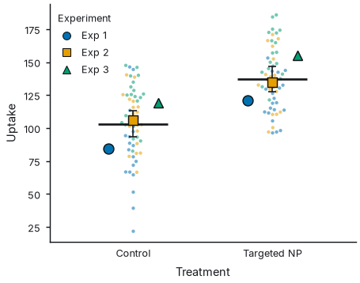

## 6. Making figures

### 6.1 Graph types

Page **3 Graph** lists only the graph types that suit the selected table.
*Default elements* are what a new figure of that type shows; you can change them in the **Elements** panel.

| Graph type | What it shows | Table types | Default elements |
|---|---|---|---|
| Bar + individual points | Bars at the mean with error bars; every data point is shown by default. | Column, Grouped, Multiple variables | bar at the mean, SEM error bar, jittered points |
| Scatter dot plot (mean ± error) | Every value as a dot with a line at the mean and an error bar. | Column, Grouped, Multiple variables | jittered points, short line at the mean, SD error bar |
| Box plot + points | Median, quartiles and whiskers, with the raw points on top. | Column, Grouped, Multiple variables | box and whiskers, jittered points |
| Violin plot + points | Smoothed distribution shape for each group with the raw points. | Column, Grouped, Multiple variables | violin outline, jittered points, short line at the median |
| Violin + box + points | Violin outline, a slim box plot inside, and the raw points. | Column, Grouped, Multiple variables | violin outline, box and whiskers, jittered points |
| Beeswarm | Points arranged so none overlap, with a line at the mean. | Column, Grouped, Multiple variables | beeswarm points, short line at the mean, SD error bar |
| SuperPlot (replicate-coloured) | Small dots = technical replicates, large dots = mean of each biological replicate, coloured by replicate; statistics use the replicate means. | Multiple variables | beeswarm points, replicate means, short line at the mean, SEM error bar |
| Estimation plot | Raw data on the left, the mean difference and its 95% CI on the right. | Column, Multiple variables | beeswarm points, short line at the mean, 95% CI error bar, axis with the mean difference and its CI |
| Before-after (paired lines) | One line per subject connecting its values across conditions. | Column, Multiple variables | one line per subject, points in a line |
| XY (points, error bars, lines) | Y versus X with error bars from replicates; optional fitted line or curve. | XY, Multiple variables | line through the means, SEM error bar, dot at the mean |
| Dose-response curve | Response versus dose on a log axis with the fitted sigmoidal curve. | XY | SEM error bar, dot at the mean, fitted curve |
| Survival curve (Kaplan-Meier) | Staircase survival curves with tick marks for censored subjects. | Multiple variables | survival steps, ticks at censored times |
| Grouped bars | Side-by-side bars for two grouping variables, with points and error bars. | Grouped, Multiple variables | bar at the mean, SEM error bar, jittered points |
| Stacked bars | Bars stacked on top of each other (means or counts). | Grouped, Multiple variables, Contingency | stacked bar |
| Histogram | Frequency distribution of values. | Column, Multiple variables, XY | histogram bars |
| Heat map | A colour-coded grid of values (means, counts or correlations). | Grouped, Multiple variables, Contingency, Column | coloured grid |
| Q-Q plot (normality) | Data quantiles against normal quantiles; points on the line = normal. | Column, Multiple variables | reference line, quantile points |
| Residual plot | Residuals of a fitted model versus X or fitted value (needs a fit result). | XY, Multiple variables, Column, Grouped | zero line, residual points |

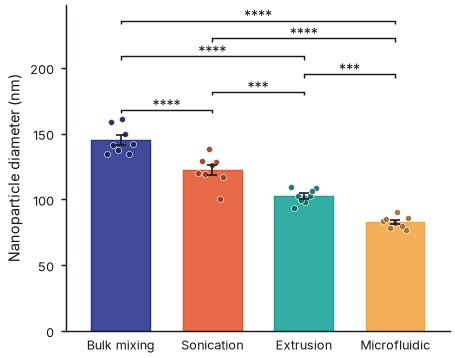

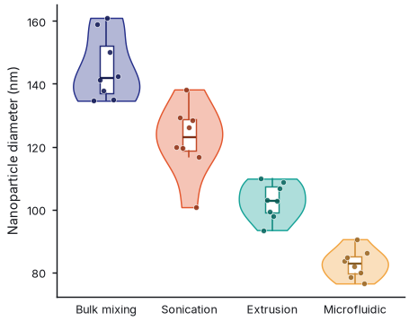

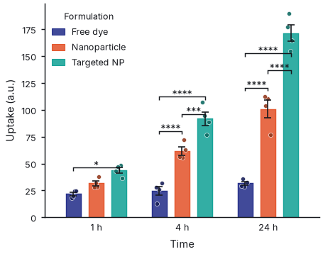

For four graph types you can choose a computed result under *Draw from result*:
*Survival curve (Kaplan-Meier)*, *Residual plot*, *Heat map* (for a correlation matrix) and
*Q-Q plot (normality)*. A residual plot always needs a regression result. The other three can
also be drawn straight from the table.

### 6.2 Error bars: SD, SEM or confidence interval

Choose them under **Elements** > *Error bars*.

| Choice | What is drawn | What it tells the reader |
|---|---|---|
| SD | mean plus and minus the standard deviation | The spread of the data. It does not shrink with more data. |
| SEM | mean plus and minus SD / square root of n | How precisely the mean is known. It shrinks as n grows. It says little about the spread. |
| 95% CI | the 95% confidence interval of the mean (t distribution) | The range that is likely to contain the true mean. About twice as wide as the SEM bar for large n, wider for small n. |
| Range | from the smallest to the largest value, around the mean | The extremes. |
| IQR | from the first to the third quartile, around the median | The middle half of the data. Suited to skewed data. |
| None | no error bar | Use it when the points speak for themselves. |

- Always say in the legend which one you used, and give n.
- SEM bars look small. Do not choose them for that reason.
- The IQR bar is centred on the median. The bar or line of a bar or dot plot still marks the mean, so
  use IQR with a box plot or a violin plot.
- Keep *Individual data points* on. Most journals ask for them. Choices: *Jittered*,
  *Beeswarm (no overlap)*, *In a line*, *Hidden*.

### 6.3 Significance brackets come only from computed results

You cannot type a P value or stars onto a figure.

- In **Statistics on the graph**, choose a result under *Significance brackets from*.
  Only results of this table that contain pairwise comparisons are listed.
- *Show*: *All comparisons* or *Only significant ones*.
- *Label*: stars, the P value, or both. The text is read from the adjusted P value of each comparison.
- *Test summary text in a corner* writes the test name and its P value, again from a computed result.

Example (one-way ANOVA with Tukey's test on the sample *Nanoparticle diameter (nm)*, comparison Bulk mixing vs Sonication):

| *Label* choice | Text on the bracket |
|---|---|
| Stars | `****` |
| P = 0.0123 | `P < 0.0001` |
| 0.0123 | `<0.0001` |
| Stars and P value | `**** (P < 0.0001)` |

The corner text for the same result is:

> One-way ANOVA: F(3, 28) = 80.14, P < 0.0001

Stars follow this code: `ns, not significant; *P < 0.05; **P < 0.01; ***P < 0.001; ****P < 0.0001`.

If you type something that looks like a statistic into a title or a text label, TorusPlot refuses it:

> Figure title looks like a statistical result ('P < 0.05 vs control'). Statistics cannot be typed into a figure: add a StatAnnotation that references a computed StatResult ID instead.

The same rule holds for the AI features: they can choose which computed comparisons to show, but they cannot write a number.

If the result behind a bracket is deleted, the bracket is not drawn and a note appears under the preview.

### 6.4 Fitted curves

1. Run the regression on page **2 Analyze** (linear or nonlinear).
2. On page **3 Graph**, create an *XY* or *Dose-response curve* figure.
3. Under **Statistics on the graph**, choose the result under *Fitted curves to draw*.
   Tick *Show 95% confidence band* to shade the uncertainty of the curve.

- The curve is drawn from the stored result. It is not refitted by the graph.
- Dose-response graphs use a logarithmic X axis automatically. Points with X of 0 or less cannot be
  shown on a log axis; a note under the preview says how many were skipped.
- A new dose-response figure attaches the latest curve fit of each data set by itself.

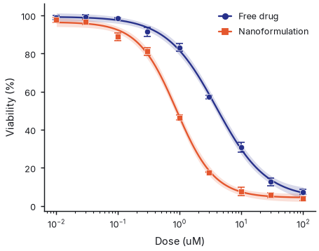

### 6.5 Estimation plots and before-after plots

An **estimation plot** shows the raw data on the left and the difference between the group means
with its 95% CI on a second axis on the right. It puts the size of the effect in front of the reader,
not only a P value.

- If a result is attached, the difference and CI come from it.
- If none is attached, TorusPlot computes the difference between the first two groups with Welch's
  t test (second group minus first group).

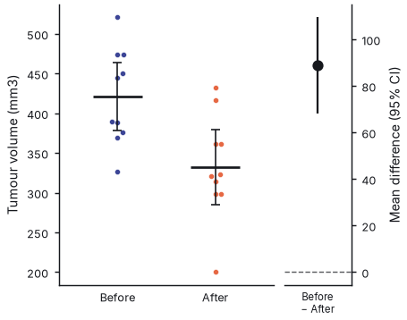

A **before-after plot** draws one line per subject. Use it for paired data, with one subject per row.

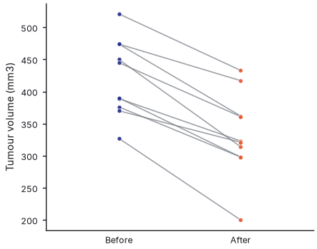

### 6.6 Survival curves

Run *Survival analysis (Kaplan-Meier, log-rank)* first, then create a figure of type
*Survival curve (Kaplan-Meier)*. The curve steps down at each event. Tick marks show censored subjects.

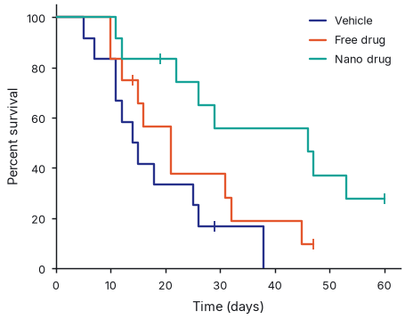

## 7. Styling and exporting

### 7.1 Style presets

A preset sets fonts, line widths, colours and the figure size in one step. Choose it on page
**4 Style** under *Style preset*. Every value can then be changed by hand; an empty box means
"use the preset".

| Preset | Default size | Font | Base text size | Palette | Description |
|---|---|---|---|---|---|
| Torus Signature | 89 x 70 mm | Inter | 8 pt | Torus | Modern, high-contrast and clean: bold palette, raw points on tinted bars, open top/right. |
| Classic Lab | 100 x 80 mm | Liberation Sans | 9 pt | Classic Lab | The traditional lab-meeting look: black axes, black/grey bars with black outlines, capped error bars. |
| Journal Single-Column (89 mm) | 89 x 65 mm | Liberation Sans | 7 pt | Okabe-Ito | Compact single-column figure: 89 mm wide, 7 pt sans-serif text, thin lines, colourblind-safe palette. |
| Journal 1.5-Column (120 mm) | 120 x 80 mm | Liberation Sans | 7 pt | Okabe-Ito | One-and-a-half-column figure: 120 mm wide, 7 pt text, colourblind-safe palette. |
| Journal Double-Column (183 mm) | 183 x 90 mm | Liberation Sans | 7 pt | Okabe-Ito | Full-width double-column figure: 183 mm wide, 7 pt text, colourblind-safe palette. |
| Minimal | 89 x 70 mm | Source Sans 3 | 8.5 pt | Torus Soft | Quiet and airy: light axes, no bar outlines, soft colours, subtle horizontal grid. |
| Presentation (large type) | 220 x 150 mm | Inter | 16 pt | Torus | For slides and posters: large type, thick lines and big markers that read from the back of the room. |

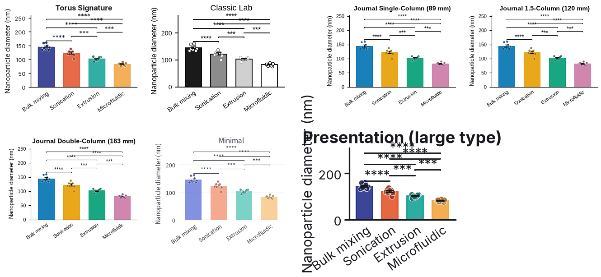

The three journal presets share the same font, text sizes, line widths and palette. They differ in
size: single column, one and a half columns, double column.
Check the author guidelines of your journal for its exact widths and minimum font size.

### 7.2 Colours and the colour-blind preview

Under **Colours** on page **4 Style**:

- *Palette*: a named palette, the preset default, or *Custom colours* (hex codes separated by commas).
- *Colour groups along a gradient*: for ordered groups such as doses or time points.
- *Set a colour for individual groups*: one colour picker per group.

Open *Colour-blind preview* under the live preview. It shows the figure as seen with:
- Deuteranopia (green-blind, most common)
- Protanopia (red-blind)
- Tritanopia (blue-blind, rare)
- Grayscale (print / total colour blindness)

The table below is computed by TorusPlot's own palette check. Two colours count as distinguishable
when their colour distance (CIE76 Delta-E) is at least 10 after the simulation.

| Palette | Colours | Colour-blind safe with 4 groups | Colour-blind safe with all its colours | Distinguishable in grayscale with 4 groups |
|---|---|---|---|---|
| Okabe-Ito | 8 | yes | yes | no |
| Torus | 8 | yes | yes | no |
| Torus Soft | 8 | yes | yes | no |
| Classic Lab | 6 | yes | yes | yes |
| Grayscale | 6 | yes | no | yes |
| Blue-Orange | 6 | yes | yes | no |
| viridis | any | yes | (gradient) | yes |
| magma | any | yes | (gradient) | yes |
| plasma | any | yes | (gradient) | yes |
| inferno | any | yes | (gradient) | yes |
| cividis | any | yes | (gradient) | yes |

- Okabe-Ito is the safest named palette for categories. The journal presets use it.
- No palette of saturated colours survives grayscale printing. If the figure may be printed in
  black and white, use a gradient palette (viridis family), *Classic Lab*, or different symbols.
- With many groups, even a good palette runs out of distinguishable colours. Check the preview.

### 7.3 Fonts

Under **Text**: *Font*, *Base font size (pt)*, *Tick label size (pt)*, *Axis title size (pt)*.

- TorusPlot ships with 3 fonts: Inter, Source Sans 3, Liberation Sans. They render the same on every computer.
- Liberation Sans has the same letter widths as Arial. A figure laid out with it keeps its proportions if a journal replaces the font with Arial.
- Fonts installed on your computer are listed after the bundled ones. Arial and Helvetica are not bundled; you can select them if they are installed.
- If a project asks for a font that is not installed, TorusPlot uses Inter and says so in a note.

### 7.4 Exact size in millimetres

Under **Size and lines**: *Width (mm)* and *Height (mm)*.

- The exported file has exactly this size. Nothing is cropped or rescaled.
- Page **6 Export** prints the size under the preview (*Exact size: ... mm*).
- Text sizes are in points and stay as set. Make the figure at its final printed size, so that 7 pt
  text is 7 pt in the journal.

### 7.5 Multi-panel figures

Page **5 Compose** arranges finished figures on a grid.

1. *Panels (in reading order)*: choose the figures. They are placed left to right, top to bottom.
2. *Columns*: the number of columns of the grid.
3. *Width (mm)* and *Height (mm)*: the size of the whole composition. The default width is 183 mm.
4. *Panel letters*: `A`, `a`, `(A)`, `(a)`, `1` or `none`.
5. *Same Y range* and *Same X range*: give panels in a row, in a column, or all panels the same axis range.
6. *One shared legend*: one legend for the whole figure.
7. *Apply one style to all panels*: one preset for every panel, or keep each figure's own style.
8. Click **Save composition**. It then appears on page **6 Export**.

### 7.6 Export formats

| Format | What you get | Use it for |
|---|---|---|
| SVG | Vector file. Text stays text and every element is in a named group. | Touching up in a vector editor (Inkscape, Illustrator). |
| PDF | Vector file with embedded fonts. Text stays selectable. | Journal submission of line art and graphs; inserting into documents. |
| TIFF | Flattened image with LZW compression at the chosen resolution. | Journal systems that ask for TIFF. |
| PNG | Image at the chosen resolution. | Slides, documents, the web. |

Resolution (*Resolution (dpi) for TIFF/PNG*: 150, 300, 600 or 1200):

- 300 dpi for figures with colour or shading.
- 600 dpi or more for line art (graphs with thin lines and small text).
- 150 dpi only for drafts and slides.
- Vector formats (SVG, PDF) have no resolution. Prefer them when the journal accepts them.

*Transparent background* removes the white background (useful for slides).
Under the SVG button, *SVG check* confirms that the file has editable text and named groups.

### 7.7 The statistics report

Page **6 Export** > *Statistics report and methods paragraph*.

- Results that are drawn on the figure are always included. Add others under
  *Also include these results for the same data*.
- **Download report (Markdown)** is a readable report: for each result the interpretation, why the
  test was chosen, the statistic, P value, effect sizes, estimates, the ANOVA table, every comparison
  with its ID, descriptive statistics, assumption checks, warnings, data notes (exclusions) and the
  method references.
- **Download report (CSV)** has the same numbers as a flat table, one row per number, for spreadsheets.
- Nothing in the report is typed by hand. Keep it with the figure; reviewers ask for these numbers.

### 7.8 The methods paragraph

The box *Methods paragraph* holds text you can paste into the statistics section of a manuscript.
It is assembled from what was actually run:

1. how the data are presented (from the elements of the figure);
2. the methods sentence of each result;
3. the significance threshold;
4. any exclusions;
5. the sample sizes;
6. a last sentence that names the TorusPlot version and the numerical libraries.

Example for a bar graph of the sample *Nanoparticle diameter (nm)* with the one-way ANOVA result
(the last sentence is left out here):

> Data are presented as mean ± SEM, with individual data points shown. Group means were compared with a one-way ANOVA (alpha = 0.05), followed by Tukey's HSD test (studentized range, pooled error variance) (all 6 pairwise comparisons among 4 groups). P < 0.05 was considered statistically significant. Sample sizes: Bulk mixing: n = 8, Sonication: n = 8, Extrusion: n = 8, Microfluidic: n = 8.

Read the paragraph before you paste it. Add what the software cannot know: how subjects were allocated, what n counts (animals, experiments, cells), and whether the analysis was planned in advance.

### 7.9 Project files (.tplot)

Page **6 Export** > tab **Project file**.

- **Save project (.tplot)** downloads one file with your tables, figures, compositions, statistics
  results and the activity log.
- *Open a project* and **Open this project (replaces the current one)** load it again.
- Opening a project re-creates every figure exactly. The saved results are used as they are;
  nothing is recalculated.
- A `.tplot` file is an ordinary zip archive: a manifest (`project.yaml`), one CSV per table
  (`data/`) and the results (`results.json`). You can open it with any zip tool.
- The *Activity log* lists what was done: tables added, analyses run, values excluded.
- Save before you close the browser tab or stop TorusPlot. The project is kept in memory only.

## 8. Optional AI features and the MCP server

### 8.1 Optional AI features

AI features are **off by default**. TorusPlot works completely without them, and offline.

**The hard rule: AI can change how a figure looks, never the statistics.** An AI feature can
produce or change a figure description (graph type, elements, colours, size, and which already
computed comparisons to show). It cannot compute, type or alter a P value, a star or any other
number. This is enforced by the program, not by trusting the AI: a figure description has no place
to put a number, and text that looks like a statistic is rejected (section 6.3).

**Turning AI on.** Page **Settings** > switch on *Enable AI features* > choose a *Provider* >
click **Test the provider**.

| Provider | What it means |
|---|---|
| Demo | Offline, canned example answers. For trying the screens. |
| Ollama | A free program that runs AI models on your own computer. Nothing leaves the computer. You download a model yourself. |
| Google Gemini, Anthropic, OpenAI | Cloud services, with your own API key. The key is read from a file named `.env` next to the app (copy `.env.example`), or pasted for the current session only. |

With a cloud provider, the text you type into AI boxes and the images you upload there are sent to
that company under your account. Its terms, pricing and data policies apply. Your data values are
not included in AI prompts; table and column names are.

**Using AI.** Page **AI Assistant** has four tabs.

| Tab | What it does | Needs a provider? |
|---|---|---|
| Describe it | Type what you want under *Describe the figure* and click **Create figure from description**. Choose an existing figure under *Start from* to change it. | Yes |
| Match this figure | Upload an image under *Reference figure (PNG or JPG)* and click **Match this figure**. The style (colours, proportions, look of the axes) is copied onto your data. The other figure's data are never copied. | No. Without a provider, colours and proportions are measured from the image; a vision model adds the graph type and finer details. |
| Digitize | Upload an image of a plot, mark the plot area, the axis values and the series, and click **Digitize**. **Add as an APPROXIMATE table** stores the values. | No |
| Outside AI instructions | Copy the prompt under *Prompt to give your chatbot* into any chatbot, paste its answer under *Paste the chatbot's answer here*, and click **Turn into a figure**. | No, when the answer is in TorusPlot's format |

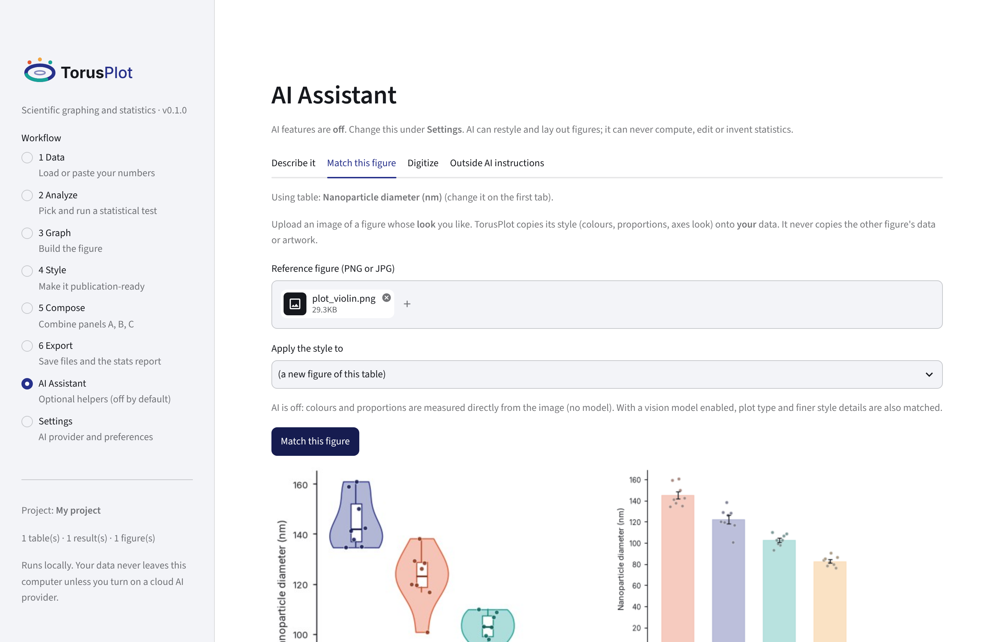

- A figure made by AI is a normal figure. Refine it on **3 Graph** and **4 Style**.
- Digitized values are estimates read off an image. The table is marked APPROXIMATE on every page
  and in every report, and statistics are blocked on it unless you override (section 9).
- The full prompt for chatbots is also in
  [PROMPT_TEMPLATE_FOR_OUTSIDE_AI.md](PROMPT_TEMPLATE_FOR_OUTSIDE_AI.md).

### 8.2 MCP server

The Model Context Protocol (MCP) lets an AI assistant call TorusPlot's tools: load a table, run an
analysis, make and export a figure. The server runs on your computer and makes no network calls
itself. The same hard rule applies: every number comes from TorusPlot's statistics engine.

Setup, the list of tools and the privacy notes are in [MCP.md](MCP.md).

## 9. Troubleshooting and FAQ

### 9.1 Messages and what to do

The messages below are the real texts TorusPlot shows. In the app they follow the words in the first column.

| The app says | Message | What to do |
|---|---|---|
| The analysis could not be run: | Table 'Digitized' holds APPROXIMATE values digitized from an image (for reference only), so statistical tests are switched off for it. If a rough reference value is all you need, tick 'I understand these are estimates read off an image. Allow statistics anyway.' on page 2 Analyze; the result is then marked APPROXIMATE. (In a script, pass allow_approximate=True.) | The table was digitized from an image. Its numbers are estimates. Use measured data. If you only want a rough reference value, tick *I understand these are estimates read off an image. Allow statistics anyway.* on page **2 Analyze**; the result is then marked APPROXIMATE. |
| The analysis could not be run: | 'Fisher's exact test' is not available for a Column table (valid table types: contingency). | The analysis does not fit the table type. In the app the menu already hides such analyses. Re-create the table with the right type (section 2). |
| The analysis could not be run: | A has 1 value(s); a t test needs at least 2. | A group has too few values. Add replicates. Check that numbers were not read as text (a stray letter or unit in a cell turns it into a missing value). |
| The analysis could not be run: | Unknown group 'Bulk'. Available groups: ['Bulk mixing', 'Sonication', 'Extrusion', 'Microfluidic']. | The group name does not exist in the table. Pick the group from the list; names are case-sensitive. |
| The analysis could not be run: | A paired t test needs at least 2 complete pairs; there are 0. | Paired tests use only rows that have a value in both columns. Put each subject on one row. |
| The analysis could not be run: | The Friedman test needs at least 3 conditions (columns). For 2 related conditions use the Wilcoxon matched-pairs signed-rank test or a paired t test. | Use the test the message names. |
| The analysis could not be run: | One-way ANOVA needs replicates: every group has a single value, so the within-group variability cannot be estimated. Add more values per group. | Each group needs replicates. |
| The analysis could not be run: | Counts must be whole numbers of subjects. Percentages, proportions, means or normalised values are not valid input for this test: enter the actual number of subjects in each cell. | Enter the number of subjects in each cell, not percentages. |
| The analysis could not be run: | The event column must contain only 1 (event occurred, e.g. death) or 0 (censored). Other code(s) found: 2. Recode the column and run again. | Recode the event column to 1 (event) and 0 (censored). |
| The analysis could not be run: | Group(s) a, b have only one biological replicate (n = 1). The sample size is the number of biological replicates (independent experiments, animals), not the number of technical replicates (cells, wells) inside them, so with n = 1 no statistical comparison is possible. Collect at least 3 biological replicates per group. | The replicate column must name at least two independent experiments or animals in each group, and three or more are needed for a useful test. |
| The analysis could not be run: | This fit estimates 4 parameter(s) but only 3 usable point(s) were given. At least 4 are needed (and more to get standard errors). | Add more X values, or fix some parameters under *Fixed parameters* (for example `Bottom=0, Top=100`). |
| The analysis could not be run: | Unknown function 'open'. Available functions: abs, arctan, atan, cos, cosh, exp, ln, log, log10, log2, max, min, pow, sin, sinh, sqrt, tan, tanh. | A user-defined equation may only contain numbers, X, parameter names, + - * / ^, brackets and the listed functions. |
| Could not create the table: | 5 data columns cannot be split into groups of 3 replicates. | The number of Y columns is not a multiple of *Replicates side by side*. Correct the number, or set it to 0 and name the columns `Name:1, Name:2`. |
| That setting is not valid: | Figure title looks like a statistical result ('P < 0.05 vs control'). Statistics cannot be typed into a figure: add a StatAnnotation that references a computed StatResult ID instead. | Remove the statistic from the title. Add brackets or the corner summary from a computed result instead (section 6.3). |

Other notes you may see under a figure preview:

- *This figure cannot be drawn yet: ...* The figure lacks something, usually a result. A residual
  plot, for example, needs a regression result chosen under *Draw from result*.
- *Note: ... statistics result ... was not found, so it was not drawn.* The result behind a bracket
  or curve was deleted. Run the analysis again and choose the new result.
- *Note: ... comparison(s) ... do not match groups on this plot and were not drawn.* The result
  compares groups that the figure does not show. Show those groups or choose another result.

### 9.2 Frequently asked questions

**The numbers differ slightly from another statistics package. Which is right?**
Small differences usually come from conventions, not errors. Common ones:
quartiles (TorusPlot uses linear interpolation, definition 7 of Hyndman and Fan);
exact or approximate P values for rank tests; Yates' correction for 2 x 2 tables;
Type II or Type III sums of squares in unbalanced designs; which sphericity correction is the headline.
[STATS_METHODS.md](STATS_METHODS.md) lists the convention for each method.

**The normality test passes. Can I trust the t test?**
A pass means no deviation was detected. With small samples that is weak evidence. Judge from what is
known about the measurement, look at the points, and consider Welch's test or a rank test.

**My result is not significant. Is there no effect?**
No. Look at the confidence interval of the difference. If it is wide, the experiment could not tell.
Use the power calculator before the next experiment.

**I have 3 values per group. What can I do?**
Report the individual values and the difference with its confidence interval. A rank test cannot
reach P below 0.05 with 3 per group. A t test can, but it rests on assumptions that 3 values cannot check.

**Can I compare more than two groups with several t tests?**
Use a one-way ANOVA (or Kruskal-Wallis test) with multiple comparisons. They control the chance of
a false positive across all comparisons.

**Where did my brackets go?**
Brackets belong to a result. If you deleted the result or changed the groups shown, they are not
drawn. Choose a result again under *Significance brackets from*.

**Can I type "P < 0.05" on the figure myself?**
No. See section 6.3.

**Nothing happens when I close the browser. Is my work saved?**
No. Save the project on page **6 Export** > **Project file** before you close TorusPlot.

**Is my data sent anywhere?**
No, unless you turn on a cloud AI provider (section 8).

**Who checks my statistics?**
TorusPlot is a tool, not a statistician. For clinical data, regulatory submissions and other
high-stakes work, have a statistician review the plan and the results.

## 10. Glossary

**Alpha.** The threshold you set in advance for calling a P value significant. Usually 0.05. It is the chance of a false positive that you accept when there is truly no effect.

**Censoring.** In survival data, a subject is censored when it was still event-free when last seen (the study ended, or the subject was lost). Its time still counts until then.

**Confidence interval (CI).** A range computed from the data that is likely to contain the true value. For a 95% CI, the method captures the true value in 95% of repeated experiments.

**EC50 / IC50.** The concentration that gives a response halfway between the bottom and the top of a dose-response curve. EC50 is used for stimulation, IC50 for inhibition.

**Effect size.** A number that says how large an effect is, separately from how sure you are. **Cohen's d**: the difference between two means divided by the SD (0.2 small, 0.5 medium, 0.8 large by Cohen's benchmarks). **Hedges' g**: Cohen's d with a correction for small samples. **Eta squared**: the share of the total variation explained by a factor, from 0 to 1 (0.01 small, 0.06 medium, 0.14 large). The benchmarks are rough conventions, not rules.

**Multiple comparisons.** When you make several comparisons, the chance that at least one is a false positive grows. Procedures such as Tukey, Dunnett, Bonferroni and Holm adjust the P values to keep that chance at alpha. Read the adjusted P value.

**P value.** The probability of data at least as extreme as yours if there were truly no effect. A small P value is evidence against "no effect". It is not the probability that the hypothesis is true, and it does not measure the size of the effect.

**Paired vs unpaired.** Paired: the same subject (or a matched pair) is measured under both conditions, and the test looks at the within-subject differences. Unpaired: different subjects in each group.

**Parametric vs nonparametric.** Parametric tests (t test, ANOVA) assume a distribution, usually the normal one, and compare means. Nonparametric tests (Mann-Whitney, Wilcoxon, Kruskal-Wallis, Friedman) use ranks and assume less, at the cost of some power when the data are normal.

**Pseudoreplication.** Treating measurements that are not independent (cells from one dish, repeated readings of one sample) as if each were an independent sample. It makes P values too small. See section 5.4.

**SD vs SEM.** The standard deviation (SD) describes how much individual values scatter. The standard error of the mean (SEM = SD divided by the square root of n) describes how precisely the mean is known. The SEM gets smaller with more data; the SD does not.

**Sphericity.** An assumption of repeated-measures ANOVA: the differences between every pair of conditions have the same variance. When it is violated, the Greenhouse-Geisser or Huynh-Feldt correction lowers the degrees of freedom.
